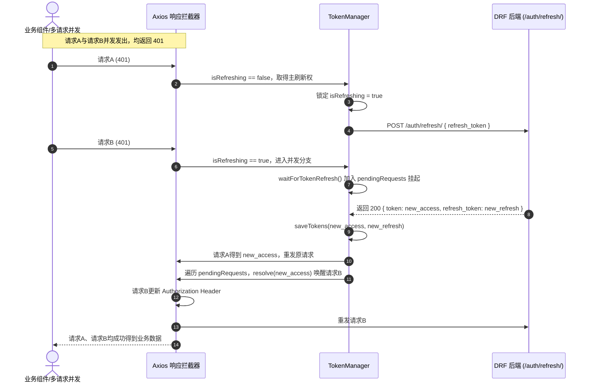

# DRF 高可用网络通信层、环境配置与运维部署契约勘查及平移兼容方案报告

**勘查报告编号**: SURVEY-EXPLORER-03  
**基准版本**: pure-admin-thin 6.0.0 (升级目标: vue-pure-admin 7.0.0)  
**作者**: Survey Explorer 3  
**状态**: 勘查完成 (Completed)  

---

## 目录
1. [执行摘要](#1-执行摘要)
2. [DRF 高可用网络通信层深度逆向剖析](#2-drf-高可用网络通信层深度逆向剖析)
   - 2.1 [TokenManager 双 Token 机制与静默预警刷新](#21-tokenmanager-双-token-机制与静默预警刷新)
   - 2.2 [401 并发互斥重发等待队列机制](#22-401-并发互斥重发等待队列机制)
   - 2.3 [DRF 异常反解与错误处理责任链](#23-drf-异常反解与错误处理责任链)
   - 2.4 [CSRF 自动提取与请求头注入机制](#24-csrf-自动提取与请求头注入机制)
   - 2.5 [响应格式自适应与重试机制](#25-响应格式自适应与重试机制)
3. [多环境网络配置与全局常量勘查](#3-多环境网络配置与全局常量勘查)
   - 3.1 [环境配置文件矩阵 (.env.*)](#31-环境配置文件矩阵-env)
   - 3.2 [平台全局配置与 Vite 代理契约](#32-平台全局配置与-vite-代理契约)
4. [运维部署与容器化不可破坏契约](#4-运维部署与容器化不可破坏契约)
   - 4.1 [Dockerfile 多阶段构建契约](#41-dockerfile-多阶段构建契约)
   - 4.2 [Nginx 反向代理与路由分发契约](#42-nginx-反向代理与路由分发契约)
   - 4.3 [Docker Compose 服务互联契约](#43-docker-compose-服务互联契约)
5. [平移融入官方最新完整版 PureHttp 底座的映射与兼容方案](#5-平移融入官方最新完整版-purehttp-底座的映射与兼容方案)
   - 5.1 [官方原生 PureHttp 的局限性与潜在风险](#51-官方原生-purehttp-的局限性与潜在风险)
   - 5.2 [整体架构映射与平移策略](#52-整体架构映射与平移策略)
   - 5.3 [TypeScript 6 / Vue 3.5 严格模式兼容细节](#53-typescript-6--vue-35-严格模式兼容细节)
   - 5.4 [平移实施任务清单与验证标准](#54-平移实施任务清单与验证标准)

---

## 1. 执行摘要

经过对 `lipeaks_admin` 现有网络通信层（`src/utils/http/`）、状态管理层（`src/store/modules/user.ts`）、生命周期入口（`src/main.ts`）、环境配置（`.env.*`）以及容器化部署配置文件（`Dockerfile`、`nginx/default.conf`、`docker-compose.yml`）的纯代码事实全面逆向勘查，得出以下核心结论：

1. **核心网络层资产完备**：当前项目建立了一套成熟、健壮的企业级 Django REST Framework (DRF) 适配网络通信层，涵盖 **TokenManager 单例管理**、**JWT 过期前 5 分钟主动预警静默刷新**、**401 并发互斥重发等待队列**、**Django/DRF 复杂错误序列化反解机制**、**CSRF 头自动提取注入** 及 **6 级错误处理责任链**。
2. **严禁直接替换原生底座**：官方最新版 `vue-pure-admin` 附带的原生 `PureHttp` 仅包含基础 Token 传递与简易刷新，若直接覆盖将导致 DRF 业务校验错误丢失、Token 并发刷新雪崩、表单提交 CSRF 403 拦截等致命缺陷。
3. **部署契约固定严格**：系统固定监听端口为 **8848**，Nginx 配置强制承担 `/api/`、`/backend-static/`、`/media/` 到内部后端服务 `http://web:8000` 的路由分发与代理契约，此运维结构具有强耦合性，不可擅自破坏。
4. **平移可行性极高**：网络层已实现高内聚、低耦合，通过将当前 `src/utils/http/` 的 6 个核心模块整体平移并适配官方最新版 `PureHttpRequestConfig` 泛型签名，上层 17 个业务视图模块与 15 个 API 模块可保持 **零破坏、零改造、完全透明调用**。

---

## 2. DRF 高可用网络通信层深度逆向剖析

当前网络通信层源码集中位于 `src/utils/http/` 目录，共有 6 个 TypeScript 源码文件：
- `src/utils/http/tokenManager.ts` (274 行)：Token 状态机与并发队列调度器
- `src/utils/http/index.ts` (681 行)：Axios 实例封装、请求/响应拦截器、DRF 错误解析主入口
- `src/utils/http/errorHandlers.ts` (403 行)：错误分类器与责任链设计模式实现
- `src/utils/http/errorCodes.ts` (275 行)：DRF 业务错误码字典与交互指引映射
- `src/utils/http/retryManager.ts` (215 行)：网络及服务器异常重试管理器
- `src/utils/http/types.d.ts` (48 行)：网络层类型扩展定义

### 2.1 TokenManager 双 Token 机制与静默预警刷新

#### 2.1.1 存储机制与双 Token 策略
- **实现位置**：`src/utils/http/tokenManager.ts:41-83`
- **存储键名**：
  - Access Token: `localStorage.getItem('access_token')`
  - Refresh Token: `localStorage.getItem('refresh_token')`
- **生命周期协同**：
  在登录成功（`src/store/modules/user.ts:153-154`）时，后端返回 `{ token, refresh_token, user }`，前端双写至 `localStorage`。同时在 `src/utils/auth.ts` 中维护 Cookie 级别的 `authorized-token` 用于多标签页同步检测。在登出（`clearTokens()`）时，除了清空 `localStorage` 中的双 Token，还会调用 `useUserStoreHook().logOut()` 清理 Pinia 状态与路由缓存。

#### 2.1.2 过期前 5 分钟主动预警静默刷新
- **实现位置**：`src/utils/http/tokenManager.ts:211-264`
- **判定原理**：
  ```typescript
  // 提取 JWT payload 并解析 exp
  isTokenNearExpiry(threshold = 300): boolean {
    const token = this.getAccessToken();
    if (!token) return false;
    try {
      const payload = JSON.parse(atob(token.split('.')[1]));
      const exp = payload.exp * 1000; // 转为毫秒
      const now = Date.now();
      return (exp - now) < (threshold * 1000); // 提前 300 秒 (5分钟)
    } catch (error) {
      logger.warn('解析Token过期时间失败:', error);
      return false;
    }
  }
  ```
- **守护心跳与预警执行**：
  - `startTokenWatcher()`：通过 `setInterval` 每隔 60 秒（60000ms）执行心跳检查。
  - `preemptiveRefresh()`：若检测到 `isTokenNearExpiry()` 为真且当前无刷新任务（`!this.isRefreshing`），主动触发 `this.refreshToken()` 发起静默换票，用户操作完全无感知，彻底规避业务操作中途 Token 过期导致的请求失败。
- **应用生命周期挂载**：
  在 `src/main.ts:93` 应用初始化阶段，在 `getPlatformConfig` 成功后立即调用 `initTokenManager()` 启动全局监听器。

### 2.2 401 并发互斥重发等待队列机制

当短时间内页面触发多个并发 API 请求，若 Access Token 已失效，所有请求均会返回 401 Unauthorized。若不加控制，将引发并发刷新风暴（多次请求刷新接口造成 Refresh Token 竞争失效或服务器限流）。

当前项目通过 **双锁互斥机制 + Promise 挂起队列** 完美解决了该并发场景：

#### 2.2.1 队列与状态设计
- **源码位置**：`src/utils/http/tokenManager.ts:21-38`, `index.ts:360-423`
- `isRefreshing`: 互斥锁布尔标志位。
- `pendingRequests: PendingRequest[]`: 缓存 `{ resolve: (token) => void, reject: (error) => void }` 的 Promise 控制器数组。
- `refreshPromise: Promise<string | null> | null`: 正在执行的刷新 Promise 单例。

#### 2.2.2 401 并发重发时序流程



#### 2.2.3 核心实现代码
```typescript
// src/utils/http/index.ts:360-423
if (status === 401) {
  if (!PureHttp.isRefreshing) {
    PureHttp.isRefreshing = true;
    try {
      const newToken = await tokenManager.refreshToken();
      if (newToken) {
        const newConfig = {
          ...errorConfig,
          headers: { ...errorConfig.headers, 'Authorization': `Bearer ${newToken}` }
        };
        return await PureHttp.axiosInstance(newConfig); // 重发原始请求
      }
    } finally {
      PureHttp.isRefreshing = false;
    }
  } else {
    // 已经在刷新，挂起当前请求等待通知
    try {
      const newToken = await tokenManager.waitForTokenRefresh();
      const newConfig = {
        ...errorConfig,
        headers: { ...errorConfig.headers, 'Authorization': `Bearer ${newToken}` }
      };
      return await PureHttp.axiosInstance(newConfig);
    } catch (waitError) { ... }
  }
}
```

### 2.3 DRF 异常反解与错误处理责任链

#### 2.3.1 Django/DRF 典型错误响应特征
DRF（Django REST Framework）的异常响应结构多样且具有特异性，若不经过定制反解，前端直接通过通用错误拦截器展示会导致界面出现 `[object Object]` 或毫无意义的报错：
1. **字段验证错误（Serializer Validation Errors）**：
   - 字典包列表：`{ "username": ["该用户名已存在。"], "email": ["请输入有效的邮箱地址。"] }`
   - DRF 内部 `ErrorDetail` 对象序列化：`{ "phone": [ { "string": "手机号格式不正确", "code": "invalid" } ] }`
2. **非字段全局校验错误**：
   - 键名为 `non_field_errors`：`{ "non_field_errors": ["两次输入的密码不一致。"] }`
3. **系统与视图级异常**：
   - 默认 detail 格式：`{ "detail": "身份认证凭证未提供或已过期。" }`
4. **Python 字典字符串陷阱**：
   - 某些历史接口将 Python 字典未通过 JSON 序列化，而是直接以字符串输出到 `message` 字段：`message: "{'username': ['该字段是必填项。'], 'is_active': False}"`。其特点是单引号 `'` 包裹，且包含 Python 原生字面量 `True`、`False`、`None`。

#### 2.3.2 `formatErrorMessage` 反解引擎
- **实现位置**：`src/utils/http/index.ts:50-129`
- **反解算法**：
  1. **字符串与空值快速返回**；
  2. **数组处理**：识别项是否包含 `string` 属性（DRF `ErrorDetail`），优先取 `err.string`，次之取 `err.message`，最终逗号拼接；
  3. **对象处理**：
     - 递归优先提取 `non_field_errors`；
     - 遍历所有字段键值对，格式化拼接为 `${field}: ${formatErrorMessage(fieldError)}`，各字段间以 `; ` 分隔；
     - 若无字段错误，回退检测 `message`、`detail` 字段。
  4. **Python 字典字符串正则转义解析**（`src/utils/http/index.ts:466-479`）：
     ```typescript
     if (data.message.includes("'") && !data.message.includes('"')) {
       const preparedMessage = data.message
         .replace(/'/g, '"')
         .replace(/\bTrue\b/g, "true")
         .replace(/\bFalse\b/g, "false")
         .replace(/\bNone\b/g, "null");
       parsedMessage = JSON.parse(preparedMessage);
       errorMsg = formatErrorMessage(parsedMessage);
     }
     ```

#### 2.3.3 错误分类与责任链设计模式 (`ErrorHandlerChain`)
- **实现位置**：`src/utils/http/errorHandlers.ts`
- **错误分类器 (`ErrorClassifier`)**：根据业务 `error_code` 或 HTTP 状态码统一映射归类：
  - `authentication`: 4001~4004 (认证错误)
  - `permission`: 4003, 4303 (权限拒绝)
  - `validation`: 4000 (表单校验)
  - `tenant` / `license` / `user` / `points` / `cms`: 4100~4599 (垂直业务域错误)
  - `server`: 5000~5099 (服务端内部异常)
- **责任链处理器群**：
  ```
  ErrorHandlerChain
  ├── 1. AuthenticationErrorHandler -> 清除Token，ElMessage.warning，保存 returnUrl，1.5s 后路由跳转 /login
  ├── 2. PermissionErrorHandler     -> ElMessageBox.alert 弹窗，显示引导文案并支持跳转
  ├── 3. ValidationErrorHandler     -> ElMessage.error('请检查表单输入')，保留 data 对象供组件高亮字段
  ├── 4. NetworkErrorHandler        -> ElNotification 不自动关闭的浮窗提示，支持 2s 后自动重试
  ├── 5. ServerErrorHandler         -> 可重试错误弹出 ElMessageBox.confirm 确认框引导重试
  └── 6. BusinessErrorHandler       -> 兜底业务处理器，按 low/medium/high 区分 ElMessageBox / ElMessage
  ```

### 2.4 CSRF 自动提取与请求头注入机制

- **实现位置**：`src/utils/http/index.ts:180-184`
- **Django CSRF 机制契约**：
  Django 启用 `django.middleware.csrf.CsrfViewMiddleware` 时，会在响应中通过 Set-Cookie 下发名为 `csrftoken` 的 Cookie。对于非安全 HTTP 方法（POST, PUT, PATCH, DELETE），Django 要求客户端在 HTTP 请求头中携带 `X-CSRFTOKEN`。
- **自动提取与注入实现**：
  ```typescript
  // 请求拦截器中
  const csrfToken = document.cookie.match(/csrftoken=([^;]*)/)?.[1];
  if (csrfToken) {
    config.headers["X-CSRFTOKEN"] = csrfToken;
  }
  ```
  该机制确保无论在前后端同域、Nginx 反代还是生产跨域携带凭证（`withCredentials`）环境下，均能准确提取 Django 客户端凭证并无缝注入。

### 2.5 响应格式自适应与重试机制

1. **Blob 二进制文件流保全**：
   在 `src/utils/http/index.ts:275-280` 中，专门对 `response.config.responseType === "blob"` 进行拦截保护，将 `response.headers` 挂载到 Blob 对象上，防止报文头（如 `content-disposition` 中的文件名信息）被标准 JSON 包装截断丢失。
2. **标准响应格式自适应包裹**：
   若接口未按照标准 `{ success, code, message, data }` 返回，拦截器自动封装成 `{ success: true, code: 2000, message: "操作成功", data: res }`。
3. **指数退避重试管理器 (`RetryManager`)**：
   位于 `src/utils/http/retryManager.ts`，默认最大重试 3 次，间隔 `[1000ms, 2000ms, 4000ms]` 指数退避，对 `NETWORK_ERROR`、`REQUEST_TIMEOUT`、`5000+` 服务端错误提供自动与手动重试能力。

---

## 3. 多环境网络配置与全局常量勘查

### 3.1 环境配置文件矩阵 (`.env.*`)

项目根目录共存在 4 个核心环境变量文件，配置细节如下表所示：

| 配置项 / 变量名 | `.env` (通用基础) | `.env.development` (开发环境) | `.env.staging` (预发布环境) | `.env.production` (生产环境) |
|---|---|---|---|---|
| **VITE_PORT** | `8848` | `8848` | - | - |
| **VITE_PUBLIC_PATH** | - | `/` | `/` | `/` |
| **VITE_ROUTER_HISTORY** | - | `"hash"` | `"hash"` | `"hash"` |
| **VITE_HIDE_HOME** | `false` | - | - | - |
| **VITE_CDN** | - | - | `true` | `false` |
| **VITE_COMPRESSION** | - | - | `"none"` | `"none"` |
| **VITE_BASE_API** | - | `http://localhost:8000/api/v1/` | `http://43.142.76.105:8000/api/v1/` | `https://backend.compressx.online/api/v1/` |

**关键发现**：
- **路由模式全局统一**：全环境均采用 `"hash"` 哈希路由模式，以规避静态资源服务器对前端路由路径的 404 回退依赖；
- **生产 API 域名**：生产环境真实指向 `https://backend.compressx.online/api/v1/`；
- **代码内置兜底地址**：在 `src/utils/http/index.ts:30` 与 `src/utils/http/tokenManager.ts:151` 中，如果未读取到 `VITE_BASE_API`，默认硬编码兜底为 `http://43.142.76.105:8000/api/v1`。

### 3.2 平台全局配置与 Vite 代理契约

- **平台静态配置 (`public/platform-config.json`)**：
  ```json
  {
    "Version": "6.0.0",
    "Title": "LipeaksAdmin",
    "FixedHeader": true,
    "Layout": "vertical",
    "Theme": "light",
    "EpThemeColor": "#409EFF",
    "ShowLogo": true,
    "ResponsiveStorageNameSpace": "responsive-"
  }
  ```
- **Vite 代理与服务配置 (`vite.config.ts`)**：
  - 本地监听：`server.host = "0.0.0.0"`, `server.port = VITE_PORT (8848)`；
  - 参数序列化：在 `src/utils/http/index.ts:39-41` 配置了 `paramsSerializer: { serialize: stringify as unknown as CustomParamsSerializer }`，使用 `qs` 库对 GET 请求的数组参数进行序列化（避免 Django 接收为 `tag[]` 导致的解析异常）。

---

## 4. 运维部署与容器化不可破坏契约

### 4.1 Dockerfile 多阶段构建契约

- **文件位置**：`d:\Github\lipeaks_admin\Dockerfile`
- **构建阶段与命令契约**：
  1. **构建镜像**：`node:20-alpine` 作为构建基座（`build-stage`）；
  2. **包管理工具**：启用 corepack，采用最新 `pnpm`；
  3. **依赖锁定**：必须先复制 `.npmrc package.json pnpm-lock.yaml`，并执行 `pnpm install --frozen-lockfile`；
  4. **额外关键包**：Dockerfile 第 12 行显式指定 `RUN pnpm add diff`（代码中存在差异对比功能依赖）；
  5. **产物输出目录**：`/app/dist`；
  6. **生产运行阶段**：基于 `nginx:stable-alpine`，挂载 `/app/dist` 至 `/usr/share/nginx/html`，挂载 `./nginx/default.conf` 至 `/etc/nginx/conf.d/default.conf`；
  7. **暴露端口**：`EXPOSE 8848`（**注意：严禁修改为 80 端口，生产宿主机端口映射严重依赖 8848 契约**）。

### 4.2 Nginx 反向代理与路由分发契约

- **文件位置**：`d:\Github\lipeaks_admin\nginx\default.conf`
- **核心路由分发契约**：

```nginx
server {
    listen 8848;
    server_name localhost;
    
    # 1. 前端 SPA 路由回退兜底
    location / {
        root /usr/share/nginx/html;
        index index.html;
        try_files $uri $uri/ /index.html;
    }
    
    # 2. 前端静态打包资源直接访问
    location /static/ {
        root /usr/share/nginx/html;
        try_files $uri $uri/ =404;
    }
    
    # 3. 核心 API 反向代理 (不可破坏)
    location /api/ {
        proxy_pass http://web:8000/api/;
        proxy_set_header Host $host;
        proxy_set_header X-Real-IP $remote_addr;
        proxy_set_header X-Forwarded-For $proxy_add_x_forwarded_for;
        proxy_set_header X-Forwarded-Proto $scheme;
    }
    
    # 4. 后端 Django Admin / 静态资源代理
    location /backend-static/ {
        proxy_pass http://web:8000/static/;
        proxy_set_header Host $host;
        proxy_set_header X-Real-IP $remote_addr;
        proxy_set_header X-Forwarded-For $proxy_add_x_forwarded_for;
        proxy_set_header X-Forwarded-Proto $scheme;
    }
    
    # 5. 用户上传媒体文件代理 (不可破坏)
    location /media/ {
        proxy_pass http://web:8000/media/;
        proxy_set_header Host $host;
        proxy_set_header X-Real-IP $remote_addr;
        proxy_set_header X-Forwarded-For $proxy_add_x_forwarded_for;
        proxy_set_header X-Forwarded-Proto $scheme;
    }
    
    error_page 500 502 503 504 /50x.html;
    location = /50x.html {
        root /usr/share/nginx/html;
    }
}
```

### 4.3 Docker Compose 服务互联契约

- **文件位置**：`d:\Github\lipeaks_admin\docker-compose.yml`
- **契约分析**：
  在 Compose 编排中，Django 后端容器服务被命名为 `web`（暴露端口 8000）。前端 Nginx 配置中的 `proxy_pass http://web:8000/api/;` 正是基于 Docker 内部 DNS 解析 `web`。因此，前端与后端的容器编排网络必须保持在同一个 Docker 网络内，且服务名称 `web:8000` 不得变更。

---

## 5. 平移融入官方最新完整版 PureHttp 底座的映射与兼容方案

### 5.1 官方原生 PureHttp 的局限性与潜在风险

官方最新完整版 `vue-pure-admin`（v7.0.0）中的 `PureHttp` 是一个通用的、轻量级的 Axios 封装：
- **缺少对 DRF 特有错误的解析**：遇到 `ErrorDetail`、`non_field_errors`、Python 字典字符串时，只能提示模糊的 HTTP 400 失败，丢失具体的表单字段校验反馈；
- **缺少 JWT 主动预警静默刷新**：官方依赖被动捕获 401，用户在编辑长文本或长表单时容易因过期丢弃数据；
- **缺少 CSRF 注入**：原生没有从 Cookie 提取 `csrftoken` 注入 `X-CSRFTOKEN`，接入开启 CSRF 保护的 Django 后端时，所有非 GET 请求直接被 403 阻断；
- **错误提示过于单一**：原生仅做基础 Toast 提示，缺乏业务等级划分（无法在租户配额超限、许可证过期时弹出指引对话框并跳转续费）。

### 5.2 整体架构映射与平移策略

我们提出 **“全量保留高可用 DRF 网络层 + 适配官方最新 PureHttp 接口类型规范”** 的平移策略：

```
src/utils/http/
├── types.d.ts         <-- 保留并继承官方 AxiosRequestConfig / PureHttpRequestConfig 类型
├── errorCodes.ts      <-- 100% 完整平移，保持所有 DRF 错误码字典与指引配置
├── errorHandlers.ts   <-- 100% 完整平移，依赖 Element Plus 对话框/通知/Toast 提示
├── tokenManager.ts    <-- 100% 完整平移，单例模式、JWT预警解析、401并发等待队列
├── retryManager.ts    <-- 100% 完整平移，指数退避重试管理器
└── index.ts           <-- 核心入口，保持 class PureHttp，导出 http 单例，无缝注入 DRF 拦截器
```

#### 兼容适配具体要点：
1. **单例导出契约**：
   继续对外导出 `export const http = new PureHttp();`，同时保留 `default defaultConfig`。
2. **方法签名兼容**：
   确保 `http.request<T>()`、`http.get<T, P>()`、`http.post<T, P>()`、`http.put<T, P>()`、`http.delete<T, P>()` 签名与官方最新版 100% 吻合，同时内部完整包裹 `NProgress`、`logger` 及 `formatErrorMessage`。
3. **白名单与请求头**：
   保留白名单校验 `const whiteList = ["/auth/login/"]`；在请求拦截器中同时自动注入 `Authorization: Bearer <token>` 与 `X-CSRFTOKEN: <cookie_csrf>`。
4. **401 处理闭环**：
   在响应拦截器错误回调中，完整移植当前的互斥刷新与等待重发逻辑（调用 `tokenManager.refreshToken()` 与 `tokenManager.waitForTokenRefresh()`）。

### 5.3 TypeScript 6 / Vue 3.5 严格模式兼容细节

官方最新 v7.0.0 采用 TS 6 与严苛类型校验模式，需在 `types.d.ts` 与 `index.ts` 中做出以下细节优化：
1. **Axios 内部类型兼容**：
   新版 Axios 中 `CustomParamsSerializer` 与 `InternalAxiosRequestConfig` 做了更严格的类型要求，在请求拦截器中返回 `InternalAxiosRequestConfig` 或类型断言 `(config as any)` 避免编译阻塞。
2. **Pinia 登出解耦**：
   在 `tokenManager.ts` 中调用 `useUserStoreHook().logOut()` 时，保持防御性 `try...catch`，防止在 Pinia 实例尚未挂载完全时调用报错。
3. **Blob 类型头推导**：
   Blob 响应挂载 headers 时显式声明交叉类型 `Blob & { headers?: any }`，消除类型警告。

### 5.4 平移实施任务清单与验证标准

| 序号 | 迁移/验证任务 | 责任范围 | 验证方法与验收条件 |
|---|---|---|---|
| **M1** | 拷贝并校验 `src/utils/http/` 全部 6 个文件至新底座 | 网络层 | 检查文件无缺失，依赖包（`qs`, `element-plus`, `nprogress`, `axios`）正常安装 |
| **M2** | 在新版 `src/main.ts` 中挂载 `initTokenManager()` | 应用入口 | 应用启动后控制台打印 `Token监控器已启动`，`setInterval` 正常定时轮询 |
| **M3** | 迁移所有的 `.env.*` 配置文件及环境变量 | 配置层 | 检查 `VITE_BASE_API`、`VITE_ROUTER_HISTORY="hash"`、`VITE_PORT=8848` 完整保留 |
| **M4** | 保持 `Dockerfile` 与 `nginx/default.conf` 部署契约 | 运维层 | 确认 EXPOSE 8848、反代 `/api/`、`/backend-static/`、`/media/` 规则 100% 一致 |
| **M5** | 验证 400 DRF 错误反解 | 运行时 | 模拟提交错误表单，界面能准确弹出 `username: 该字段是必填项` 等格式化文案 |
| **M6** | 验证 401 并发刷新与重发 | 运行时 | 模拟 Token 失效，多个并发请求均能自动暂停等待刷新后成功重发 |
| **M7** | 静态类型检查与生产构建 | 编译层 | 执行 `pnpm typecheck` 0 报错，`pnpm build` 顺利产出 `dist/` 目录 |

---
*报告生成完毕。*
