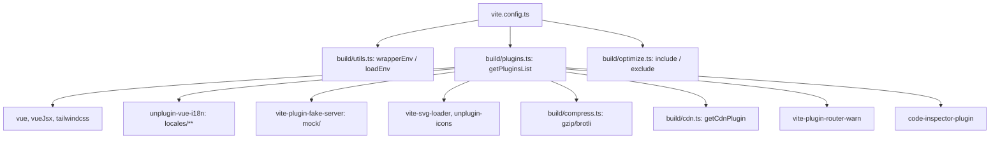
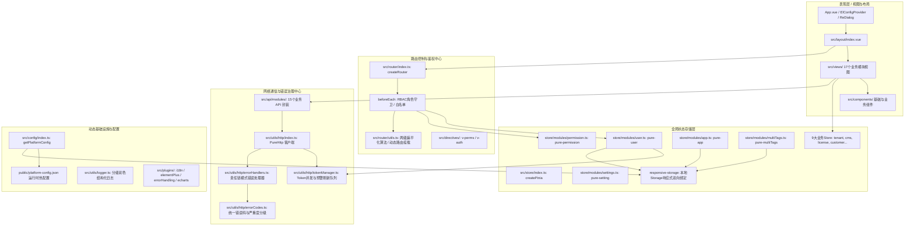
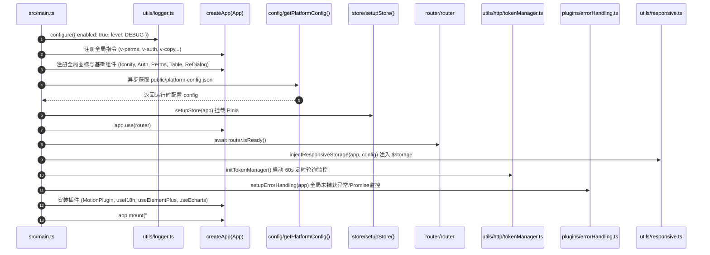
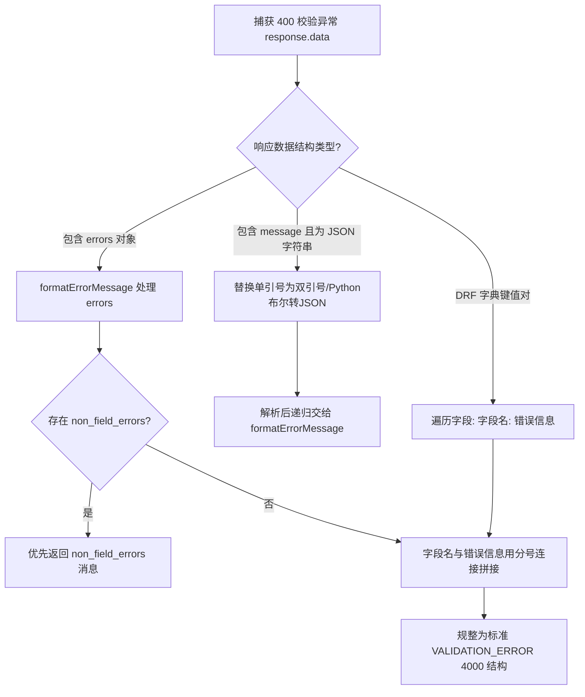
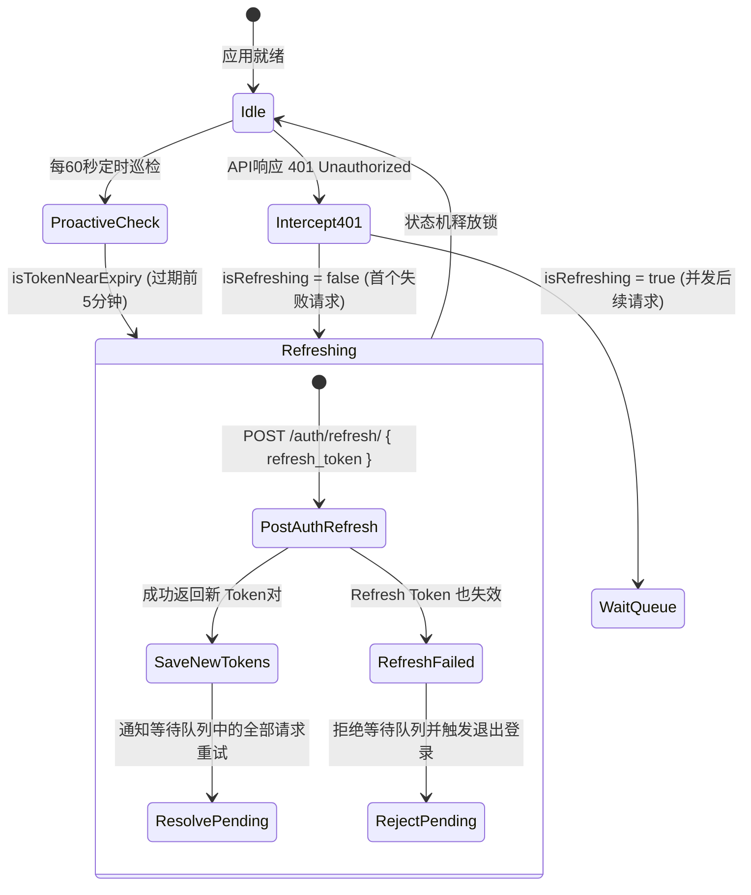

# Lipeaks Admin 整体工程底座与系统架构逆向分析报告

> **调研执行主体**：代码库逆向探索与架构分析专家 (`explorer_survey_arch_1`)  
> **调研基准**：严格以项目代码库真实源码（TypeScript、Vue 3、Pinia、Vite、Axios、配置文件等）为唯一事实来源（Single Source of Truth），排除所有陈旧文档干扰。  
> **完成日期**：2026-10-16

---

## 一、 系统概览与核心技术栈矩阵

`lipeaks_admin` 是一个基于企业级规范构建的多租户后台前端管理系统（底层技术栈派生自 `Pure Admin Thin 6.0.0`），深度适配了现代化微服务/单体混合架构的 Django REST Framework (DRF) 后端。

### 1.1 技术栈核心矩阵（源自 `package.json`）

| 核心维度 | 关键组件 / 依赖库 | 准确版本 | 架构作用与职责 |
| :--- | :--- | :--- | :--- |
| **运行时框架** | `vue` | `^3.5.13` | 前端响应式核心引擎 (SFC, Composition API) |
| **构建工具** | `vite` | `^6.3.3` | 基于 ESM 的下一代构建工具与本地开发服务器 |
| **语言规范** | `typescript` | `^5.8.3` | 静态类型系统与编译时类型安全保障 |
| **状态管理** | `pinia` | `^3.0.2` | 全局状态集中管理，模块化与类型推导支持 |
| **路由系统** | `vue-router` | `^4.5.0` | 页面路由、动态路由挂载、路由守卫与鉴权 |
| **UI 组件库** | `element-plus` | `^2.9.8` | 核心桌面端 UI 组件体系 |
| **高级扩展组件** | `@pureadmin/table` | `^3.2.1` | 高度二次封装的企业级表格组件 |
|  | `@pureadmin/descriptions` | `^1.2.1` | 详情描述列表组件 |
|  | `@pureadmin/utils` | `^2.6.0` | 常用工具函数库（存储、设备检测、类型判定等） |
| **原子化 CSS** | `tailwindcss` / `@tailwindcss/vite` | `^4.1.4` | Vite 原生集成的 Tailwind CSS v4 样式引擎 |
| **网络请求** | `axios` | `^1.9.0` | 基于 Promise 的网络通信客户端 |
| **持久化存储** | `responsive-storage` | `^2.2.0` | 响应式存储插件（同步 Pinia / Vue 属性与 LocalStorage） |
|  | `js-cookie` | `^3.0.5` | 浏览器端 Cookie 管理（用于 Token 过期与多标签状态） |
|  | `localforage` | `^1.10.0` | 客户端离线异步存储库 |
| **国际化** | `vue-i18n` | `^11.1.3` | 国际化核心库（结合 `@intlify/unplugin-vue-i18n`） |
| **图表可视化** | `echarts` | `^5.6.0` | 商业级图表绘制库 |
| **动效库** | `@vueuse/motion` / `animate.css` | `^3.0.3` / `^4.1.1` | 页面切换与组件过渡动效引擎 |
| **开发环境调试** | `code-inspector-plugin` | `^0.20.10` | 页面按键（Alt+Shift）直达源码行定位插件 |
| **Mock 引擎** | `vite-plugin-fake-server` | `^2.2.0` | 本地与生产 Mock 数据支持 |

### 1.2 运行环境与引擎约束

- **Node.js**：`^18.18.0 || ^20.9.0 || >=22.0.0`
- **包管理器**：`pnpm >= 9`（由 `preinstall: "npx only-allow pnpm"` 强制约束，杜绝 npm/yarn 混用引发 lock 错乱）。

---

## 二、 工程化与构建配置逆向分析

### 2.1 Vite 构建架构 (`vite.config.ts` & `build/`)

系统的 Vite 构建配置高度模块化，抽离在 `build/` 目录下（`cdn.ts`, `compress.ts`, `info.ts`, `optimize.ts`, `plugins.ts`, `utils.ts`）：



1. **路径解析与别名映射 (`build/utils.ts` & `tsconfig.json`)**：
   - `@/*` $\rightarrow$ `src/*`
   - `@build/*` $\rightarrow$ `build/*`
   - 依赖 Node.js 的 `process.cwd()` 与 `fileURLToPath(import.meta.url)` 精确解析路径。
2. **应用注入元信息 (`__APP_INFO__`)**：
   - 在编译期通过 `define` 注入 `__APP_INFO__`，携带 `package.json` 中的名称、版本、依赖列表及构建时间戳 (`lastBuildTime`)。
3. **依赖预构建优化 (`build/optimize.ts`)**：
   - `include` 列表：`qs`, `mitt`, `dayjs`, `axios`, `pinia`, `vue-i18n`, `vue-types`, `js-cookie`, `vue-tippy`, `pinyin-pro`, `sortablejs`, `@vueuse/core`, `@pureadmin/utils`, `responsive-storage`。将核心 ESM 模块提前编译缓存至 `node_modules/.vite`，杜绝动态热重载时的二次编译卡顿。
   - `exclude` 列表：`@iconify/json`（按需按图标加载，不整体全量预打包）。
4. **打包分类分块与构建产物规划 (`vite.config.ts` build 配置)**：
   - `target: "es2015"`, `sourcemap: false`, `chunkSizeWarningLimit: 4000`。
   - 静态资源分类打包命名策略：
     - JS Chunk：`static/js/[name]-[hash].js`
     - Entry：`static/js/[name]-[hash].js`
     - Assets：`static/[ext]/[name]-[hash].[ext]`
5. **预热文件机制 (`server.warmup`)**：
   - 显式声明客户端预热文件：`clientFiles: ["./index.html", "./src/{views,components}/*"]`，大幅提升本地冷启动后的首次页面首屏加载性能。

### 2.2 多环境配置策略 (`.env.*`)

系统支持 4 套运行环境配置，核心变量矩阵如下：

| 配置变量 | `.env` (全局基准) | `.env.development` (本地开发) | `.env.staging` (预发布环境) | `.env.production` (生产环境) |
| :--- | :--- | :--- | :--- | :--- |
| `VITE_PORT` | `8848` | `8848` | - | - |
| `VITE_PUBLIC_PATH` | - | `/` | `/` | `/` |
| `VITE_ROUTER_HISTORY` | - | `"hash"` | `"hash"` | `"hash"` |
| `VITE_HIDE_HOME` | `false` | - | - | - |
| `VITE_CDN` | - | - | `true` | `false` |
| `VITE_COMPRESSION` | - | - | `"none"` | `"none"` |
| `VITE_BASE_API` | - | `http://localhost:8000/api/v1/` | `http://43.142.76.105:8000/api/v1/` | `https://backend.compressx.online/api/v1/` |

> **关键代码事实**：所有环境均统一指定 `VITE_ROUTER_HISTORY = "hash"`，意味着路由全部工作在 Hash 模式，避免传统 SPA 在 Nginx 重定向刷新时的 `404` 路由丢失问题。

### 2.3 代码规范与质量保障工具链

- **ESLint v9 Flat Config (`eslint.config.js`)**：采用最新的 ESLint 扁平化配置系统，集成 `@eslint/js`, `typescript-eslint`, `eslint-plugin-vue`, `eslint-plugin-prettier`，并内置全局类型只读声明（`RefType`, `Nullable`, `Recordable`, `ImportMetaEnv` 等）。
- **Prettier (`.prettierrc.js`)**：`singleQuote: false`, `bracketSpacing: true`, `arrowParens: "avoid"`, `trailingComma: "none"`。
- **Stylelint (`stylelint.config.js`)**：集成 `stylelint-config-standard`, `stylelint-config-html/vue`, `stylelint-config-recess-order` (属性重排规范)，并配置 SCSS/Tailwind 专用指令白名单。
- **Git Hooks & Commit 规范**：
  - `husky` (`.husky/`) + `lint-staged` (`.lintstagedrc`)：在提交前自动触发 prettier、eslint --fix 与 stylelint --fix。
  - `commitlint` (`commitlint.config.js`)：遵循 `@commitlint/config-conventional`，限定 `feat|fix|perf|style|docs|test|refactor|build|ci|chore|revert|wip|workflow|types|release`。

### 2.4 容器化构建与 Nginx 反向代理配置

- **Dockerfile 多阶段构建 (`Dockerfile`)**：
  1. `build-stage`：基于 `node:20-alpine`，启用 `corepack` 并激活最新版 `pnpm`，使用 npmmirror 镜像源执行 `pnpm install --frozen-lockfile` 并安装 `diff` 依赖，最终执行 `pnpm build`。
  2. `production-stage`：基于 `nginx:stable-alpine`，从构建阶段复制 `/app/dist` 至 `/usr/share/nginx/html`，加载 `./nginx/default.conf`，暴露端口 `8848`。
- **Nginx 反向代理与资源映射 (`nginx/default.conf`)**：
  - 监听端口：`8848`。
  - 前端静态页：`location / { try_files $uri $uri/ /index.html; }`。
  - 独立静态资源目录：`location /static/ { root /usr/share/nginx/html; try_files $uri $uri/ =404; }`。
  - 后端 API 反向代理：`location /api/ { proxy_pass http://web:8000/api/; }`。
  - 后端静态文件与多媒体：`location /backend-static/ { proxy_pass http://web:8000/static/; }`，`location /media/ { proxy_pass http://web:8000/media/; }`。
- **Docker Compose 编排 (`docker-compose.yml`)**：
  - 编排了 `db` (`mysql:8.0`) 与 `web` (`lipeaks_backend:latest`, Django 应用)，挂载静态与上传目录。

---

## 三、 系统总架构与分层设计

### 3.1 系统分层拓扑图



### 3.2 系统启动装配链路 (`src/main.ts`)

应用启动采用严格的异步串行装配管道，确保依赖项按正确的生命周期拓扑初始化：



---

## 四、 网络通信层与错误治理深度分析

### 4.1 Axios 实例封装 (`src/utils/http/index.ts`)

系统在 `PureHttp` 类中完成了单例 Axios 实例的深度定制：

```typescript
// 基础配置关键参数
const defaultConfig: AxiosRequestConfig = {
  baseURL: import.meta.env.VITE_BASE_API || "http://43.142.76.105:8000/api/v1",
  timeout: 10000,
  headers: {
    Accept: "application/json, text/plain, */*",
    "Content-Type": "application/json",
    "X-Requested-With": "XMLHttpRequest"
  },
  paramsSerializer: {
    serialize: stringify as unknown as CustomParamsSerializer
  }
};
```

#### 1. 请求拦截器 (Request Interceptor) 机制
- **进度条动画**：`NProgress.start()`。
- **自定义生命周期回调**：支持请求级 `beforeRequestCallback`。
- **CSRF Token 自动补丁**：自动从浏览器 Cookie 提取 `csrftoken` 并写入请求头 `X-CSRFTOKEN`，满足 Django CSRF 校验规范。
- **请求白名单**：`const whiteList = ["/auth/login/"]`，白名单接口直接放行，不携带 Authorization。
- **Bearer Token 注入**：通过 `tokenManager.getAccessToken()` 获取 Token，并写入 `Authorization: Bearer ${token}`。
- **全局日志审计**：通过 `logger.logRequest(config)` 记录请求的 URL、方法、入参与 Headers。

#### 2. 响应拦截器 (Response Interceptor) 机制
- **进度条闭合**：`NProgress.done()`。
- **Blob 场景透传**：若 `responseType === "blob"`，为 Blob 对象保留挂载 `headers` 后直接返回二进制实体（用于 Excel/模板导出）。
- **标准响应结构契约检查与自动规整**：
  - 后端标准结构：`{ success: boolean, code: number, message: string, data: any }`。
  - 若符合标准直接放行；
  - 若属于非标准原生数据，自动包裹为标准结构：`{ success: true, code: 2000, message: "操作成功", data: res }`。

### 4.2 DRF 异常与验证错误逆向解析引擎

针对 Django REST Framework 在表单校验失败时返回的非标、嵌套及 Python 字典字符串格式，封装了专有解析函数 `formatErrorMessage(errors)`：



- **Python 特有语法反序列化兼容**：使用正则将 Python 字典单引号 `'` 替换为 `"`, `True/False/None` 转换为 `true/false/null`，随后通过 `JSON.parse` 还原对象。
- **DRF `ErrorDetail` 对象解包**：递归解包对象中的 `string` 与 `message` 字段。

### 4.3 Token 完整生命周期治理与并发刷新队列 (`src/utils/http/tokenManager.ts`)

为了彻底解决 Access Token 过期导致的高并发接口雪崩与失效重试，系统实现了带状态机锁的 `TokenManager`：



1. **多级持久化存储**：
   - `localStorage.getItem('access_token')`：用于高速读取。
   - `localStorage.getItem('refresh_token')`：用于调用刷新。
   - `Cookies` (`authorized-token`)：存有时效标记。
2. **主动预警刷新 (`preemptiveRefresh`)**：
   - 解析 JWT Payload：`JSON.parse(atob(token.split('.')[1]))`。
   - 若 `(exp * 1000 - Date.now()) < 300000`（不足 5 分钟），在请求发送前或通过 60s 定时器 (`startTokenWatcher`) 主动刷新，避免接口出现 401。
3. **被动 401 并发等待队列 (`waitForTokenRefresh`)**：
   - 互斥锁 `isRefreshing`：保证同一时刻只有一个 HTTP 刷新请求发出。
   - 并发拦截的请求被包装为 Promise 放入 `pendingRequests` 队列，刷新成功后统一执行原请求的重试重发。

### 4.4 错误处理责任链模式 (`src/utils/http/errorHandlers.ts`)

采用面向对象的责任链设计模式（Chain of Responsibility），分级分流拦截异常：

```mermaid
graph LR
    Error[捕获 StandardErrorResponse] --> Classifier[ErrorClassifier: 错误码/类型分类]
    Classifier --> Chain[ErrorHandlerChain 责任链]
    
    Chain --> AuthHandler[1. AuthenticationErrorHandler 401/4001]
    AuthHandler -->|不匹配| PermHandler[2. PermissionErrorHandler 403/4003]
    PermHandler -->|不匹配| ValHandler[3. ValidationErrorHandler 400/4000]
    ValHandler -->|不匹配| NetHandler[4. NetworkErrorHandler 超时/网络断开]
    NetHandler -->|不匹配| ServerHandler[5. ServerErrorHandler 500/服务器挂载]
    ServerHandler -->|不匹配| BizHandler[6. BusinessErrorHandler 租户/许可证/积分等业务错误]
```



- **`AuthenticationErrorHandler`**：清除 Token 与 LocalStorage，写入 `sessionStorage.setItem('returnUrl', currentPath)`，提示警告后延迟 1500ms 重定向至 `/login`。
- **`PermissionErrorHandler`**：弹窗提示 `ElMessageBox.alert`，若配置有行动指引（`guidance.route`）则重定向至无权限说明页。
- **`NetworkErrorHandler`**：弹出不自动关闭的持久化通知 `ElNotification`，并返回 `{ shouldRetry: true, retryAfter: 2000 }` 触发自动重试。
- **`ServerErrorHandler`**：针对 500/5003 数据库异常，弹出确认重试弹窗，若用户确认则在 1000ms 后自动重放原请求。
- **`BusinessErrorHandler`**：解析业务错误码（如 `TENANT_QUOTA_EXCEEDED`, `LICENSE_EXPIRED`），读取 `ACTION_GUIDANCE` 呈现升级套餐或续费的行动入口。

---

## 五、 路由系统与权限控制机制

### 5.1 静态与动态路由生成机制 (`src/router/`)

系统采用“静态基座路由 + 运行时动态后端路由合并”的双轨制：

1. **静态路由自动装配**：
   - 通过 Vite 的 Fast-Glob：`import.meta.glob(["./modules/**/*.ts", "!./modules/**/remaining.ts"], { eager: true })` 自动扫描引入所有的静态路由文件（`home.ts`, `error.ts`, `errorExample.ts`）。
   - `remaining.ts` 保持独立，存放非菜单路由（`/login`, `/redirect`, `/preview/article/:id` 等）。
2. **动态路由请求与两级拍平算法 (`formatTwoStageRoutes`)**：
   - 动态路由数据源：`getAsyncRoutes()` 发送请求至 `GET /menus/admin/routes/`。
   - **两级拍平规范 (Two-Stage Flattening)**：Vue 3 原生 `<keep-alive>` 对超过两级以上的嵌套路由无法做多级缓存。系统通过 `buildHierarchyTree` $\rightarrow$ `formatFlatteningRoutes` $\rightarrow$ `formatTwoStageRoutes` 将三级及以上路由的所有子路由全部拍平并挂载到根路由 `/` 的 `children` 下，而渲染菜单的原始树形结构则由 `constantMenus` 与 `usePermissionStore().wholeMenus` 独立维系。

### 5.2 动态路由组件映射算法 (`addAsyncRoutes`)

后端返回的路由结构中，`component` 字段通常为字符串（如 `/src/views/tenant/list.vue` 或 `"tenant/list"`）。前端采用 Glob 字典映射机制实现动态还原：

```typescript
const modulesRoutes = import.meta.glob("/src/views/**/*.{vue,tsx}");

// 组件解析优先级
if (v.meta?.frameSrc) {
  v.component = IFrame; // 内嵌 iframe 页面
} else if (String(v.component) === "/src/layout/index.vue" || String(v.component) === "Layout1") {
  v.component = Layout; // 页面布局骨架
} else {
  // 精确匹配与带后缀 (.vue/.tsx) 兼容匹配
  const exactMatch = modulesRoutesKeys.find(ev => ev === String(v.component))
    || modulesRoutesKeys.find(ev => ev === String(v.component) + ".vue");
  v.component = exactMatch ? modulesRoutes[exactMatch] : null;
}
```

### 5.3 路由全局导航守卫拦截链路 (`router.beforeEach`)

```mermaid
flowchart TD
    Start[路由触发: to, from] --> KeepAliveCheck[处理 KeepAlive 缓存页面标记]
    KeepAliveCheck --> TitleUpdate[动态更新 document.title: transformI18n]
    TitleUpdate --> AuthCheck{Cookies 中存在 multiple-tabs 且包含 userInfo?}

    AuthCheck -->|已登录| RoleGuard{to.meta.roles 是否存在且在 userInfo.roles 中?}
    RoleGuard -->|无权限| To403[跳转 /error/403]
    RoleGuard -->|有权限| HomeGuard{VITE_HIDE_HOME 为真且访问 /welcome?}
    HomeGuard -->|是| To404[跳转 /error/404]
    HomeGuard -->|否| RefreshCheck{页面刷新且 wholeMenus 为空?}
    
    RefreshCheck -->|是| InitDynamicRouter[执行 initRouter() 重新请求并挂载动态路由]
    InitDynamicRouter --> WhiteListCheck{to 为 /login 等白名单?}
    RefreshCheck -->|否| WhiteListCheck
    
    WhiteListCheck -->|是| StayCurrent[保持当前页面 next from.fullPath]
    WhiteListCheck -->|否| Proceed[放行 next]

    AuthCheck -->|未登录| TargetIsLogin{to.path 是否为 /login?}
    TargetIsLogin -->|是| Proceed
    TargetIsLogin -->|否| InWhiteList{是否在路由白名单中?}
    InWhiteList -->|是| Proceed
    InWhiteList -->|否| ClearToLogin[removeToken 并重定向到 /login]
```

### 5.4 双轨制按钮级权限鉴权系统

代码库中严格实现了两套互补的按钮级权限机制：

| 鉴权指令 / 组件 | 权限判断方法 | 权限数据来源 | 通配符支持 | 典型适用场景 |
| :--- | :--- | :--- | :--- | :--- |
| **`v-perms`** / `<Perms>` | `hasPerms(value)` | `useUserStore().permissions` | 支持 `*:*:*`（超级管理员一票全通） | 全局通用功能权限（如 `admin:user:add`, `order:delete`） |
| **`v-auth`** / `<Auth>` | `hasAuth(value)` | `currentRoute.meta.auths` | 不支持，严格数组匹配 | 单个路由页面内绑定的局部按钮代码控制 |

- **DOM 级精准卸载**：当指令判定无权限时，执行 `el.parentNode?.removeChild(el)` 从 DOM 树直接剔除该元素，从根本上防止通过 CSS display 篡改绕过权限。

---

## 六、 全局状态管理机制 (Pinia Store)

系统在 `src/store/modules/` 中构建了模块分明、持久化联动的状态体系：

### 6.1 核心底座 Store 清单与职责

| Store 名称 | 模块 ID | 核心 State 字段 | 核心职责与响应式流向 |
| :--- | :--- | :--- | :--- |
| **`useUserStore`** | `pure-user` | `id`, `username`, `nickname`, `email`, `is_admin`, `is_super_admin`, `roles`, `permissions`, `isRemembered`, `loginDay`, `loading` | 用户身份管理、角色与权限码同步、登录 (`loginByUsername`)、注销清理 (`logOut`)、个人信息与头像上传。 |
| **`usePermissionStore`** | `pure-permission` | `constantMenus`, `wholeMenus`, `flatteningRoutes`, `cachePageList` | 菜单树生成、根据用户角色过滤无权限菜单 (`filterNoPermissionTree`)、KeepAlive 缓存页面动态增删。 |
| **`useAppStore`** | `pure-app` | `sidebar` (`opened`, `withoutAnimation`), `layout`, `device`, `viewportSize` | 侧边栏折叠/展开、布局模式切换、桌面/移动端设备自适应检测、视口尺寸监听。 |
| **`useMultiTagsStore`** | `pure-multiTags` | `multiTags`, `multiTagsCache` | 标签页（Tabs View）增删改查、路由切换自动添加 Tag、标签页持久化、动态路由最大打开数限制。 |
| **`useSettingStore`** | `pure-setting` | `title`, `fixedHeader`, `hiddenSideBar` | 全局标题、是否固定顶栏、是否隐藏侧边栏等偏好设置。 |
| **`useEpThemeStore`** | `pure-epTheme` | `epThemeColor`, `epTheme` | Element Plus 主题色与明暗主题切换，动态生成主题样式。 |

### 6.2 业务 Store 清单 (Business Pinia Modules)

系统为全部核心业务建立了独立的 Store，统一封装了各自的 CRUD Actions、分页与防重复加载状态：
- `adminUser`: 管理员列表、超级管理员授权/撤销、冻结/解冻；
- `application`: 应用系统管理、Logo 上传、应用关联文章；
- `cms`: 文章/分类/标签/评论全流程管理、多媒体上传；
- `customer`: 客户管理、租户关联、成员联系人关联、统计分析；
- `license`: 许可证方案、激活记录、机器码绑定、配额审计与收益统计；
- `member`: 注册会员/用户中心、客户绑定、批量操作；
- `menu`: 动态菜单配置、菜单树解析、用户菜单分配；
- `order`: 订单全生命周期流转、版本比对 (`diff`)、回滚与履约历史；
- `tenant`: 多租户创建、生命周期冻结/恢复、租户配额分配与审计。

### 6.3 响应式持久化存储机制 (`responsive-storage`)

为了避免传统 `Pinia` 插件对整个 Store 粗暴序列化带来的性能与脏数据问题，系统采用基于命名空间（默认 `responsive-`）的细粒度双向持久化：

```typescript
// src/utils/responsive.ts
injectResponsiveStorage(app, config);
```

- **`responsive-layout`**：存储 `layout` 布局模式、`sidebarStatus` 折叠状态、`epThemeColor` 主题色、`darkMode` 暗黑模式。
- **`responsive-configure`**：存储 `grey` (灰色模式), `weak` (色弱模式), `hideTabs` (隐藏标签), `multiTagsCache` (多标签缓存)。
- **`responsive-locale`**：存储系统当前的语言偏好（`zh` / `en`）。
- **`responsive-tags`**：当且仅当 `multiTagsCache = true` 时，将当前打开的标签列表同步存储至 LocalStorage。

### 6.4 注销登录与清理机制 (`useUserStore.logOut`)

退出登录时触发严格的多层清理链：
1. **Store 内存重置**：`this.username = ""`, `this.roles = []`, `this.permissions = []`。
2. **LocalStorage 清理**：移除 `access_token`, `refresh_token`, `user_info`, `user-info`。
3. **Cookie 清理**：调用 `removeToken()` 销毁 `authorized-token` 与 `multiple-tabs`。
4. **标签页与缓存重置**：调用 `useMultiTagsStoreHook().handleTags("equal", [...routerArrays])` 重置标签至初始态。
5. **Vue Router 重置**：调用 `resetRouter()` 清理所有动态添加的路由，仅保留基础静态路由。
6. **重定向**：`router.push("/login")`。

---

## 七、 布局与全局组件/指令/插件体系

### 7.1 页面骨架结构 (`src/layout/index.vue`)

布局系统基于 `useLayout` 与 `useResizeObserver` 提供了 3 种页面布局形态与断点响应：

1. **纵向布局 (`vertical`)**：左侧经典垂直侧边栏（Logo + 菜单）+ 顶部导航栏（Navbar + Tags）+ 主内容区。
2. **横向布局 (`horizontal`)**：顶部通栏菜单 + 主内容区。
3. **混合布局 (`mix`)**：顶部展示一级菜单，左侧展示对应子菜单。
4. **响应式断点与设备检测**：
   - 宽度 $\le 760\text{px}$：强制切换为移动端模式（`mobile`），自动收起/隐藏侧边栏。
   - $760\text{px} < \text{宽度} \le 990\text{px}$：自动折叠侧边栏为小图标模式。
   - 宽度 $> 990\text{px}$：根据用户手动操作记忆展开侧边栏。

### 7.2 全局扩展指令体系 (`src/directives/`)

| 指令名称 | 引入路径 | 核心实现与行为 |
| :--- | :--- | :--- |
| `v-perms` | `@/directives/perms` | 检查全局权限码，无权限则直接移除 DOM 节点。 |
| `v-auth` | `@/directives/auth` | 检查当前路由的 `meta.auths`，无权限则移除 DOM 节点。 |
| `v-copy` | `@/directives/copy` | 点击复制指定内容至系统剪切板，附带成功提示。 |
| `v-longpress` | `@/directives/longpress` | 监听长按手势（长按达特定时限触发回调）。 |
| `v-optimize` | `@/directives/optimize` | 针对防抖（debounce）与节流（throttle）的事件绑定优化。 |
| `v-ripple` | `@/directives/ripple` | 按钮波纹扩散动画效果。 |

### 7.3 全局插件体系 (`src/plugins/`)

- **`useElementPlus` (`src/plugins/elementPlus.ts`)**：按需导出并注册全套 Element Plus 核心组件，并配置全局弹窗与通知默认参数。
- **`useI18n` (`src/plugins/i18n.ts`)**：加载根目录 `locales/` 下的 `zh-CN.yaml` 与 `en.yaml`，结合 `transformI18n` 函数对动态路由 title 做运行时多语言转换。
- **`useEcharts` (`src/plugins/echarts.ts`)**：按需注册 ECharts 图表类型，并提供自适应窗口重绘支持。
- **`setupErrorHandling` (`src/plugins/errorHandling.ts`)**：
  - `app.config.errorHandler`：捕获 Vue 组件渲染与生命周期异常。
  - `window.addEventListener('unhandledrejection')`：捕获未处理的 Promise 异常。
  - 生产环境下支持向 `/api/v1/monitoring/frontend-errors/` 远端上报前端错误。

---

## 八、 逆向调研中发现的关键工程事实与注意事项

在静态逆向全量源码的过程中，确认了以下关键工程事实：

1. **`build/` 构建目录在工作区被意外删除的问题**：
   - Git 仓库中原本包含：`build/cdn.ts`, `build/compress.ts`, `build/info.ts`, `build/optimize.ts`, `build/plugins.ts`, `build/utils.ts`。
   - 工作区中这 6 个文件处于 `deleted` 未提交状态，导致 `vite.config.ts` 在当前未恢复的工作区中直接引用时会报模块不存在。**后续开发与文档中必须明确指出此目录属于工程构建基础设施，应通过 `git restore build/` 恢复**。
2. **Token 双重存储事实**：
   - 认证成功后，Token 在 `Cookie`（Key: `authorized-token`）和 `localStorage`（Key: `access_token` & `refresh_token`）中被同时写入。Axios 拦截器优先使用 `TokenManager` 从 `localStorage` 读取，而路由守卫判断用户是否免登录则优先通过 `Cookies.get("multiple-tabs")` 结合 LocalStorage 进行多标签协同。
3. **全量业务视图与 API 对应完整度**：
   - `src/views/` 下包含全部 17 个模块，无任何缺失。
   - `src/api/modules/` 中包含配套的 15 个后端通信模块，后端 API 规范高度统一于 `/api/v1/*` 路由规范下。
