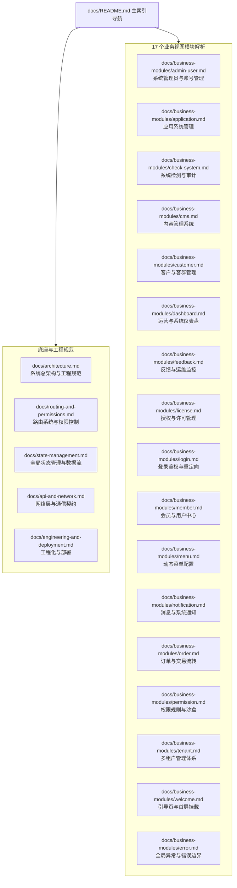
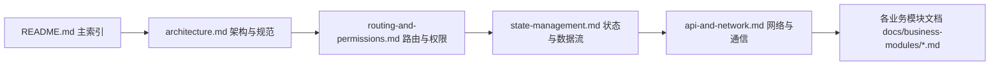
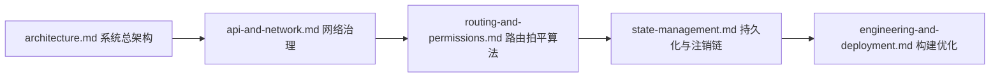
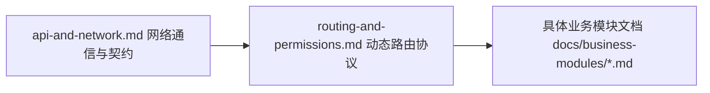
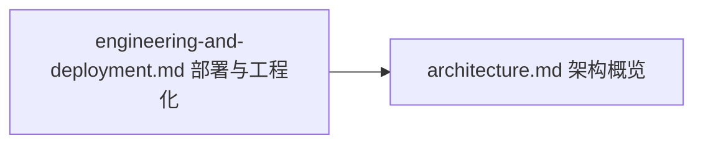

# Lipeaks Admin 工程技术文档全景索引

> **文档状态**：基于当前代码库真实源码静态逆向提炼  
> **版本基准**：Pure Admin Thin 6.0.0 / Vue 3.5.13 / TypeScript 5.8.3 / Vite 6.3.3  
> **构建系统**：pnpm >= 9 / Node.js >= 18.18.0

---

## 一、 系统工程定位

`lipeaks_admin` 是一个面向企业级多租户场景的高性能后台管理系统前端工程。系统底层架构深度派生自 `Pure Admin Thin 6.0.0`，在保留轻量级核心底座的同时，全面适配了基于 **Django REST Framework (DRF)** 构建的微服务/单体混合架构后端通信体系。

本工程具备以下核心工程特性：
1. **严格的单向依赖分层**：表现层（Vue 3 SFC / Element Plus）、路由与鉴权层（Vue Router 4 / RBAC）、状态管理层（Pinia 3 / 响应式持久化存储）、网络通信与容错层（Axios / PureHttp / TokenManager）清晰解耦。
2. **多租户业务隔离体系**：支持租户级配额、独立成员管理、应用系统接入、内容管理及订单财务核算全流程流转。
3. **企业级高可靠网络通道**：内置 JWT 双 Token 预警刷新机制（过期前 5 分钟主动轮询无感刷新）、401 并发互斥重发队列与针对 DRF 异常的序列化反解责任链。
4. **灵活的双轨制权限控制**：融合了页面级角色路由控制（RBAC）与细粒度按钮级指令（`v-perms` 全局通配符与 `v-auth` 局部页面权限），支持 DOM 级物理剔除。

---

## 二、 核心技术栈矩阵

系统核心依赖及其在工程架构中的关键职责如下表所示（数据源自 `package.json`）：

| 核心维度 | 关键组件 / 依赖库 | 准确版本 | 架构作用与职责 |
| :--- | :--- | :--- | :--- |
| **运行时引擎** | `vue` | `^3.5.13` | 前端响应式核心引擎 (SFC, Composition API, `<script setup>`) |
| **构建工具** | `vite` | `^6.3.3` | 基于 ESM 的现代构建工具与快速冷启动开发服务器 |
| **语言规范** | `typescript` | `^5.8.3` | 静态类型系统与编译期类型安全 |
| **状态管理** | `pinia` | `^3.0.2` | 模块化全局状态管理，提供响应式 Store 与自动类型推导 |
| **路由系统** | `vue-router` | `^4.5.0` | 路由守卫、两级路由拍平缓存、动态路由组件映射与懒加载 |
| **UI 组件库** | `element-plus` | `^2.9.8` | 核心桌面端企业级 UI 组件体系 |
| **高级组件扩展** | `@pureadmin/table` | `^3.2.1` | 高度二次封装的高性能表格组件 |
|  | `@pureadmin/descriptions` | `^1.2.1` | 详情描述列表组件 |
|  | `@pureadmin/utils` | `^2.6.0` | 常用工具函数库（类型判定、DOM 操作、设备检测、本地存储） |
| **原子化样式** | `tailwindcss` / `@tailwindcss/vite` | `^4.1.4` | Vite 原生集成的 Tailwind CSS v4 样式引擎 |
| **网络通信** | `axios` | `^1.9.0` | 基于 Promise 的网络通信客户端（封装于 `PureHttp` 单例） |
| **响应式持久化** | `responsive-storage` | `^2.2.0` | 响应式本地存储插件（打通 Pinia/Vue 属性与 LocalStorage） |
|  | `js-cookie` | `^3.0.5` | 浏览器 Cookie 管理器（管理 Token 生命周期与多标签页标识） |
|  | `localforage` | `^1.10.0` | 客户端离线异步存储库（IndexedDB/WebSQL/LocalStorage 自动降级） |
| **国际化系统** | `vue-i18n` | `^11.1.3` | 国际化支持（结合 `@intlify/unplugin-vue-i18n` 编译多语言包） |
| **图表可视化** | `echarts` | `^5.6.0` | 商业级图表绘制库，支持响应式视口重绘 |
| **页面动效** | `@vueuse/motion` / `animate.css` | `^3.0.3` / `^4.1.1` | 页面切换平滑过渡与微动效引擎 |
| **源码溯源** | `code-inspector-plugin` | `^0.20.10` | 开发环境下按键直达源码行定位调试插件 |
| **Mock 服务** | `vite-plugin-fake-server` | `^2.2.0` | 开发/构建阶段的 Mock 数据支持 |

---

## 三、 文档架构拓扑全景

---

## 四、 全景文档索引目录

### 4.1 系统底座与软件工程核心规范

| 文档路径 | 核心内容提要 |
| :--- | :--- |
| [系统总架构与工程规范](./architecture.md) | 系统五层架构拓扑、目录组织规范、异步串行启动时序、响应式 Storage 与 Layout 断点骨架。 |
| [路由系统与权限控制](./routing-and-permissions.md) | 静态/动态路由生成、两级路由拍平算法、全局导航守卫、白名单与 `v-perms`/`v-auth` 双轨鉴权。 |
| [全局状态管理与数据流](./state-management.md) | Pinia 6 大底座 Store 与 9 大业务 Store 架构、响应式持久化联动与登出注销清理机制。 |
| [网络层与通信契约](./api-and-network.md) | `PureHttp` 单例、TokenManager 5分钟主动预警与401并发互斥队列、DRF 异常解析与责任链。 |
| [工程化与部署](./engineering-and-deployment.md) | Vite 6/TS/TailwindCSS v4 构建打包、多环境配置、Docker 多阶段与 Nginx 反代方案、代码质量规范工具链。 |

### 4.2 全量业务模块深度技术解析

| 文档路径 | 模块名称 | 业务职责与技术要点 |
| :--- | :--- | :--- |
| [admin-user.md](./business-modules/admin-user.md) | 系统管理员与账号管理 | 超管授权/撤销、多角色与租户分配、状态切换及对话框交互。 |
| [application.md](./business-modules/application.md) | 应用系统管理 | 应用接入注册、多维度配置、状态管理与密钥凭证管理。 |
| [check-system.md](./business-modules/check-system.md) | 系统检测与审计 | 涵盖模版、类别、任务、周期与检测记录 5 大子目录的审计体系。 |
| [cms.md](./business-modules/cms.md) | 内容管理系统 | 文章、分类、标签与评论，支持离线多图导入与 Markdown 导出。 |
| [customer.md](./business-modules/customer.md) | 客户与客群管理 | 跨租户客户管理、CustomerMembersSubTable 展开子表及订单关联合同。 |
| [dashboard.md](./business-modules/dashboard.md) | 运营仪表盘 | 租户/用户双 Tab 统计面板、7 个响应式 ECharts 图表、时间防抖查询。 |
| [feedback.md](./business-modules/feedback.md) | 反馈与运维监控 | 用户工单、邮件模版/日志、系统及 Redis 探活、软件版本发布管理。 |
| [license.md](./business-modules/license.md) | 授权与许可管理 | 产品许可套餐、机器指纹绑定、在线/离线激活认证与配额审计。 |
| [login.md](./business-modules/login.md) | 登录鉴权与重定向 | JWT 登录表单、图形校验动效、initRouter 动态菜单拉取与重定向。 |
| [member.md](./business-modules/member.md) | 会员与用户中心 | 注册会员全生命周期、批量启用/禁用、头像切片上传与订单历史。 |
| [menu.md](./business-modules/menu.md) | 动态菜单配置 | 树形/表格切换、拖拽重排节点、JSON 导入导出与级联删除权限保护。 |
| [notification.md](./business-modules/notification.md) | 消息与系统通知 | Composables 架构、租户/应用/成员触达范围及草稿/发布状态机。 |
| [order.md](./business-modules/order.md) | 订单与交易流转 | 翻译订单流转、财务毛利实时核算、快照历史比对回滚与数据大屏。 |
| [permission.md](./business-modules/permission.md) | 权限规则与沙盒 | 页面级路由重载沙盒、v-auth 局部权限与 v-perms 全局通配符体系。 |
| [tenant.md](./business-modules/tenant.md) | 多租户管理体系 | 超管硬拦截策略、租户生命周期状态机与存储/账号配额实时监管。 |
| [welcome.md](./business-modules/welcome.md) | 引导页与首屏挂载 | 首屏重定向策略、多标签初始化挂载与 VITE_HIDE_HOME 守卫控制。 |
| [error.md](./business-modules/error.md) | 全局异常与错误边界 | 403/404/500 页面、邮件联系管理员、重载防重试与统一 ErrorPage 封装。 |

---

## 五、 推荐阅读路径

根据开发者在团队中的不同分工与角色，建议按以下链路查阅技术文档：

### 路径 A：新入职全栈 / 前端开发工程师（业务功能实现）

- **核心目标**：理解代码分层规范、掌握如何新建一个页面并接入动态路由、理解如何使用 `PureHttp` 发起带 Token 刷新的请求并消费 Pinia 状态。

### 路径 B：核心架构师 / 技术主管（底层演进与重构）

- **核心目标**：审视两级路由拍平算法（解决 KeepAlive 缓存）、掌握 TokenManager 5分钟主动预警与 401 互斥锁、审查 responsive-storage 双向同步机制及构建分块策略。

### 路径 C：后端（DRF）研发工程师（契约与联调）

- **核心目标**：对齐标准响应结构 `{ success, code, message, data }`、对齐 DRF 异常抛出格式（`non_field_errors`、字段校验错误）与 Token 刷新接口规范（`POST /auth/refresh/`）。

### 路径 D：DevOps 与运维工程师（交付与部署）

- **核心目标**：掌握多环境 `.env.*` 配置注入、Dockerfile 多阶段优化镜像打包、Nginx 端口（`8848`）与后端 API/静态资源反向代理规则。
