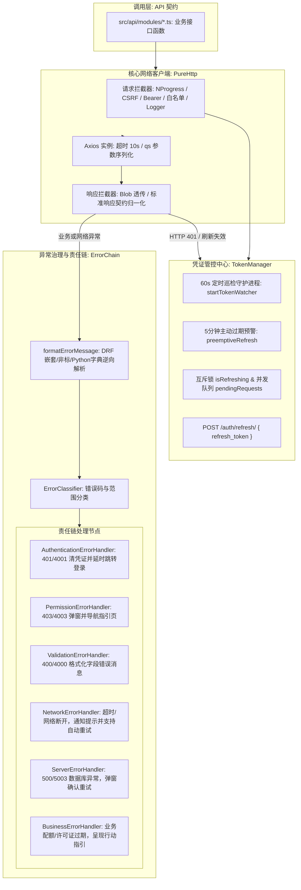
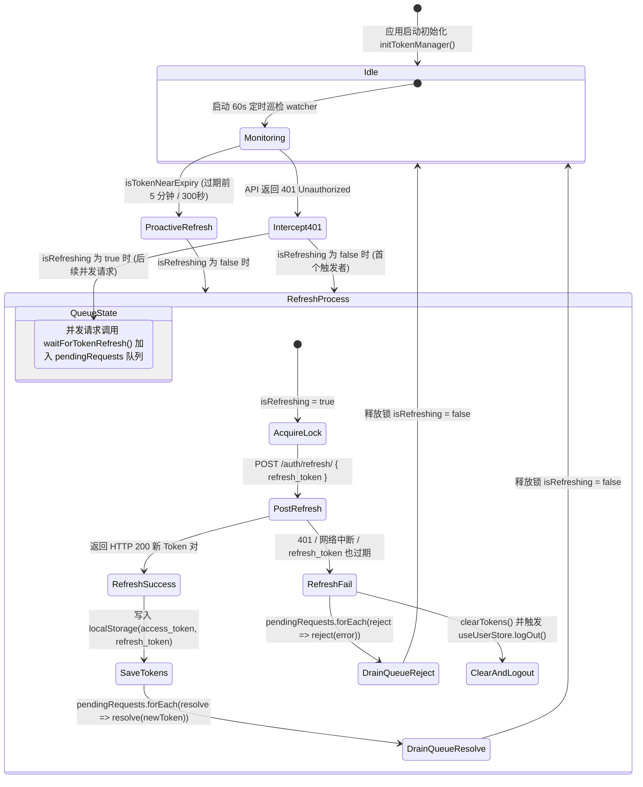
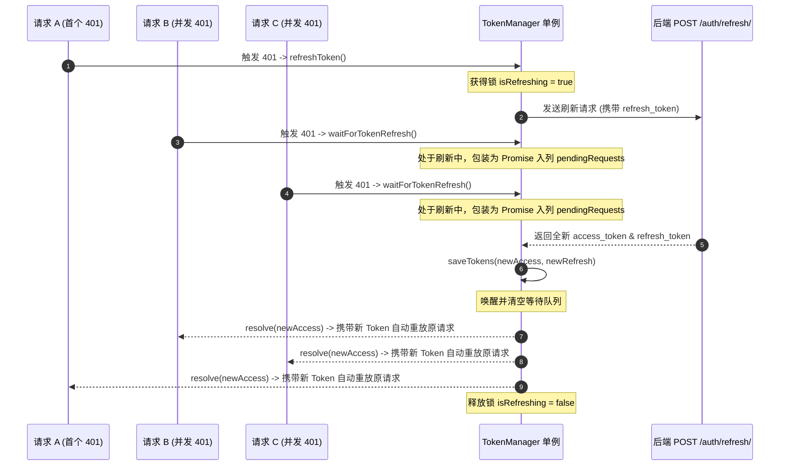
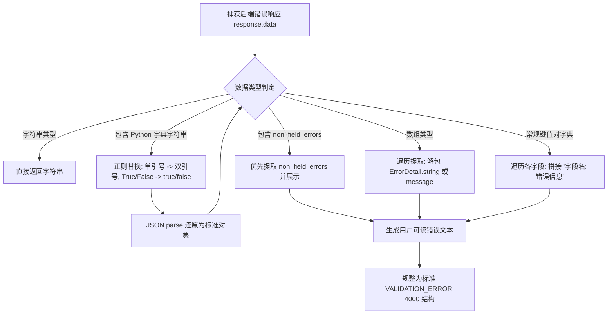

# 网络层与 API 通信契约

> **相关参考**：  
> - 返回主索引：[README.md](./README.md)  
> - 系统总架构：[architecture.md](./architecture.md)  
> - 状态管理与注销清理：[state-management.md](./state-management.md)  
> - 登录鉴权模块：[login.md](./business-modules/login.md)

---

## 一、 网络通信层架构全景

`lipeaks_admin` 基于 **Axios 1.9.0** 构建了工业级网络通信引擎。整体架构围绕单例客户端 `PureHttp`、无感换票调度器 `TokenManager`、面向对象的错误责任链 `ErrorHandlerChain` 以及专门适配 **Django REST Framework (DRF)** 的错误逆向反序列化引擎展开。



---

## 二、 PureHttp 单例客户端封装 (`src/utils/http/index.ts`)

### 2.1 基础配置与参数序列化

客户端基础配置统一定义在 `src/utils/http/index.ts` 中：
```typescript
const defaultConfig: AxiosRequestConfig = {
  // 请求基础地址 (优先读取环境变量 VITE_BASE_API)
  baseURL: import.meta.env.VITE_BASE_API || "http://43.142.76.105:8000/api/v1",
  // 超时时间：10 秒
  timeout: 10000,
  headers: {
    Accept: "application/json, text/plain, */*",
    "Content-Type": "application/json",
    "X-Requested-With": "XMLHttpRequest"
  },
  // 使用 qs 库进行数组/嵌套对象参数序列化
  paramsSerializer: {
    serialize: stringify as unknown as CustomParamsSerializer
  }
};
```

### 2.2 请求拦截器机制 (Request Interceptor)

在每个 HTTP 请求发送之前，拦截器依次执行以下动作：
1. **加载进度条启动**：触发 `NProgress.start()`。
2. **请求级前置钩子**：执行配置中的 `beforeRequestCallback` 回调（若有）。
3. **Django CSRF 校验补丁**：从浏览器 Cookie 中提取名为 `csrftoken` 的 Cookie 键，若存在则自动写入请求头 `X-CSRFTOKEN`，确保安全穿透 Django CSRF 检查机制。
4. **白名单无鉴权放行**：内置白名单 `const whiteList = ["/auth/login/"]`。若请求路径包含在白名单中，跳过 Authorization 注入。
5. **Bearer Token 自动注入**：通过 `tokenManager.getAccessToken()` 获取当前有效的 JWT 访问凭证，注入请求头 `Authorization: Bearer ${token}`。
6. **结构化日志输出**：通过 `logger.logRequest(config)` 记录包含 URL、Method、Headers 及 Payload 的调试信息。

### 2.3 响应拦截器机制 (Response Interceptor) 与契约归一化

1. **进度条闭合**：触发 `NProgress.done()`。
2. **Blob 二进制流透传**：当请求声明 `responseType === "blob"` 时（如导出 Excel、下载离线许可证、图片流），不作 JSON 解构，保留挂载 response headers 后直接返回二进制对象。
3. **响应结构契约检查与自动规整**：
   - 后端规范结构契约：
     ```json
     {
       "success": true,
       "code": 2000,
       "message": "操作成功",
       "data": { ... }
     }
     ```
   - 若后端直接返回非标准数据（例如原生分页数组或单值），拦截器执行智能规整包装：
     ```typescript
     return {
       success: true,
       code: 2000,
       message: "操作成功",
       data: res
     };
     ```

---

## 三、 TokenManager 全生命周期治理与并发刷新队列

系统在 `src/utils/http/tokenManager.ts` 中实现了一套**双重保障（主动巡检预警 + 被动 401 拦截并发互斥重发）**的高可用 Token 管理器。



### 3.1 主动预警刷新机制 (`preemptiveRefresh`)

传统 SPA 应用在 Token 过期时往往只能依赖后置 401 拦截，这会导致用户的当前操作被打断，甚至偶发网络并发雪崩。

`TokenManager` 引入了**主动防御**策略：
1. **JWT 载荷解码**：通过 `JSON.parse(atob(token.split('.')[1]))` 解析出 `exp` 过期时间戳。
2. **5 分钟阈值判定 (`isTokenNearExpiry`)**：
   ```typescript
   isTokenNearExpiry(threshold = 300): boolean {
     const token = this.getAccessToken();
     if (!token) return false;
     try {
       const payload = JSON.parse(atob(token.split('.')[1]));
       const exp = payload.exp * 1000;
       return (exp - Date.now()) < (threshold * 1000);
     } catch (error) {
       return false;
     }
   }
   ```
3. **60 秒守护巡检**：`startTokenWatcher()` 每隔 60 秒轮询一次，一旦发现剩余有效期不足 5 分钟，且当前未处于刷新状态，立即在后台静默发起 `/auth/refresh/`，将最新 Token 写回存储，用户完全无感知。

### 3.2 被动 401 并发互斥队列 (`waitForTokenRefresh`)

当多个并发 API 请求几乎同时遇到 Token 失效时，若每个请求都去调用刷新接口，将造成严重的后端竞争与 Refresh Token 重放攻击拦截。

系统通过互斥锁与 Promise 挂起队列解决并发问题：



---

## 四、 DRF 异常与验证错误逆向解析引擎 (`formatErrorMessage`)

Django REST Framework 在模型校验或 Serializer 抛出 `ValidationError` 时，返回的往往是深层嵌套的字典、包含 Python `ErrorDetail` 对象的数组、甚至是直接将 Python 原生字典转成的未转义字符串（包含单引号 `'` 与 Python 布尔值 `True`/`False`）。

前端在 `src/utils/http/index.ts` 中构建了专有的反解函数：



### 4.1 字段错误解析核心逻辑

1. **`non_field_errors` 全局错误提权**：如果错误对象中包含非字段级错误，说明是跨字段组合逻辑冲突，系统优先提取该错误直接提示。
2. **DRF `ErrorDetail` 对象解包**：递归识别并提取对象内的 `.string` 属性与 `.message` 属性。
3. **字段级多错分号拼接**：将 `{"username": ["该用户名已存在"], "email": ["邮箱格式不合法"]}` 自动平铺格式化为：`username: 该用户名已存在; email: 邮箱格式不合法`，并在表单输入控件旁精准浮现提示。

---

## 五、 面向对象的错误处理责任链模式 (`src/utils/http/errorHandlers.ts`)

系统采用经典的设计模式——责任链模式（Chain of Responsibility），将异常分流为 6 个相互独立的 Handler：

```mermaid
graph LR
    Input[StandardErrorResponse] --> Classifier[ErrorClassifier: 错误归类]
    Classifier --> Chain[ErrorHandlerChain 责任链]

    Chain --> H1[1. AuthenticationErrorHandler<br/>401, 4001~4004]
    H1 -->|不匹配| H2[2. PermissionErrorHandler<br/>403, 4003, 4303]
    H2 -->|不匹配| H3[3. ValidationErrorHandler<br/>400, 4000]
    H3 -->|不匹配| H4[4. NetworkErrorHandler<br/>5001, 5002 超时与断网]
    H4 -->|不匹配| H5[5. ServerErrorHandler<br/>5000, 5003 数据库故障]
    H5 -->|不匹配| H6[6. BusinessErrorHandler<br/>租户配额/许可证过期/积分不足]
```



### 5.1 各级 Handler 处置策略

1. **`AuthenticationErrorHandler`（认证失效）**：
   - 匹配条件：`errorType === 'authentication'` 或 `shouldClearAuth`。
   - 动作：清除 LocalStorage 中的 Token，将当前访问路径记入 `sessionStorage.setItem('returnUrl', path)`，弹出黄色警告 `ElMessage.warning`，延迟 1500ms 重定向至 `/login`。
2. **`PermissionErrorHandler`（越权拦截）**：
   - 匹配条件：HTTP 403 或业务权限码 `AUTH_PERMISSION_DENIED`。
   - 动作：弹出阻塞式确认框 `ElMessageBox.alert`，若配置了 `guidance.route` 则导航至无权限说明页。
3. **`ValidationErrorHandler`（数据校验失败）**：
   - 动作：经由 `formatErrorMessage` 处理后，通过 `ElMessage.error` 弹出友好的中文校验提示。
4. **`NetworkErrorHandler`（网络连接/超时异常）**：
   - 动作：弹出持久化通知框 `ElNotification`（不自动关闭），并返回 `{ shouldRetry: true, retryAfter: 2000 }` 策略，支持网络恢复后的自动重发。
5. **`ServerErrorHandler`（500 服务器/数据库异常）**：
   - 动作：弹出确认重试弹窗，若用户点击“重试”，在 1000ms 后自动重放原始请求。
6. **`BusinessErrorHandler`（业务规则与配额拦截）**：
   - 匹配条件：租户超配 (`TENANT_QUOTA_EXCEEDED`)、许可过期 (`LICENSE_EXPIRED`) 等。
   - 动作：读取 `src/utils/http/errorCodes.ts` 中的 `ACTION_GUIDANCE`，呈现直通升级套餐或购买许可证的操作指引按钮。
