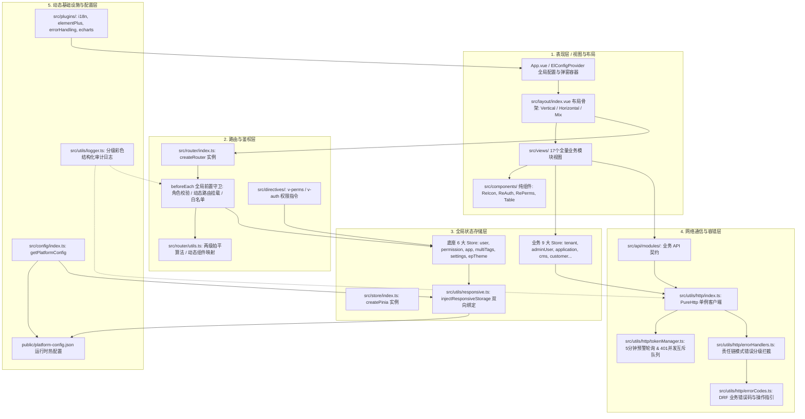
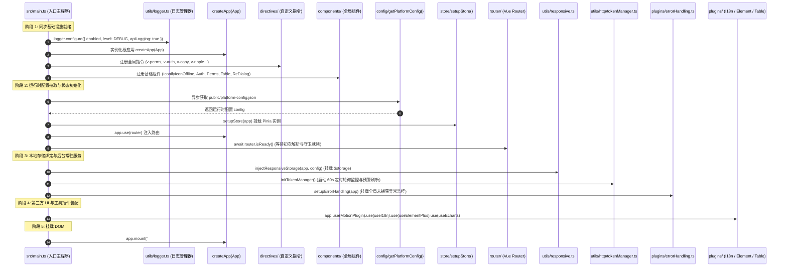
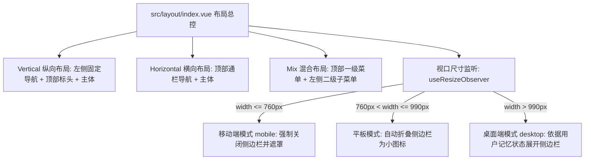

# 系统总架构与工程规范

> **相关参考**：  
> - 返回主索引：[README.md](./README.md)  
> - 路由与鉴权系统：[routing-and-permissions.md](./routing-and-permissions.md)  
> - 全局状态管理：[state-management.md](./state-management.md)  
> - 网络通信与错误治理：[api-and-network.md](./api-and-network.md)  
> - 工程化与部署：[engineering-and-deployment.md](./engineering-and-deployment.md)

---

## 一、 系统分层设计拓扑

`lipeaks_admin` 严格遵循单向依赖与关注点分离（Separation of Concerns）的工程设计原则。整体系统划分为五大逻辑层：**表现层 (Presentation Layer)**、**路由与鉴权层 (Routing & Auth Layer)**、**全局状态存储层 (State Layer)**、**网络通信与容错层 (Network Layer)**、以及**动态基础设施与配置层 (Platform Infrastructure Layer)**。



### 1.1 分层核心职责

1. **表现层 (Presentation Layer)**：
   - 负责页面渲染、表单交互、数据呈现和图表可视化。
   - 所有页面由统一的 `src/layout/index.vue` 骨架容器承载，支持纵向（Vertical）、横向（Horizontal）与混合（Mix）三种布局模型。
2. **路由与鉴权层 (Routing & Auth Layer)**：
   - 基于 `vue-router 4` 维护前端路由表。
   - 实现“静态基础路由 + 运行时后端动态路由合并”机制，并通过**两级拍平算法**将深层嵌套路由扁平化为二级路由，解决 Vue 3 内置 `<keep-alive>` 对三级以上嵌套路由缓存失效的底层缺陷。
   - 提供 RBAC 页面级拦截与 `v-perms`/`v-auth` 按钮级精准物理 DOM 剔除。
3. **全局状态存储层 (State Layer)**：
   - 基于 `Pinia 3` 实现统一状态治理。
   - 划分为底座 6 大基础 Store 与业务 9 大专用 Store。通过 `responsive-storage` 实现细粒度响应式双向持久化，避免整库序列化引发的脏数据与性能瓶颈。
4. **网络通信与容错层 (Network Layer)**：
   - 基于 `Axios 1.9` 封装单例 `PureHttp`。
   - 包含自主研发的 `TokenManager`，提供 JWT 过期前 5 分钟的主动预警静默刷新，以及高并发 401 拦截下的请求重发互斥锁与队列调度。
   - 集成面向对象的责任链（Chain of Responsibility）错误处理机制，内置对 DRF 复杂嵌套与非标异常数据的反序列化解析引擎。
5. **动态基础设施与配置层 (Platform Infrastructure Layer)**：
   - 支持通过 `public/platform-config.json` 进行无需重新编译的前端运行时热配置。
   - 提供分级彩色结构化审计日志（`src/utils/logger.ts`）与全局未捕获异常监控中心。

---

## 二、 代码库目录组织规范

项目遵循严格的模块化组织结构，源码统一收敛于 `src/`，构建与部署配置分布在根目录与 `build/` 中：

```
lipeaks_admin/
├── .husky/                       # Git 提交前置钩子配置 (commit-msg, pre-commit)
├── build/                        # Vite 构建扩展模块 (插件流、优化项、CDN、工具库)
├── docs/                         # 工程全景技术文档体系 (本目录)
│   ├── business-modules/         # 17 个全量业务模块深度解析文档
│   ├── README.md                 # 文档主索引导航与技术栈矩阵
│   ├── architecture.md           # 系统总架构与工程规范
│   ├── routing-and-permissions.md# 路由系统与权限控制
│   ├── state-management.md       # 全局状态管理与数据流
│   ├── api-and-network.md        # 网络层与通信契约
│   └── engineering-and-deployment.md # 工程化与部署
├── locales/                      # 全局国际化 YAML 字典文件 (zh-CN.yaml, en.yaml)
├── mock/                         # 本地及构建测试 Mock 接口定义
├── nginx/                        # 生产环境 Nginx 反向代理配置 (default.conf)
├── public/                       # 静态资源与运行时配置 (platform-config.json, favicon)
├── src/                          # 核心业务与框架源码
│   ├── api/                      # 后端接口契约与请求定义
│   │   ├── modules/              # 15 个业务领域接口模块 (adminUser, tenant, order...)
│   │   ├── routes.ts             # 动态菜单与路由获取接口 (getAsyncRoutes)
│   │   └── user.ts               # 用户登录鉴权与 Token 刷新接口
│   ├── assets/                   # 静态媒体资源 (SVG 图标、iconfont、图片)
│   ├── components/               # 全局共享与二次封装 UI 组件
│   │   ├── ReAuth/               # 局部权限包装组件 (<Auth>)
│   │   ├── ReIcon/               # 离线/在线/字体图标组件 (<IconifyIconOffline>)
│   │   ├── RePerms/              # 全局权限包装组件 (<Perms>)
│   │   └── index.ts              # 全局组件注册入口
│   ├── config/                   # 动态运行时配置读取与命名空间定义
│   ├── directives/               # 全局自定义指令 (auth, perms, copy, optimize, ripple...)
│   ├── layout/                   # 页面骨架与结构布局
│   │   ├── components/           # 布局子组件 (lay-navbar, lay-sidebar, lay-tag, lay-content)
│   │   ├── hooks/                # 布局响应式 Hooks (useLayout, useDataThemeChange)
│   │   └── index.vue             # 核心布局入口与窗口断点监听
│   ├── plugins/                  # 框架级插件 (i18n, elementPlus, echarts, errorHandling)
│   ├── router/                   # 路由定义、路由守卫与拍平算法
│   │   ├── modules/              # 静态路由模块 (home.ts, error.ts, remaining.ts)
│   │   ├── index.ts              # 路由实例创建与 beforeEach 守卫拦截
│   │   └── utils.ts              # 两级拍平、动态挂载与权限过滤工具函数
│   ├── store/                    # Pinia 状态管理仓库
│   │   ├── modules/              # 6 大底座 Store + 9 大业务 Store
│   │   └── index.ts              # Pinia 根实例创建与挂载入口
│   ├── style/                    # 全局样式系统 (reset.scss, index.scss, tailwind.css)
│   ├── utils/                    # 底层核心工具库
│   │   ├── http/                 # PureHttp 客户端、TokenManager、错误责任链
│   │   ├── auth.ts               # Token 读写、用户信息 LocalStorage 存储、hasPerms 判定
│   │   ├── logger.ts             # 分级彩色日志管理器
│   │   ├── responsive.ts         # responsive-storage 双向持久化注入器
│   │   └── tree.ts               # 树结构递归与层级处理
│   ├── views/                    # 17 个全量业务视图页面目录
│   ├── App.vue                   # 根组件 (包裹 ElConfigProvider 与 ReDialog)
│   └── main.ts                   # 应用装配入口与串行生命周期管道
├── Dockerfile                    # Node 20 + Nginx 容器化多阶段构建脚本
├── docker-compose.yml            # 前后端与 MySQL 容器化编排文件
├── eslint.config.js              # ESLint v9 扁平化规范配置
├── package.json                  # 项目依赖与 scripts 任务定义
├── tsconfig.json                 # TypeScript 静态类型编译配置
└── vite.config.ts                # Vite 6 构建配置入口
```

---

## 三、 异步串行启动时序装配管道 (`src/main.ts`)

为了杜绝异步加载竞争导致的状态未就绪、路由未初始化即发起页面重定向等问题，`lipeaks_admin` 在 `src/main.ts` 中设计了严格的异步串行装配管道：



### 关键步骤深度解析：

1. **日志引擎先行配置（Step 1）**：在任何第三方库加载前配置 `logger`，确保后续初始化过程中的每一条警告与调试信息均能被彩色格式化输出。
2. **异步运行时配置加载（Step 6）**：通过 HTTP 请求读取 `public/platform-config.json`，允许运维人员在生产构建产物交付后，通过修改 JSON 直接调整 API 路径或平台标题，而无需重新打包代码。
3. **`router.isReady()` 显式等待（Step 9）**：等待路由完成初次导航解析后再注入响应式存储与挂载应用，杜绝首屏空白及深层链接刷新时的路由错乱。
4. **Token 后台轮询守护进程启动（Step 11）**：调用 `initTokenManager()` 激活每 60 秒的定时巡检，当检测到 JWT 有效期不足 300 秒（5分钟）时，在后台静默发起换票刷新。

---

## 四、 响应式 Storage 持久化规范 (`src/utils/responsive.ts`)

为了避免传统单页面应用对整个 Pinia Store 进行粗暴序列化写入 LocalStorage 所带来的性能劣化、存储碎片与脏数据问题，系统引入了 `responsive-storage` 双向持久化桥接引擎。

### 4.1 命名空间与内存映射模型

持久化数据被限制在独立的命名空间中（默认为 `responsive-`），全局挂载于 Vue 实例属性 `$storage`。

```typescript
// 核心映射结构 (src/utils/responsive.ts)
injectResponsiveStorage(app, config);
```

| 存储键名 (Storage Key) | 内存数据模型 | 核心管理属性 | 默认值 / 回退策略 |
| :--- | :--- | :--- | :--- |
| **`responsive-locale`** | `{ locale: string }` | 系统当前国际化语言 | 回退至 `config.Locale ?? "zh"` |
| **`responsive-layout`** | `LayoutConfig` | `layout` (vertical/horizontal/mix)<br/>`theme` (light/dark)<br/>`darkMode` (boolean)<br/>`sidebarStatus` (boolean)<br/>`epThemeColor` (十六进制颜色)<br/>`overallStyle` (light/dark/system) | 由 `config.json` 初始化，与侧边栏折叠/主题深度绑定 |
| **`responsive-configure`** | `ConfigureConfig` | `grey` (灰色模式/哀悼模式)<br/>`weak` (色弱模式)<br/>`hideTabs` (是否隐藏多标签栏)<br/>`hideFooter` (是否隐藏页脚)<br/>`showLogo` (是否展示侧边栏 Logo)<br/>`multiTagsCache` (是否开启标签持久化) | 界面偏好开关，实时响应 UI 样式注入 |
| **`responsive-tags`** | `Array<TagItem>` | 当前打开的多标签页列表 | 当且仅当 `multiTagsCache = true` 时持久化，否则关闭标签记忆 |

### 4.2 响应式读写与同步机制

- **读操作**：组件内通过 `const { $storage } = useGlobal<GlobalPropertiesApi>()` 直接以普通对象属性方式读取 `$storage.layout.layout`。
- **写操作**：直接赋值 `$storage.layout.sidebarStatus = false`，插件内部通过 Proxy 自动将新值同步更新至浏览器 LocalStorage，并在多标签页触发 `storage` 事件同步。

---

## 五、 Layout 页面骨架与断点响应体系 (`src/layout/index.vue`)

系统布局采用组件化封装，支持 3 种主流企业管理后台骨架形态，并结合 `useResizeObserver` 与 `deviceDetection` 实现了毫秒级视口自适应：



### 5.1 三大核心布局模式

1. **纵向布局 (`vertical`)**：
   - 包含左侧垂直侧边栏（Logo 区域 + `NavVertical` 菜单树）、顶部导航栏（`LayNavbar` + `LayTag` 标签栏）与核心内容区（`LayContent`）。
   - 适用于功能树深、模块繁多的管理系统主场景。
2. **横向布局 (`horizontal`)**：
   - 将菜单上移至顶部通栏（`NavHorizontal`），隐藏左侧侧边栏，为主体区域腾出最大可视宽度。
   - 适用于宽屏大屏数据展示与报表类场景。
3. **混合布局 (`mix`)**：
   - 顶部通栏呈现一级大类模块，左侧垂直侧边栏仅展示当前激活大类下的二级与多级子菜单。

### 5.2 视口宽度断点与自适应策略 (`useResizeObserver`)

系统在 `appWrapperRef` 容器上挂载了 `ResizeObserver`，视口变化时触发以下自适应逻辑：

```typescript
useResizeObserver(appWrapperRef, entries => {
  if (isMobile) return;
  const entry = entries[0];
  const [{ inlineSize: width, blockSize: height }] = entry.borderBoxSize;
  useAppStoreHook().setViewportSize({ width, height });

  // 移动端宽度强制降级为垂直布局
  width <= 760 ? setTheme("vertical") : setTheme(useAppStoreHook().layout);

  // 断点状态机控制
  if (width <= 760) {
    toggle("mobile", false); // 标记移动设备，隐藏侧边栏
  } else if (width > 760 && width <= 990) {
    toggle("desktop", false); // 折叠侧边栏至图标模式
  } else {
    toggle("desktop", true);  // 展开侧边栏
  }
});
```

- **`width <= 760px`（移动端）**：应用切换为 `mobile` 类名，侧边栏以浮层抽屉形式展现，点击遮罩背景（`layout-bg`）自动收起，保障在小屏设备上的可用性。
- **`760px < width <= 990px`（中等屏幕/平板）**：侧边栏自动收缩为窄条图标模式（Collapsed），悬停时浮出二级子菜单。
- **`width > 990px`（标准桌面）**：恢复完整侧边栏形态，维持用户手动配置的展开或折叠状态。
