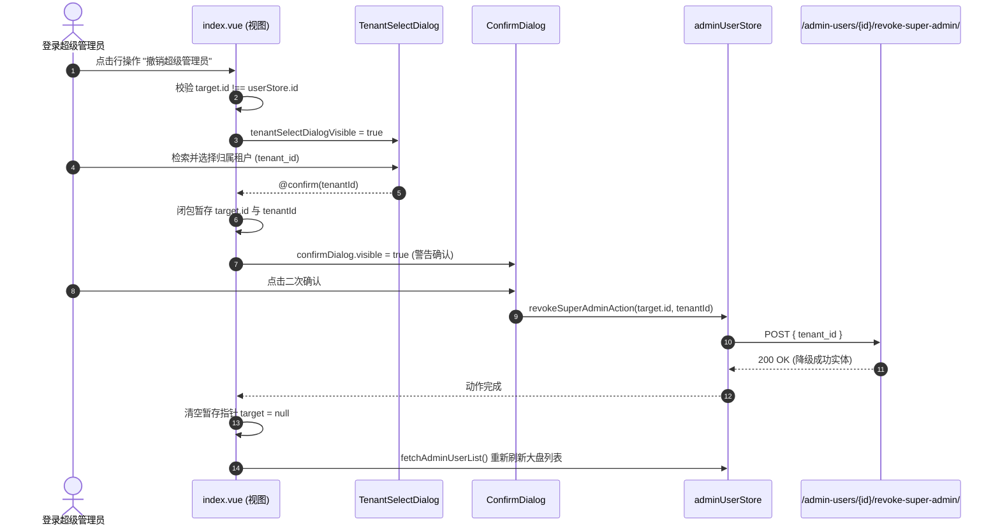

# 系统管理员与账号管理 (admin-user)

## 1. 模块业务职责与核心能力

`admin-user` 模块是 `lipeaks_admin` 系统的管理员用户权限中枢与账号生命周期治理核心。该模块专门服务于平台内部的高特权管理人员体系，主要具备以下业务能力：

- **双层账号架构治理**：统一管理“超级管理员（Super Admin）”与“租户管理员（Tenant Admin）”。支持全生命周期跟踪（创建、激活、停用、软删除/销毁）。
- **特权角色升降级与多阶段安全互锁**：
  - **提拔（Grant）**：将普通租户管理员提拔为全平台超级管理员，赋予全域数据与配置权限。
  - **降级（Revoke）**：将超级管理员降级为普通管理员时，实施两阶段事务管控，**必须强制指定并绑定归属租户**，随后进入警告弹窗确认，方可执行降级。
- **账号防自锁防护网**：前端内置强互锁机制，严格禁止当前登录管理员对自身账号执行“撤销超级管理员”、“停用账号”以及“删除账号”等自残性破坏操作。
- **动态个人菜单配置**：集成 `MenuSettingDialog`，允许为特定管理员定制化独立覆盖菜单树，打破通用角色权限边界。
- **凭证安全维护**：支持密码强规则重置与个人 Profile 资料（头像切片/文件上传、昵称、邮箱、手机号）维护。

---

## 2. 源码结构与组件分工

### 2.1 视图与组件目录树

```
src/views/admin-user/
├── index.vue                   # 管理员主列表台（集成搜索、操作下拉、全部弹窗容器）
├── create.vue                  # 独立视图：创建普通租户管理员
├── create-super-admin.vue      # 独立视图：创建超级管理员
├── edit.vue                    # 独立视图：编辑管理员基本信息
├── detail.vue                  # 独立视图：查看管理员属性与操作日志
└── profile.vue                 # 个人中心视图：当前登录者 Profile 与密码修改

src/components/AdminUserManagement/
├── AdminUserForm.vue           # 统一管理员核心表单（create/superAdmin/update/view 四态复用）
├── ConfirmDialog.vue           # 危险操作统一二次确认弹窗
├── TenantSelectDialog.vue      # 撤销超管专用：租户选择与合法性校验模态框
├── MenuSettingButton.vue       # 菜单树授权入口按钮
├── MenuSettingDialog.vue       # 细粒度个人菜单树穿梭/分配弹窗
└── ResetPasswordDialog.vue     # 重置密码安全对话框
```

### 2.2 核心子组件职责明细

| 组件名称 | 职责定位 | 交互特性 |
|---|---|---|
| `AdminUserForm.vue` | 管理员全量属性编辑表单 | 支持四种 `mode`，集成密码强度校验、租户下拉选择（针对租户管理员）、手机号与邮箱正则校验 |
| `TenantSelectDialog.vue` | 撤销超管降级中转容器 | 调取 `/tenants/` 接口列出可用租户，未选择租户时禁止点击确认，输出选定 `tenantId` |
| `ConfirmDialog.vue` | 业务级风险预警框 | 接收动态 `title`、`content` 与异步 `confirmAction`，执行过程中自带 Loading 态 |
| `MenuSettingDialog.vue` | 用户级专属动态路由树分配 | 获取系统全量路由树与用户已分配菜单，支持树节点勾选与级联提交 |
| `ResetPasswordDialog.vue` | 密码重置表单弹窗 | 包含 `new_password` 与 `confirm_password`，双重一致性核验与复杂度校验 |

---

## 3. 路由与前置守卫

### 3.1 路由注册规范

该模块主要由后端接口 `/menus/admin/routes/` 动态下发并经 `src/router/utils.ts` 的 `addAsyncRoutes` 挂载进 Vue Router。其标准路由契约如下：

```ts
{
  path: "/admin-user",
  name: "AdminUser",
  component: () => import("@/views/admin-user/index.vue"),
  meta: {
    title: "menus.pureAdminUser",
    icon: "ri:admin-line",
    roles: ["super_admin"],
    backstage: true,
    keepAlive: true
  },
  children: [
    {
      path: "/admin-user/create",
      name: "CreateAdminUser",
      component: () => import("@/views/admin-user/create.vue"),
      meta: { title: "adminUser.createAdminUser", roles: ["super_admin"], showLink: false }
    },
    {
      path: "/admin-user/profile",
      name: "AdminUserProfile",
      component: () => import("@/views/admin-user/profile.vue"),
      meta: { title: "adminUser.profile", showLink: false }
    }
  ]
}
```

### 3.2 页面级拦截硬防线

除了全局路由守卫基于 `roles: ["super_admin"]` 进行拦截外，在 `src/views/admin-user/index.vue` 脚本顶层设置了不可逾越的前置防御校验：

```ts
const isSuperAdmin = computed(() => userStore.is_super_admin);

// 如果非超级管理员，立即弹出错误并回退到仪表盘
if (!isSuperAdmin.value) {
  ElMessage.error("无权限访问此页面");
  router.push("/dashboard");
}
```

---

## 4. API 通信契约

通信层统一由 `src/api/modules/adminUser.ts` 输出，基于 Axios 封装单例 `http` 发起强类型通信：

### 4.1 接口清单

| 方法名 | HTTP Method | 接口 Endpoint | 核心载荷 (Request) | 响应契约 (Response) |
|---|---|---|---|---|
| `getAdminUserList` | `GET` | `/admin-users/` | `AdminUserListParams` (page, page_size, search, status, is_super_admin) | `PaginationResponse<AdminUser>` |
| `getAdminUserDetail` | `GET` | `/admin-users/${id}/` | 路径参数 `id: number` | `ApiResponse<AdminUser>` |
| `createAdminUser` | `POST` | `/admin-users/` | `AdminUserCreateParams` (含 tenant_id) | `ApiResponse<AdminUser>` |
| `createSuperAdmin` | `POST` | `/admin-users/super-admin/create/` | `AdminUserCreateParams` (`is_super_admin: true`) | `ApiResponse<AdminUser>` |
| `updateAdminUser` | `PUT` | `/admin-users/${id}/` | `AdminUserUpdateParams` | `ApiResponse<AdminUser>` |
| `deleteAdminUser` | `DELETE` | `/admin-users/${id}/` | 路径参数 `id: number` | `ApiResponse<any>` |
| `grantSuperAdmin` | `POST` | `/admin-users/${id}/grant-super-admin/` | 路径参数 `id: number` | `ApiResponse<AdminUser>` |
| `revokeSuperAdmin` | `POST` | `/admin-users/${id}/revoke-super-admin/` | `id: number`, Body: `{ tenant_id: number }` | `ApiResponse<AdminUser>` |
| `activateAdminUser` | `POST` | `/admin-users/${id}/activate/` | 路径参数 `id: number` | `ApiResponse<AdminUser>` |
| `deactivateAdminUser` | `POST` | `/admin-users/${id}/deactivate/` | 路径参数 `id: number` | `ApiResponse<AdminUser>` |
| `resetAdminUserPassword` | `POST` | `/auth/${id}/change-password/` | `{ new_password: string, confirm_password: string }` | `ApiResponse<{ success: boolean }>` |
| `uploadAdminUserAvatar` | `POST` | `/admin-users/${id}/avatar/upload/` | `FormData` (`avatar: File`) | `ApiResponse<{ avatar: string }>` |
| `getCurrentAdmin` | `GET` | `/admin-users/me/` | 无 | `ApiResponse<AdminUser>` |
| `updateCurrentAdmin` | `PUT` | `/admin-users/me/` | `AdminUserUpdateParams` | `ApiResponse<AdminUser>` |

### 4.2 核心数据类型契约 (`src/types/adminUser.ts`)

```ts
export type AdminUserStatus = "active" | "suspended" | "inactive";

export interface AdminUser {
  id: number;
  username: string;
  email: string;
  phone?: string;
  nick_name?: string;
  first_name?: string;
  last_name?: string;
  is_active: boolean;
  avatar?: string;
  tenant?: number;
  tenant_name?: string;
  is_admin: boolean;
  is_member: boolean;
  is_super_admin: boolean;
  role?: string;
  status: AdminUserStatus;
  last_login_time?: string;
  last_login_ip?: string;
  date_joined: string;
}
```

---

## 5. 状态管理与数据模型

### 5.1 Pinia Store 架构 (`src/store/modules/adminUser.ts`)

`useAdminUserStore` 集中维护列表数据流与多动作独立 Loading 状态：

```ts
export const useAdminUserStore = defineStore("adminUser", {
  state: (): AdminUserState => ({
    adminUserList: {
      total: 0,
      page: 1,
      limit: 10,
      data: []
    },
    currentAdminUser: null,
    loading: {
      list: false,
      create: false,
      createSuperAdmin: false,
      update: false,
      delete: false,
      grantSuperAdmin: false,
      revokeSuperAdmin: false,
      activate: false,
      deactivate: false,
      resetPassword: false,
      uploadAvatar: false
    }
  }),
  actions: {
    async fetchAdminUserList(params: AdminUserListParams) { ... },
    async createNewAdminUser(data: AdminUserCreateParams) { ... },
    async grantSuperAdminAction(id: number) { ... },
    async revokeSuperAdminAction(id: number, tenantId: number) { ... },
    async removeAdminUser(id: number) { ... }
  }
});
```

### 5.2 视图层响应式 State

- `pagination`: `{ currentPage: 1, pageSize: 10, total: computed(...) }`
- `searchForm`: `reactive<AdminUserListParams>`，与顶部筛选栏双向绑定。
- `confirmDialog`: 统一二次确认状态包，包含 `visible`、`title`、`content` 与异步闭包句柄 `confirmAction`。

---

## 6. 关键业务流程与时序

### 6.1 撤销超级管理员特权两阶段事务时序

撤销超级管理员具有极高破坏性，降级后该用户必须受辖于单一租户。系统采用“选定租户 -> 风险二次警示 -> 闭包捕获提交”两阶段时序：



---

## 7. 权限控制与安全互锁

### 7.1 双重身份鉴权矩阵

| 操作行为 | 权限限制条件 | UI 表现 / 拦截机制 |
|---|---|---|
| 进入页面 | `userStore.is_super_admin === true` | 非超管路由守卫与组件脚本双重重定向至 `/dashboard` |
| 提拔超级管理员 | `!row.is_super_admin` | 仅在目标为普通管理员时在下拉菜单中呈现 |
| 撤销超级管理员 | `row.is_super_admin && row.id !== userStore.id` | **自身账号强屏蔽**；必须经租户选择对话框指派所属租户 |
| 停用账号 | `row.is_active && row.id !== userStore.id` | **自身账号强屏蔽**，防止自毁导致当前会话被锁 |
| 激活账号 | `!row.is_active` | 仅在目标处于非激活态时展示 |
| 删除管理员 | `row.id !== userStore.id` | **自身账号强屏蔽**，弹出高危红色警告确认框 |
| 配置菜单权限 | 必须具备超管权限 | 调起 `MenuSettingDialog` 穿梭分配个人路由树 |
