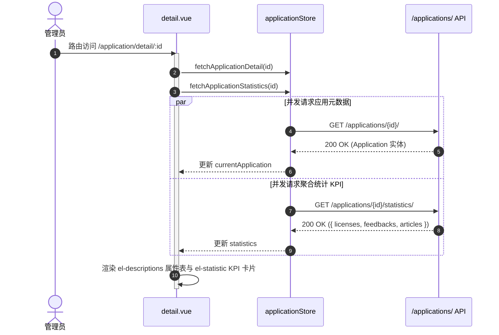

# 应用系统管理 (application)

## 1. 模块业务职责与核心能力

`application` 模块是 `lipeaks_admin` 系统中面向平台接入软件、微服务或商业客户端产品的**主数据资产目录中心**。在整套后台架构中，它扮演着许可证（License）、服务工单（Feedback）以及知识库文章（CMS）等多个下游模块的**顶层宿主与关联聚合锚点**。

核心能力包括：
- **软件资产全生命周期建档**：登记与维护应用的代码标识（`code`）、系统名称（`name`）、当前发版版本号（`current_version`）、归属团队（`team`）、业务负责人（`owner`）、系统 Logo 及描述说明。
- **状态流转与可观测性标签**：规范应用所处的研发与运维状态（开发中、测试中、活跃上线、停用、已废弃）。
- **聚合统计与多维度 KPI 仪表盘**：在应用详情页联动汇聚下游关联实体的宏观业务指标，包括该应用签发的**许可证总数（Licenses Total）**、收到的**工单总数（Feedbacks Total）**以及发布的**知识库/文档文章数（Articles Total）**。
- **灵活的交互视图体系**：支持列表页弹窗（Modal）就地创建/编辑，同时支持独立路由深层链接（`/application/create`、`/application/edit/:id`、`/application/detail/:id`）。

---

## 2. 源码结构与组件分工

### 2.1 视图与组件目录树

```
src/views/application/
├── index.vue               # 应用主列表视图（组合检索、卡片工具栏、数据表格、内嵌弹窗）
├── create.vue              # 独立页面模式：新建应用
├── edit.vue                # 独立页面模式：编辑应用
└── detail.vue              # 应用详情看板（基础属性描述列表 + 聚合统计指标卡）

src/components/Application/
├── index.ts                # 组件统一导出入口
├── StatusTag.vue           # 应用状态标签（带 Element Plus 动态色彩映射）
└── ApplicationForm.vue     # 核心编辑/新建表单（集成 Logo 上传、校验规则、提交触发）
```

### 2.2 核心子组件职责明细

| 组件名称 | 职责定位 | 核心交互逻辑与实现特性 |
|---|---|---|
| `StatusTag.vue` | 状态可视化标识 | 接收 `status: ApplicationStatus`，根据 `development`（info）、`testing`（warning）、`active`（success）、`inactive`（danger）、`deprecated`（info）映射 Tag 主题 |
| `ApplicationForm.vue` | 应用模型编辑表单 | 支持表单校验规则 `rules`（`name` 与 `code` 必填，`code` 限制英文字符规范）；集成 Logo 预览；通过 `resetForm()` 对外暴露受控重置句柄 |

---

## 3. 路由与前置守卫

### 3.1 路由注册规范

该模块由动态后端路由在系统初始化（`initRouter`）时统一加载并展开拍平：

```ts
{
  path: "/application",
  name: "Application",
  component: () => import("@/views/application/index.vue"),
  meta: {
    title: "menus.pureApplication",
    icon: "ri:apps-line",
    keepAlive: true,
    roles: ["admin", "super_admin"]
  },
  children: [
    {
      path: "/application/detail/:id",
      name: "ApplicationDetail",
      component: () => import("@/views/application/detail.vue"),
      meta: { title: "application.detail", showLink: false, activePath: "/application" }
    },
    {
      path: "/application/create",
      name: "ApplicationCreate",
      component: () => import("@/views/application/create.vue"),
      meta: { title: "application.actions.create", showLink: false, activePath: "/application" }
    },
    {
      path: "/application/edit/:id",
      name: "ApplicationEdit",
      component: () => import("@/views/application/edit.vue"),
      meta: { title: "application.actions.edit", showLink: false, activePath: "/application" }
    }
  ]
}
```

### 3.2 守卫与页面级拦截

- 列表视图启用了 `meta.keepAlive: true`，在多标签切换时保留当前的搜索过滤输入及表格滚动位置。
- 行级别操作及独立页面跳转通过权限辅助函数与超管状态实施动态拦截。

---

## 4. API 通信契约

通信层文件位于 `src/api/modules/application.ts`，基于系统单例 `http`（PureHttp/Axios）封装：

### 4.1 接口清单

| 方法名 | HTTP Method | 接口 Endpoint | 载荷参数 (Request) | 响应数据 (Response) |
|---|---|---|---|---|
| `getApplicationList` | `GET` | `/applications/` | `ApplicationListParams` (page, page_size, search, status) | `PaginationResponse<Application>` |
| `getApplicationDetail` | `GET` | `/applications/${id}/` | 路径参数 `id: number` | `ApiResponse<Application>` |
| `createApplication` | `POST` | `/applications/` | `ApplicationCreateUpdateParams` | `ApiResponse<Application>` |
| `updateApplication` | `PUT` | `/applications/${id}/` | `id: number`, `ApplicationCreateUpdateParams` | `ApiResponse<Application>` |
| `patchApplication` | `PATCH` | `/applications/${id}/` | `id: number`, `Partial<ApplicationCreateUpdateParams>` | `ApiResponse<Application>` |
| `deleteApplication` | `DELETE` | `/applications/${id}/` | 路径参数 `id: number` | `ApiResponse<any>` |
| `getApplicationStatistics` | `GET` | `/applications/${id}/statistics/` | 路径参数 `id: number` | `ApiResponse<ApplicationStatistics>` |
| `getApplicationArticles` | `GET` | `/applications/${id}/articles/` | 路径参数 `id: number` | `ApiResponse<ApplicationArticle[]>` |
| `uploadApplicationLogo` | `POST` | `/applications/${id}/upload-logo/` | `FormData` (`logo: File`) | `ApiResponse<ApplicationLogoUploadResponse>` |

### 4.2 核心数据模型契约 (`src/types/application.ts`)

```ts
export type ApplicationStatus =
  | "development"   // 研发中
  | "testing"       // 测试中
  | "active"        // 正式投产上线
  | "inactive"      // 暂停服务/维护
  | "deprecated";   // 废弃下线

export interface Application {
  id: number;
  name: string;
  code: string;
  logo?: string;
  current_version: string;
  status: ApplicationStatus;
  owner?: string;
  team?: string;
  description?: string;
  created_at: string;
  updated_at: string;
}

export interface ApplicationStatistics {
  licenses: { total: number };
  feedbacks: { total: number };
  articles: { total: number };
}
```

---

## 5. 状态管理与数据模型

### 5.1 Pinia Store 架构 (`src/store/modules/application.ts`)

`useApplicationStore` 统一承载应用列表、当前高亮应用、关联聚合统计数据以及独立的加载锁：

```ts
export const useApplicationStore = defineStore("application", {
  state: () => ({
    applicationList: {
      total: 0,
      page: 1,
      limit: 10,
      data: [] as Application[]
    },
    currentApplication: null as Application | null,
    statistics: null as ApplicationStatistics | null,
    loading: {
      list: false,
      detail: false,
      create: false,
      update: false,
      delete: false
    }
  }),
  actions: {
    async fetchApplicationList(params?: ApplicationListParams) { ... },
    async fetchApplicationDetail(id: number) { ... },
    async fetchApplicationStatistics(id: number) { ... },
    async createApplication(data: ApplicationCreateUpdateParams) { ... },
    async updateApplication(id: number, data: ApplicationCreateUpdateParams) { ... },
    async deleteApplication(id: number) { ... }
  }
});
```

### 5.2 组件内部响应式 State

- `searchForm`: `reactive({ search: "", status: "" })`，与顶部搜索控件绑定。
- `createDialog`: `reactive({ visible: false, loading: false })`
- `editDialog`: `reactive({ visible: false, loading: false, applicationData: null })`
- **宏任务表单防御机制**：在打开创建模态框时，利用 `setTimeout(() => createFormRef.value?.resetForm(), 0)`，确保在 Vue DOM 挂载和对话框动画就绪后彻底重置子组件内部表单校验与初始值，消除复用脏数据。

---

## 6. 关键业务流程与时序

### 6.1 应用详情并行汇聚拉取时序

当用户进入应用详情页时，页面需要同时装载应用本身元数据及跨模块聚合统计 KPI，前端采用并行网络时序：



---

## 7. 权限控制与按钮级鉴权

### 7.1 双轨制鉴权机制

组件内部采用 `hasPermission` 封装：
```ts
const hasPermission = (permission: string): boolean => {
  return userStore.is_super_admin || hasPerms(permission);
};
```
当当前登录者为超级管理员（`is_super_admin === true`）时，自动豁免所有权限码检查；非超管则调用 `hasPerms` 校验后端返回的角色与权限码集合。

### 7.2 按钮级权限码对照表

| 权限码 | 操作行为 | 对应 UI 元素 | 鉴权逻辑 |
|---|---|---|---|
| `application:create` | 创建应用 | 顶部工具栏“新建应用”按钮 | `v-if="hasPermission('application:create')"` |
| `application:view` | 查看详情 | 表格操作列“详情”按钮 | `v-if="hasPermission('application:view')"` |
| `application:edit` | 编辑应用 | 表格操作列“编辑”按钮 / 详情页顶部编辑 | `v-if="hasPermission('application:edit')"` |
| `application:delete` | 删除应用 | 表格操作列“删除”按钮（高危红色气泡） | `v-if="hasPermission('application:delete')"` |
