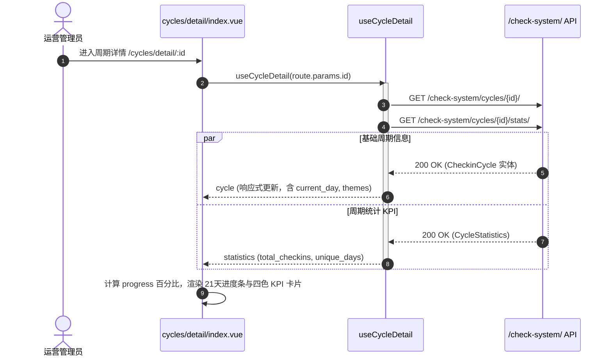

# 系统检测与打卡体系 (check-system)

## 1. 模块业务职责与核心能力

`check-system` 模块是 `lipeaks_admin` 系统中的**用户健康习惯养成与行为数据审计闭环中心**（依托 21 天打卡理论）。该模块构建了从平台预设行为标准、个性化任务模板分发、终端会员打卡流水监控，到 21 天周期达标分析的全流程体系。

核心业务能力涵盖：
- **打卡行为分类与表单形态多态化（Task Categories）**：
  - 定义打卡行为的记录形态（`form_type`），涵盖**文本感想（text）**、**睡眠监测（sleep）**、**运动卡路里消耗（exercise）**以及**饮食热量摄入（diet）**。
  - 支撑系统预设分类（`is_system: true`）与租户自定义分类。
- **全要素六国语言国际化支持（Multi-language i18n）**：
  - 针对分类与模板，内置六大语言支持（简体中文 `zh-hans`、英语 `en`、繁体中文 `zh-hant`、日语 `ja`、韩语 `ko`、法语 `fr`）。
  - 编辑器实时展示各语种翻译完成度百分比，以简体中文为必填基线。
- **任务模板与会员个性化任务（Templates & Tasks）**：
  - 管理可复用的打卡模板，预设提醒时间（`reminder`）与打卡频次（每日 `daily`、每周 `weekly`、自定义 `custom`）。
  - 监控会员实际领取的任务状态（进行中 `active`、已完成 `completed`、已暂停 `paused`、已取消 `cancelled`）。
- **打卡流水审计与补签监控（Check Records）**：
  - 全量归档打卡流水，记录打卡时间、经纬度、图片/数据载荷及延迟补卡标记（`delayed`）。
- **21天打卡周期量化看板（21-Day Cycles & Statistics）**：
  - 跟踪会员 21 天周期达成度，聚合总打卡次数、实际打卡天数（`unique_days`）、达成主题数（`themes_completed`）与完成率。

---

## 2. 源码结构与组件分工

### 2.1 视图文件树

```
src/views/check-system/
├── task-categories/            # 任务类型子系统
│   ├── list/index.vue          # 类型列表检索、系统内置过滤、颜色与图标展示
│   └── editor/index.vue        # 国际化多语言类型编辑器、表单类型选择
├── task-templates/             # 任务模板子系统
│   ├── list/index.vue          # 模板列表与分类级联检索
│   └── editor/index.vue        # 模板创建与多语种文案编辑器
├── tasks/                      # 会员任务跟踪
│   ├── list/index.vue          # 任务主表、状态/成员检索
│   └── detail/index.vue        # 任务执行进展看板
├── check-records/              # 打卡审计记录流水
│   └── list/index.vue          # 打卡记录日志检索、补卡核验、明细查看
└── cycles/                     # 21天打卡周期
    ├── list/index.vue          # 周期列表、活跃/结束状态筛选
    └── detail/index.vue        # 21天周期进度看板与主题完成度统计

src/composables/
└── useCheckSystem.ts           # 核心 Composables 状态驱动层（950+ 行高内聚逻辑）
```

### 2.2 子模块职责矩阵

| 子系统目录 | 核心职责 | 交互与渲染特性 |
|---|---|---|
| `task-categories/` | 打卡数据源头分类标准定义 | 支持预设系统锁、动态颜色选择器 (`el-color-picker`)、图标选择器，Tab 式多语言录入 |
| `task-templates/` | 业务标准化打卡任务预设 | 支持关联 Category、设定默认频次与提醒时间点、批量导出/发布 |
| `tasks/` | 追踪会员实例任务 | 呈现任务起止时间、频次规则、当前达标累计状态 |
| `check-records/` | 会员每一次打卡动作的审计底表 | 表格化展示结构化记录数据（睡眠起止、运动量等），标注是否补卡 |
| `cycles/` | 21天周期宏观达成看板 | 左侧展示 21 天刻度与主题标签，右侧 4 格 KPI 卡片展示打卡统计 |

---

## 3. 路由与前置守卫

### 3.1 动态路由拓扑

模块由后端接口动态返回，属于 `/check-system` 一级路由目录下的多级嵌套路由：

```ts
{
  path: "/check-system",
  name: "CheckSystem",
  component: Layout,
  meta: { title: "menus.pureCheckSystem", icon: "ri:task-line" },
  children: [
    {
      path: "/check-system/task-categories",
      name: "TaskCategories",
      component: () => import("@/views/check-system/task-categories/list/index.vue"),
      meta: { title: "checkSystem.taskCategories" }
    },
    {
      path: "/check-system/task-categories/create",
      name: "CreateTaskCategory",
      component: () => import("@/views/check-system/task-categories/editor/index.vue"),
      meta: { title: "checkSystem.createTaskCategory", showLink: false }
    },
    {
      path: "/check-system/task-templates",
      name: "TaskTemplates",
      component: () => import("@/views/check-system/task-templates/list/index.vue"),
      meta: { title: "checkSystem.taskTemplates" }
    },
    {
      path: "/check-system/tasks",
      name: "UserTasks",
      component: () => import("@/views/check-system/tasks/list/index.vue"),
      meta: { title: "checkSystem.tasks" }
    },
    {
      path: "/check-system/check-records",
      name: "CheckRecords",
      component: () => import("@/views/check-system/check-records/list/index.vue"),
      meta: { title: "checkSystem.checkRecords" }
    },
    {
      path: "/check-system/cycles",
      name: "CheckinCycles",
      component: () => import("@/views/check-system/cycles/list/index.vue"),
      meta: { title: "checkSystem.cycles" }
    },
    {
      path: "/check-system/cycles/detail/:id",
      name: "CycleDetail",
      component: () => import("@/views/check-system/cycles/detail/index.vue"),
      meta: { title: "checkSystem.cycleDetail", showLink: false }
    }
  ]
}
```

---

## 4. API 通信契约

接口层集中于 `src/api/modules/checkSystem.ts`，基础 URI 前缀为 `/check-system/`：

### 4.1 核心接口矩阵

| 业务域 | 方法名 | HTTP Method | 路径 (Endpoint) | 关键载荷 / 作用 |
|---|---|---|---|---|
| 类型 | `getTaskCategoryList` | `GET` | `/check-system/task-categories/` | `is_system`, `form_type`, `search`, `page`, `page_size` |
| 类型 | `createTaskCategory` | `POST` | `/check-system/task-categories/` | `TaskCategoryCreateParams` (含 `translations` 字典) |
| 类型 | `updateTaskCategory` | `PATCH` | `/check-system/task-categories/${id}/` | 增量更新分类属性与多语种 |
| 类型 | `deleteTaskCategory` | `DELETE` | `/check-system/task-categories/${id}/` | 删除分类（系统预设禁止删除） |
| 模板 | `getTaskTemplateList` | `GET` | `/check-system/task-templates/` | `category`, `is_system`, `search` |
| 模板 | `createTaskTemplate` | `POST` | `/check-system/task-templates/` | `TaskTemplateCreateParams` |
| 模板 | `updateTaskTemplate` | `PATCH` | `/check-system/task-templates/${id}/` | 增量修改模板 |
| 任务 | `getTaskList` | `GET` | `/check-system/tasks/` | 检索特定会员、状态、分类下的打卡任务 |
| 任务 | `getTaskDetail` | `GET` | `/check-system/tasks/${id}/` | 获取单个打卡任务详情 |
| 记录 | `getCheckRecordList` | `GET` | `/check-system/check-records/` | 查询打卡流水（支持 `task`, `member`, `check_date`, `delayed`） |
| 周期 | `getCycleList` | `GET` | `/check-system/cycles/` | 21天周期列表（`member`, `is_active`） |
| 周期 | `getCycleDetail` | `GET` | `/check-system/cycles/${id}/` | 单个周期元数据 |
| 周期 | `getCycleStatistics` | `GET` | `/check-system/cycles/${id}/stats/` | 计算打卡总数、天数与达标主题数 |

### 4.2 数据模型定义 (`src/types/checkSystem.ts`)

```ts
export type FormType = "text" | "sleep" | "exercise" | "diet";
export type TaskStatus = "active" | "completed" | "paused" | "cancelled";
export type FrequencyType = "daily" | "weekly" | "custom";

export interface TaskCategoryTranslation {
  name: string;
  description?: string;
  goal?: string;
  tip?: string;
}

export interface TaskCategoryTranslations {
  "zh-hans"?: TaskCategoryTranslation;
  en?: TaskCategoryTranslation;
  "zh-hant"?: TaskCategoryTranslation;
  ja?: TaskCategoryTranslation;
  ko?: TaskCategoryTranslation;
  fr?: TaskCategoryTranslation;
}

export interface CycleStatistics {
  total_checkins: number;         // 总打卡次数
  unique_days: number;            // 实际打卡天数
  themes_completed: number;       // 达成主题数
  selected_themes_count: number;  // 选定主题总数
}
```

---

## 5. 状态管理：Composable 架构解耦

不同于采用单例 Pinia Store 的传统视图，`check-system` 全面采用了基于 **Vue 3 组合式函数（Composables）**的现代解耦架构（`src/composables/useCheckSystem.ts`）。

### 5.1 Composable 模块划分

```ts
// 任务类型状态机
export function useTaskCategoryList(initialParams?: TaskCategoryListParams)
export function useTaskCategoryDetail(id?: number | Ref<number | undefined>)
export function useTaskCategoryMutations()

// 模板与任务状态机
export function useTaskTemplateList(...)
export function useTaskList(...)
export function useTaskDetail(...)

// 周期与统计分析
export function useCycleList(...)
export function useCycleDetail(id?: number | Ref<number | undefined>)
```

每个 Composable 封装了独立的 `loading`、`error`、`pagination`（响应式当前页、页大小、总条数、`hasNext`/`hasPrevious`）、数据拉取 `fetch...` 以及变更方法。这种设计保证了高内聚性，避免在 Store 中引入过度膨胀的缓存数据，且支持组件按需实例化独立上下文。

---

## 6. 关键业务流程与时序

### 6.1 21 天打卡周期与统计指标汇聚流转时序



---

## 7. 权限控制与操作校验

### 7.1 系统预设资产防护与操作鉴权

1. **系统预设资产锁（System Protection）**：
   - 任务类型与任务模板中的系统内置条目标记为 `is_system === true`。
   - 视图中针对系统条目禁用或隐藏“删除”按钮，编辑时禁止篡改系统内置核心标识，防止破坏基础行为规范。
2. **多语言校验规则**：
   - 编辑器内 `zh-hans`（简体中文）为必须填写的基准语言（校验规则 `required: lang.code === 'zh-hans'`），其他语种为可选拓展。
3. **补卡异常风控审计**：
   - 打卡记录列表中，对 `delayed === true` 的记录用橙色警告标签提示，辅助风控排查异常刷卡流水。
