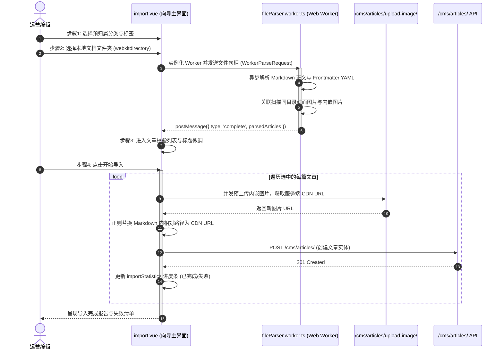

# 内容管理系统 (cms)

## 1. 模块业务职责与核心能力

`cms` 模块是 `lipeaks_admin` 系统的企业级知识库、官方公告与内容资讯发布中枢。该模块具备完备的内容采编发流程、树形分类体系、标签分组矩阵、反垃圾评论审核以及高阶的**多线程离线批量图文导入向导**与**版本历史比对回滚**能力。

核心能力涵盖：
- **文章（Article）全流程生命周期治理**：
  - 支持“草稿（draft） -> 待审核（pending） -> 正式发布（published） -> 历史归档（archived）”状态流转。
  - 属性标记：置顶（`is_pinned`）、精选推荐（`is_featured`）、锁定保护（`is_locked`，防并发修改）、访问可见性控制（公开 public、私密 private、密码保护 password）。
- **Web Worker 离线批量图文导入流水线**：
  - 基于浏览器的 `Worker` 线程（`fileParser.worker.ts`），直接读取用户上传的本地文件夹。
  - 自动解构 Markdown frontmatter 元信息，在后台静默建立图文映射；本地相对路径图片通过并发预处理通道先上传远端 OSS/服务端，自动将 Markdown 内链替换为 CDN URL 后入库创建文章。
- **树形多级分类与拖拽重排（Category Hierarchy）**：
  - 支持多层级无限树形分类管理，集成拖拽重排（Reorder）并持久化节点排序。
- **标签与标签分组体系（Tag & TagGroup）**：
  - 支持将分散的标签归入所属 TagGroup 进行业务聚合管理。
- **内容版本回溯（Article Versioning）**：
  - 记录每一次文章修订的完整内容快照与变更元数据，支持版本间差异比对（Diff）与一键版本回退。
- **多层级评论审核防线（Comment Moderation）**：
  - 支持评论与盖楼回复审核、一键批准（Approve）、违规驳回（Reject）、垃圾评论识别标记（Spam）与批量处理。

---

## 2. 源码结构与组件分工

### 2.1 视图与组件目录树

```
src/views/cms/
├── article/                    # 文章管理子系统
│   ├── index.vue               # 文章主控台（复合筛选、批量加解锁/归档/删除、列表卡片）
│   ├── create.vue              # 独立页面模式：新建文章
│   ├── edit.vue                # 独立页面模式：编辑文章
│   ├── detail.vue              # 文章详情与前台渲染阅读预览
│   ├── import.vue              # 基于 Web Worker 的 4 步离线批量导入向导
│   ├── export.vue              # 多格式文章导出工作台（txt, md, html, json）
│   └── version.vue             # 文章历史修订版本比对与回滚台
├── category/                   # 分类子系统
│   ├── index.vue               # 树形分类管理主页（拖拽排序、新增根节点）
│   ├── edit.vue                # 分类属性维护
│   └── detail.vue              # 分类挂载详情
├── tag/                        # 标签与标签组
│   ├── index.vue               # 标签列表与 TagGroup 分组管理
│   ├── create.vue              # 新建标签
│   └── edit.vue                # 编辑标签
└── comment/                    # 评论审核
    ├── index.vue               # 评论审核大厅（待审/已审/垃圾过滤、批量处理）
    ├── create.vue              # 运营代发评论
    ├── edit.vue                # 评论内容编辑
    └── detail.vue              # 评论盖楼上下文追溯

src/components/Cms/Article/
├── ArticleForm.vue             # 文章核心编辑器（Markdown/HTML、分类与标签多选）
└── ConfirmDialog.vue           # 删除/归档操作确认弹窗

src/workers/
└── fileParser.worker.ts        # 离线导入后台 Worker：Markdown Frontmatter 与图片解析
```

---

## 3. 路由与前置守卫

### 3.1 静态与动态混合路由架构

CMS 模块在路由设计上采用了“动态管理路由 + 静态特殊豁免路由”的双层注册模式：

1. **静态豁免路由 (`src/router/modules/remaining.ts`)**：
   - 预览与复杂工作流页面采用静态注册，无外层系统侧边栏包裹或独立全屏呈现：
   ```ts
   // 无侧边栏前台级阅读预览
   {
     path: "/preview/article/:id",
     name: "ArticlePreview",
     component: () => import("@/views/cms/article/detail.vue"),
     meta: { title: "cms.article.preview", showLink: false }
   },
   // 批量导入向导
   {
     path: "/cms/article/import",
     name: "ArticleImport",
     component: () => import("@/views/cms/article/import.vue"),
     meta: { title: "cms.article.import", showLink: false, activePath: "/cms/article" }
   },
   // 批量导出工作台
   {
     path: "/cms/article/export",
     name: "ArticleExport",
     component: () => import("@/views/cms/article/export.vue"),
     meta: { title: "cms.article.export", showLink: false, activePath: "/cms/article" }
   }
   ```
2. **动态管理路由**：
   - 包含 `/cms/article`、`/cms/category`、`/cms/tag`、`/cms/comment` 等标准后台页面，由后端动态下发并挂载。

---

## 4. API 通信契约

通信层文件集中在 `src/api/modules/cms.ts`，基于系统单例 `http` 发起强类型通信：

### 4.1 核心接口矩阵

| 业务分类 | 方法名 | HTTP Method | 路径 (Endpoint) | 说明与核心载荷 |
|---|---|---|---|---|
| 文章 | `getArticleList` | `GET` | `/cms/articles/` | 分页、关键词、状态、分类、标签、锁定状态过滤 |
| 文章 | `getArticleDetail` | `GET` | `/cms/articles/${id}/` | 读取文章详情（正文、元数据、分类、标签） |
| 文章 | `createArticle` | `POST` | `/cms/articles/` | 提交 `ArticleCreateParams` |
| 文章 | `updateArticle` | `PUT` | `/cms/articles/${id}/` | 完整覆盖更新 |
| 文章 | `patchArticle` | `PATCH` | `/cms/articles/${id}/` | 局部字段更新（如置顶、锁定状态变更） |
| 文章 | `deleteArticle` | `DELETE` | `/cms/articles/${id}/` | 单个物理/软删除 |
| 文章 | `batchDeleteArticles` | `POST` | `/cms/articles/batch-delete/` | `{ article_ids: number[], force: boolean }` |
| 文章 | `publishArticle` | `POST` | `/cms/articles/${id}/publish/` | 一键状态扭转至 `published` |
| 文章 | `unpublishArticle` | `POST` | `/cms/articles/${id}/unpublish/` | 撤回发布至 `draft` |
| 文章 | `archiveArticle` | `POST` | `/cms/articles/${id}/archive/` | 文章移入归档状态 |
| 版本 | `getArticleVersions` | `GET` | `/cms/articles/${id}/versions/` | 获取历史修订快照版本列表 |
| 版本 | `getArticleVersionDetail`| `GET`| `/cms/articles/${id}/versions/${ver}/` | 指定修订版正文快照 |
| 分类 | `getCategoryList` | `GET` | `/cms/categories/` | 获取全量分类（支持国际化语言头） |
| 分类 | `getCategoryTree` | `GET` | `/cms/categories/tree/` | 获取树形嵌套分类 |
| 分类 | `updateCategoryOrder`| `POST`| `/cms/categories/reorder/` | 批量更新拖拽排序层级与权重 |
| 标签 | `getTagList` | `GET` | `/cms/tags/` | 标签分页列表 |
| 标签组 | `getTagGroupList` | `GET` | `/cms/tag-groups/` | 标签组列表 |
| 评论 | `getCommentList` | `GET` | `/cms/comments/` | 评论分页列表 |
| 评论 | `approveComment` | `POST` | `/cms/comments/${id}/approve/` | 审核通过展示 |
| 评论 | `rejectComment` | `POST` | `/cms/comments/${id}/reject/` | 违规驳回并附带理由 |
| 评论 | `markCommentAsSpam`| `POST` | `/cms/comments/${id}/mark-spam/` | 标记垃圾外链评论 |
| 评论 | `batchComments` | `POST` | `/cms/comments/batch/` | 批量审核/删除 |

### 4.2 核心数据模型契约 (`src/types/cms.ts`)

```ts
export type ArticleStatus = "draft" | "pending" | "published" | "archived";
export type ContentType = "markdown" | "html" | "rich_text";
export type ArticleVisibility = "public" | "private" | "password";

export interface Article {
  id: number;
  title: string;
  slug: string;
  summary?: string;
  content: string;
  content_type: ContentType;
  status: ArticleStatus;
  visibility: ArticleVisibility;
  password?: string;
  is_featured: boolean;
  is_pinned: boolean;
  is_locked: boolean;
  view_count: number;
  like_count: number;
  comment_count: number;
  categories: Category[];
  tags: Tag[];
  created_at: string;
  published_at?: string;
}
```

---

## 5. 状态管理与数据模型

### 5.1 Pinia Store 架构 (`src/store/modules/cms.ts`)

`useCmsStore` 作为大型内容仓储中心，统一接管全量实体缓存及动作锁：

```ts
export const useCmsStore = defineStore("cms", {
  state: () => ({
    articles: { total: 0, page: 1, limit: 10, data: [] as Article[] },
    currentArticle: null as Article | null,
    categories: [] as Category[],
    categoryTree: [] as CategoryTreeItem[],
    tags: [] as Tag[],
    tagGroups: [] as TagGroup[],
    comments: { total: 0, page: 1, limit: 10, data: [] as Comment[] },
    loading: {
      articleList: false,
      articleDetail: false,
      categoryList: false,
      tagList: false,
      commentList: false
    }
  }),
  actions: {
    async fetchArticleList(params: ArticleListParams) { ... },
    async fetchCategoryTree() { ... },
    async createNewArticle(data: ArticleCreateParams) { ... },
    async batchDeleteArticlesAction(ids: number[], force?: boolean) { ... },
    async approveCommentAction(id: number) { ... }
  }
});
```

---

## 6. 关键业务流程与时序

### 6.1 Web Worker 离线批量 Markdown/图文导入向导时序

批量导入向导是系统的工程重器，它将耗时的文件读取、Frontmatter 拆解和图片相对路径重映射全部移入后台 Worker 线程，杜绝主 UI 线程卡顿：



---

## 7. 权限控制与安全互锁

### 7.1 并发锁定防篡改（Lock Protection）
- 当某篇文章处于编辑状态或管理人员主动执行“锁定文章”（`is_locked === true`）时，列表界面给出锁定标识。
- 非超管人员无法直接覆盖已被他人锁定的文章，必须先行沟通解锁，避免长文本被并发覆盖丢失。

### 7.2 批量危险操作二次防护
- 批量删除（`batchDeleteArticles`）集成 `useErrorHandling` 错误责任链与二次确认弹窗。
- 区分软删除与强制物理清除（`force: true`），物理清除必须输入管理员二次确认方可执行。
