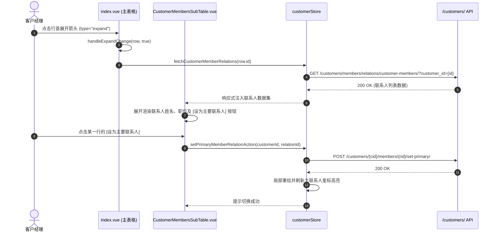

# 客户与客群管理 (customer)

## 1. 模块业务职责与核心能力

`customer` 模块是 `lipeaks_admin` 系统中面向**B端企业客户、商业实体与政企机构**的主数据全生命周期管理中枢。它在架构上横跨了用户中心（Member）、租户系统（Tenant）与交易体系（Order），承担着聚合客户商业全貌（360-Degree Profile）的枢纽职责。

核心能力包括：
- **企业客群画像与多维分级治理**：
  - **客户类型（CustomerType）**：涵盖企业客户（`enterprise`）、政府机构（`government`）、教育机构（`education`）、非营利组织（`nonprofit`）与个人客户（`individual`）。
  - **价值分级（CustomerValueLevel）**：实行白金（`platinum`）、黄金（`gold`）、白银（`silver`）、青铜（`bronze`）四级客户价值分层。
  - **生命周期状态（CustomerStatus）**：跟踪活跃（`active`）、暂停（`inactive`）、潜在意向（`prospect`）、流失已关闭（`churned`）。
- **主子表联动与主要联系人决议（Primary Contact）**：
  - 客户主列表采用行内展开（`type="expand"`）架构，点击展开时即时异步加载并内嵌渲染 `CustomerMembersSubTable`。
  - 支持多联系人挂载，并允许运营人员一键指定/切换“主要业务联系人（Primary Contact）”。
- **跨模块多标签综合档案看板（360° Customer View）**：
  - `detail.vue` 采用 `el-tabs` 组织“基本档案（basic）”、“关键联系人（contacts）”、“关联系统租户（tenants）”及跨模块引入的“历史消费订单流转（orders，调用 `CustomerOrderList.vue`）”。
- **批量数据吞吐通道**：原生支持批量新增（`bulkCreateCustomers`）、批量属性更新与批量清除（`bulkDeleteCustomers`）。

---

## 2. 源码结构与组件分工

### 2.1 视图与组件目录树

```
src/views/customer/
├── index.vue                       # 客户主列表（支持搜索、批量选择、主子表展开）
├── create.vue                      # 独立新建页面
├── edit.vue                        # 独立编辑页面
└── detail.vue                      # 客户 360 度多标签档案看板

src/components/CustomerManagement/
├── index.ts                        # 组件导出入口
├── CustomerStatusTag.vue           # 客户生命周期状态彩色标签
├── CustomerValueTag.vue            # 客户价值等级勋章式标签
├── CustomerForm.vue                # 客户基本资料编辑表单
├── CustomerMembersSubTable.vue     # 主表展开时就地渲染的联系人子表格组件
├── ContactPersonForm.vue           # 联系人与会员绑定编辑模态框表单
├── TenantLinkForm.vue              # 客户与系统租户实例关联表单
└── ConfirmDialog.vue               # 危险删除通用二次确认弹窗

src/components/OrderManagement/
└── CustomerOrderList.vue           # 跨模块组件：客户订单流转列表
```

### 2.2 核心子组件职责明细

| 组件名称 | 职责定位 | 核心逻辑与交互特性 |
|---|---|---|
| `CustomerMembersSubTable.vue` | 行内展开子表 | 接收 `customerId`，呈现关联会员的姓名、职位、联系电话，高亮“主要联系人”徽章，支持行内切换主要联系人 |
| `CustomerValueTag.vue` | 价值分级呈现 | 映射 `platinum`（紫色/高级）、`gold`（金色）、`silver`（灰色）、`bronze`（棕色）视觉标签 |
| `TenantLinkForm.vue` | 租户开通关联 | 为客户分配开通的 SaaS 租户实例，配置数据隔离作用域 |
| `CustomerOrderList.vue` | 商业订单追溯 | 读取该客户归属下的全量采购订单、支付状态与交易金额 |

---

## 3. 路由与前置守卫

### 3.1 动态路由拓扑

模块由后端接口动态返回并在 `initRouter` 中展开挂载：

```ts
{
  path: "/customer",
  name: "Customer",
  component: () => import("@/views/customer/index.vue"),
  meta: {
    title: "menus.pureCustomer",
    icon: "ri:user-shared-line",
    roles: ["admin", "super_admin"]
  },
  children: [
    {
      path: "/customer/detail/:id",
      name: "CustomerDetail",
      component: () => import("@/views/customer/detail.vue"),
      meta: { title: "customer.customerDetail", showLink: false, activePath: "/customer" }
    },
    {
      path: "/customer/create",
      name: "CustomerCreate",
      component: () => import("@/views/customer/create.vue"),
      meta: { title: "customer.createCustomer", showLink: false, activePath: "/customer" }
    },
    {
      path: "/customer/edit/:id",
      name: "CustomerEdit",
      component: () => import("@/views/customer/edit.vue"),
      meta: { title: "customer.editCustomer", showLink: false, activePath: "/customer" }
    }
  ]
}
```

---

## 4. API 通信契约

通信层文件集中于 `src/api/modules/customer.ts`，基于系统单例 `http` 发起请求：

### 4.1 核心接口矩阵

| 业务分类 | 方法名 | HTTP Method | 路径 (Endpoint) | 说明 / 核心参数 |
|---|---|---|---|---|
| 客户主数据 | `getCustomerList` | `GET` | `/customers/` | `CustomerListParams` (search, status, type, value_level, page, limit) |
| 客户主数据 | `getCustomerDetail` | `GET` | `/customers/${id}/` | 路径参数 `id: number` |
| 客户主数据 | `createCustomer` | `POST` | `/customers/` | 提交 `CustomerCreateUpdateParams` |
| 客户主数据 | `updateCustomer` | `PUT` | `/customers/${id}/` | 完整更新 |
| 客户主数据 | `deleteCustomer` | `DELETE` | `/customers/${id}/` | 单个客户软删除 |
| 客户主数据 | `searchCustomers` | `GET` | `/customers/search/` | 关键词全文检索 |
| 批量操作 | `bulkCreateCustomers` | `POST` | `/customers/bulk/create/` | 批量录入客户数据 |
| 批量操作 | `bulkUpdateCustomers` | `PUT` | `/customers/bulk/update/` | 批量修改客群状态 |
| 批量操作 | `bulkDeleteCustomers` | `DELETE` | `/customers/bulk/delete/` | `{ customer_ids: number[] }` 批量清除 |
| 联系人关系 | `getCustomerMemberRelations` | `GET` | `/customers/members/relations/customer-members/` | 查验客户关联的所有会员 |
| 联系人关系 | `createCustomerMemberRelation`| `POST`| `/customers/members/relations/` | 挂载新联系人 |
| 联系人关系 | `setPrimaryMemberRelation` | `POST`| `/customers/${cid}/members/${rid}/set-primary/`| 切换主要业务联系人 |
| 租户关联 | `getCustomerTenantRelations` | `GET` | `/customers/${cid}/tenants/` | 查询客户绑定的租户清单 |
| 租户关联 | `createCustomerTenantRelation`| `POST`| `/customers/${cid}/tenants/` | 绑定客户至指定租户 |

### 4.2 核心数据模型契约 (`src/types/customer.ts`)

```ts
export type CustomerStatus = "active" | "inactive" | "prospect" | "churned";
export type CustomerValueLevel = "platinum" | "gold" | "silver" | "bronze";
export type CustomerType = "enterprise" | "government" | "education" | "nonprofit" | "individual";

export interface Customer {
  id: number;
  name: string;
  code: string;
  status: CustomerStatus;
  type: CustomerType;
  value_level: CustomerValueLevel;
  industry?: string;
  phone?: string;
  email?: string;
  address?: string;
  website?: string;
  description?: string;
  created_at: string;
  updated_at: string;
}

export interface ContactPerson {
  id: number;
  customer: number;
  member: number;
  member_name: string;
  position?: string;
  is_primary: boolean;
  department?: string;
}
```

---

## 5. 状态管理与数据模型

### 5.1 Pinia Store 架构 (`src/store/modules/customer.ts`)

`useCustomerStore` 统筹管理客户大盘及关联子表状态：

```ts
export const useCustomerStore = defineStore("customer", {
  state: () => ({
    customerList: { total: 0, page: 1, limit: 10, total_pages: 1, data: [] as Customer[] },
    currentCustomer: null as Customer | null,
    customerContacts: [] as ContactPerson[],
    customerTenants: [] as CustomerTenantLink[],
    loading: {
      list: false,
      detail: false,
      create: false,
      update: false,
      delete: false,
      memberRelations: false,
      tenantRelations: false
    }
  }),
  actions: {
    async fetchCustomerList(params: CustomerListParams) { ... },
    async fetchCustomerDetail(id: number) { ... },
    async fetchCustomerMemberRelations(customerId: number) { ... },
    async fetchCustomerTenantRelations(customerId: number) { ... },
    async setPrimaryMemberRelationAction(customerId: number, relationId: number) { ... }
  }
});
```

---

## 6. 关键业务流程与时序

### 6.1 主表行展开与主要联系人动态变更时序

主列表通过行内异步折叠展开，支持就地进行联系人权属决策：



---

## 7. 权限控制与安全防护

### 7.1 权限码与管理角色双重保障
- 页面与按钮级权限统一绑定 `hasManagePermission`：
  ```ts
  const hasManagePermission = computed(
    () => userStore.is_super_admin || hasPerms("customer:manage")
  );
  ```
- 只有具备 `customer:manage` 或超级管理员身份的操作员，方可看到“新建客户”、“删除客户”、“批量清除”以及“切换主要联系人”等敏感变更入口。

### 7.2 误删与孤儿关联防护
- 删除客户时，前端通过 `ConfirmDialog` 实施带有客户全称插值的危险警告（`danger` 级别）。
- 关联有活跃租户或在途订单的客户在服务端配置有级联拦截外键保护，前端捕获错误后友好转译展示。
