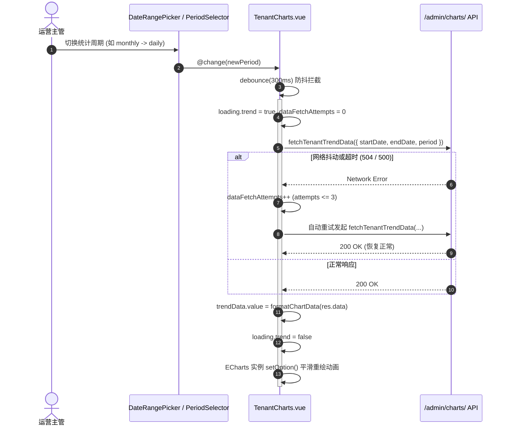

# 运营与系统仪表盘 (dashboard)

## 1. 模块业务职责与核心能力

`dashboard` 模块是 `lipeaks_admin` 系统的宏观运营态势感知与决策支持中心。作为管理员登录后首选常驻落地页之一，它通过图表可视化大盘，多维度呈现平台的核心商业指标（KPI）、租户增长动力学模型与用户活跃行为特征。

核心业务能力涵盖：
- **双维度视角分离治理（Tenant vs. User）**：
  - **租户态势大盘（Tenant Perspective）**：监测 SaaS 租户实例的总量规模、激活率、到期率、生命周期状态分布（活跃、暂停、试用、已停用）与日/周/月创建速率。
  - **用户活跃大盘（User Perspective）**：跟踪注册用户增长曲线、角色分布矩阵（超管、租户管理员、会员）、日活/月活（DAU/MAU）走势，以及 **24小时 × 7天用户登录行为热力图（Login Heatmap）**。
- **时间窗口与统计粒度多维切片**：
  - 支持自定义起止日期（`DateRangePicker`）与周期粒度（`PeriodSelector`：按日 `daily`、按周 `weekly`、按月 `monthly`、按年 `yearly`）动态切片。
- **高性能与高可用可视化渲染架构**：
  - **Tab 按需惰性渲染（Lazy Mounting）**：用户视角图表仅在切到 `activeTab === 'user'` 时才按需挂载，避免首屏巨量 Canvas/SVG 竞争主线程。
  - **防抖检索（Debounce）**：引入 `@pureadmin/utils` 的防抖工具，阻止连续点击日期产生网络风暴。
  - **容错自动重试机制（Auto-Retry Pipeline）**：内置 `MAX_RETRY_ATTEMPTS = 3`，在底层接口网络偶发抖动时自动重新发起重试拉取。

---

## 2. 源码结构与组件分工

### 2.1 视图与组件目录树

```
src/views/dashboard/
└── index.vue                       # 仪表盘顶层容器（双 Tab 切换容器）

src/components/Dashboard/
├── TenantCharts.vue                # 租户运营统计聚合容器
├── UserCharts.vue                  # 用户行为与增长统计聚合容器
├── DateRangePicker.vue             # 日期区间选择器
├── PeriodSelector.vue              # 统计周期切换器（日/周/月/年）
├── StatisticCard.vue               # 租户 KPI 汇总指标卡（带同环比趋势）
├── UserStatisticCard.vue           # 用户 KPI 指标卡
└── Charts/                         # 7 大 ECharts 响应式封装组件
    ├── TenantTrendChart.vue        # 1. 租户规模走势面积/折线图
    ├── TenantStatusChart.vue       # 2. 租户状态分布环形图
    ├── TenantCreationChart.vue     # 3. 租户创建速率柱状图
    ├── UserGrowthChart.vue         # 4. 用户注册与留存增长走势图
    ├── UserRoleChart.vue           # 5. 用户角色构成南丁格尔玫瑰图
    ├── ActiveUsersChart.vue        # 6. 日活/月活平滑曲线图
    └── LoginHeatmapChart.vue       # 7. 24h × 7d 登录高峰时段热力图
```

### 2.2 核心子组件职责明细

| 组件名称 | 图表形态 | 业务指标表达 |
|---|---|---|
| `TenantTrendChart.vue` | 渐变面积折线图 | 展现指定时间段内租户累计总量与净增量走势 |
| `TenantStatusChart.vue` | 环形嵌套饼图 | 展示活跃、试用、冻结、停用租户占比 |
| `TenantCreationChart.vue` | 分组柱状图 | 展现不同时间粒度下的租户新建速率峰值 |
| `UserGrowthChart.vue` | 多轴对比折线图 | 展现新增注册用户与累计用户对比 |
| `UserRoleChart.vue` | 南丁格尔玫瑰图 | 超级管理员、租户管理员与普通会员的角色体量对比 |
| `ActiveUsersChart.vue` | 区域折线图 | 展示 DAU/MAU 活跃波动 |
| `LoginHeatmapChart.vue` | 二维矩阵热力图 | 横轴 24 小时、纵轴星期一至星期日，精准捕捉登录高峰 |

---

## 3. 路由与前置守卫

### 3.1 路由配置

仪表盘为系统基础根路由之一，由动态路由下发或静态路由兜底重定向：

```ts
{
  path: "/dashboard",
  name: "Dashboard",
  component: () => import("@/views/dashboard/index.vue"),
  meta: {
    title: "menus.pureDashboard",
    icon: "ri:dashboard-line",
    roles: ["admin", "super_admin"],
    keepAlive: true
  }
}
```

---

## 4. API 通信契约

仪表盘跨模块调用了租户与用户两大核心 API 集（后端统一挂载于 `/admin/charts/` 路径下）：

### 4.1 租户统计通信 (`src/api/modules/tenant.ts`)

| 方法名 | HTTP Method | Endpoint | 载荷参数 | 响应契约 |
|---|---|---|---|---|
| `fetchTenantTrendData` | `GET` | `/admin/charts/tenant-trend/?period=${period}` | `period?: ChartPeriod`, `startDate?`, `endDate?` | `ApiResponse<TenantChartData>` |
| `fetchTenantStatusDistribution` | `GET` | `/admin/charts/tenant-status-distribution/` | 无 | `ApiResponse<TenantStatusData>` |
| `fetchTenantCreationRate` | `GET` | `/admin/charts/tenant-creation-rate/?period=${period}` | `period?: ChartPeriod`, `startDate?`, `endDate?` | `ApiResponse<TenantCreationData>` |

> **说明**：`calculateTenantSummary(trendData)` 是基于已有趋势图表数据进行总数、环比与增长率提炼的**前端计算辅助函数**（非后端 HTTP 接口），在数据拉取完成后同步就地执行。

### 4.2 用户统计通信 (`src/api/modules/user.ts`)

| 方法名 | HTTP Method | Endpoint | 载荷参数 | 响应契约 |
|---|---|---|---|---|
| `fetchUserGrowthTrend` | `GET` | `/admin/charts/user-growth-trend/?period=${period}` | `period?: ChartPeriod`, `startDate?`, `endDate?` | `ApiResponse<UserGrowthData>` |
| `fetchUserRoleDistribution` | `GET` | `/admin/charts/user-role-distribution/` | 无 | `ApiResponse<UserRoleData>` |
| `fetchActiveUsers` | `GET` | `/admin/charts/active-users/?period=${period}` | `period?: ChartPeriod`, `startDate?`, `endDate?` | `ApiResponse<ActiveUserData>` |
| `fetchLoginHeatmap` | `GET` | `/admin/charts/login-heatmap/` | `startDate?`, `endDate?` | `ApiResponse<LoginHeatmapData>` |

> **说明**：`calculateUserSummary(growthData, activeData)` 同样为**前端计算辅助函数**，从增长与活跃数据中推导用户核心指标，无需单独发起网络请求。

---

## 5. 状态管理与数据模型

### 5.1 组件内部响应式 State 设计

仪表盘强调组件局部自治与实时切片，状态维护于 `TenantCharts.vue` 与 `UserCharts.vue` 中：

```ts
const period = ref<ChartPeriod>("monthly");
const startDate = ref<string>("2025-03-13");
const endDate = ref<string>("2025-06-13");
const dataFetchAttempts = ref(0);
const MAX_RETRY_ATTEMPTS = 3;

const loading = reactive({
  trend: false,
  status: false,
  creation: false
});

const trendData = ref<TenantChartData | null>(null);
const statusData = ref<TenantStatusData | null>(null);
const creationRateData = ref<TenantCreationData | null>(null);
const summaryData = ref<TenantSummary | null>(null);
```

---

## 6. 关键业务流程与时序

### 6.1 防抖请求与故障自动重试时序



---

## 7. 权限控制与可观测性保障

### 7.1 角色级访问控制
- 仪表盘涉及全平台宏观经营指标，路由元信息严格限制 `roles: ["admin", "super_admin"]`。
- 普通租户管理员视角下，部分跨租户汇总数据由服务端自动施加租户隔离过滤（Scope Filtering）。

### 7.2 图表生命周期与内存防护
- 深度绑定 Vue 3 生命周期（`onBeforeUnmount`），在组件销毁或 Tab 切走时彻底调用 `chartInstance.dispose()`，杜绝 ECharts 内存泄漏与窗口 resize 事件监听挂起。
