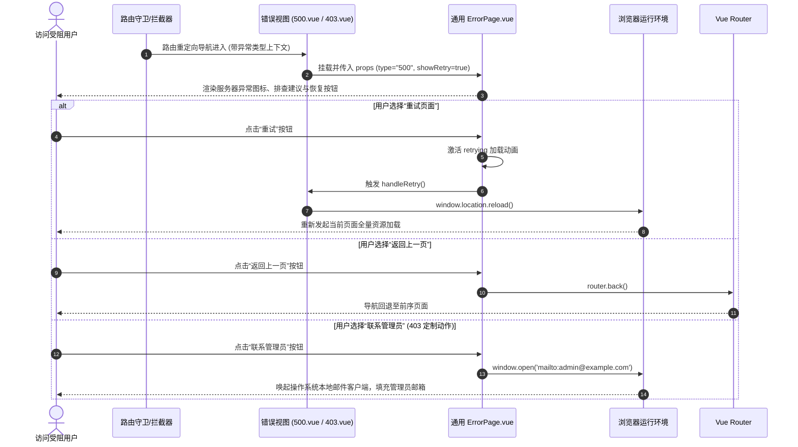

# 全局异常处理模块 (Global Error Handling Architecture)

## 1. 模块业务职责与核心能力

全局异常处理模块（Error Handling）构成了系统在面对路由失配、角色越权、网络中断、服务端崩溃以及组件级运行时渲染故障时的分层容灾恢复与友好交互指引体系。其核心业务能力涵盖：

1. **三维标准 HTTP/路由错误视图体系**：
   - **403 Forbidden (`403.vue`)**：鉴权受阻异常。当用户已成功登录，但试图通过直接输入 URL 或点击未授权的功能模块时，由全局路由守卫或接口响应拦截触发；定制提供“联系管理员”直接邮件唤起快捷方式（`mailto:admin@example.com`）；
   - **404 Not Found (`404.vue`)**：资源不存在异常。当用户访问任何未注册的 URL 路径，或在环境开启首页隐藏（`VITE_HIDE_HOME === "true"`）时试图强刷 `/welcome`，系统自动导流至 404 引导页；
   - **500 Internal Server Error (`500.vue`)**：服务端/系统级致命异常。当后台服务崩溃、网关 502/504 熔断或客户端未捕获严重异常时导流进入；提供带加载态的“重试”按钮触发 `window.location.reload()` 尝试热恢复，并展示技术支持错误码与发生时间戳。
2. **高度内聚的通用错误组件化架构 (`ErrorPage.vue`)**：
   - 提取各异常页面的共性布局与交互逻辑，通过 `type`（`403`, `404`, `500`, `network`, `custom`）动态驱动专属矢量图标、错误标题、详细说明、操作建议列表（`suggestions`）及操作按钮组（重试、返回上一页、返回首页、自定义扩展动作）；
   - 支持动态展示排查追踪信息：错误代码（`errorCode`）与发生时间戳（`timestamp`）。
3. **多层次错误防御生态 (`src/components/ErrorHandling/`)**：
   - **页面路由级**：`403.vue`, `404.vue`, `500.vue`；
   - **组件边界级 (`ErrorBoundary.vue`)**：基于 Vue 3 原生 `onErrorCaptured` 生命周期，捕获子组件渲染层未处理错误，避免单个业务图表或小部件报错导致整个页面大面积白屏崩溃，并提供局部重试与开发环境调用栈展开折叠面板；
   - **编程式通知级 (`index.ts`)**：提供轻量级函数式调用（`showErrorToast`, `showErrorModal`），动态在 Body 根节点挂载独立 Vue 弹窗/Toast 实例并自动注销。

---

## 2. 源码结构与组件分工

```
src/
├── views/error/
│   ├── 403.vue                         # 403 权限受限视图（组合 ErrorPage，配置联系管理员动作）
│   ├── 404.vue                         # 404 页面未找到视图（组合 ErrorPage）
│   └── 500.vue                         # 500 服务器错误视图（配置 reload 页面刷新重试与技术支持）
├── components/ErrorHandling/
│   ├── ErrorPage.vue                   # 核心通用全屏错误展示组件（支持建议列表、重试、返回首页/上一页）
│   ├── ErrorBoundary.vue               # 组件级错误边界捕获容器（onErrorCaptured 拦截局部白屏）
│   ├── ErrorModal.vue                  # 错误详情弹窗组件
│   ├── ErrorToast.vue                  # 错误 Toast 悬浮通知组件
│   ├── FieldError.vue                  # 表单字段级即时校验提示组件
│   ├── FormFieldWrapper.vue            # 表单字段高亮包裹器
│   └── index.ts                        # 编程式调用工厂函数（showErrorToast, showErrorModal 等）
├── router/
│   ├── modules/
│   │   ├── error.ts                    # 静态错误路由注册配置（定义 /error/403, /error/404, /error/500）
│   │   └── errorExample.ts             # 开发调试示例路由（仅在 DEV 环境生效）
│   └── index.ts                        # 全局路由守卫（roles 校验失败拦截推入 /error/403）
└── composables/
    └── useErrorHandling.ts             # 错误处理状态感知与处理 Composable
```

### 核心异常处理子组件职责分解

| 组件名称 | 视图定位 | 核心 Props / 事件 | 业务场景与容灾职责 |
|---|---|---|---|
| `ErrorPage.vue` | 全页级异常容器 | Props: `type`, `title`, `message`, `suggestions`, `showRetry`, `showBack`, `showHome`, `showContact`, `customActions`<br/>Emits: `retry`, `back`, `home` | 统揽 403/404/500 的全屏展示与通用导航动作（`router.back()`, `router.push("/")`） |
| `ErrorBoundary.vue`| 局部组件保护盾 | Props: `fallback: boolean`<br/>Slots: `default` (受保护组件) | 通过 `onErrorCaptured` 拦截子组件异常，展示“组件加载失败”微型卡片并支持局部点击重试，不中断主页面 |
| `ErrorModal.vue` | 阻塞式告警弹窗 | Props: `visible`, `title`, `message`, `errorDetails` | 在用户执行转账、批量删除或重要凭据保存失败时弹出模态窗，强制确认与查看报错堆栈 |

---

## 3. 路由与前置守卫

### 1) 静态路由配置事实 (`src/router/modules/error.ts`)

```ts
import { $t } from "@/plugins/i18n";

export default {
  path: "/error",
  redirect: "/error/403",
  meta: {
    icon: "ri/information-line",
    showLink: false,                     // 绝不在左侧导航菜单中暴露
    title: $t("menus.pureAbnormal"),
    rank: 9
  },
  children: [
    {
      path: "/error/403",
      name: "403",
      showLink: false,
      component: () => import("@/views/error/403.vue"),
      meta: {
        title: $t("menus.pureFourZeroThree")
      }
    },
    {
      path: "/error/404",
      name: "404",
      showLink: false,
      component: () => import("@/views/error/404.vue"),
      meta: {
        title: $t("menus.pureFourZeroFour")
      }
    },
    {
      path: "/error/500",
      name: "500",
      showLink: false,
      component: () => import("@/views/error/500.vue"),
      meta: {
        title: $t("menus.pureFiveZeroZero")
      }
    }
  ]
} satisfies RouteConfigsTable;
```

### 2) 全局守卫的主动拦截触发事实 (`src/router/index.ts`)

```ts
// 1. 角色不符导致的前端拦截推入 403
if (to.meta?.roles && !isOneOfArray(to.meta?.roles, userInfo?.roles)) {
  next({ path: "/error/403" });
}

// 2. 环境变量配置隐藏首页后，强刷 welcome 推入 404
if (VITE_HIDE_HOME === "true" && to.fullPath === "/welcome") {
  next({ path: "/error/404" });
}
```

---

## 4. API 通信契约与网络层责任链协同

异常处理模块不直接挂载独立的后台业务 CRUD 接口，而是作为全系统网络通信层（`PureHttp` / Axios 响应拦截器）发生异常时的最终交互承接方：

### HTTP 状态码到错误视图的映射责任链

```mermaid
flowchart LR
    HttpResp[网络请求响应 / 路由导航] --> RespCode{判断 HTTP 状态码}
    
    RespCode -- 401 Unauthorized --> TokenRefresh{尝试无感刷新 Token}
    TokenRefresh -- 刷新失败 --> KickLogin[清除凭据 -> 强制跳转 /login]
    
    RespCode -- 403 Forbidden --> Nav403[路由重定向: /error/403]
    RespCode -- 404 Not Found --> Nav404[路由重定向: /error/404]
    RespCode -- 500 / 502 / 503 --> Nav500[路由重定向: /error/500]
    RespCode -- 业务 Code != 200 --> ToastMsg[触发 showErrorToast(res.message)]
```

---

## 5. 状态管理与数据模型

### 组件 Props 模型 (`ErrorPageProps`)

```ts
export interface CustomAction {
  key: string;
  text: string;
  type?: "primary" | "success" | "warning" | "danger" | "info" | "default";
  handler: () => void | Promise<void>;
}

export interface ErrorPageProps {
  type?: "404" | "403" | "500" | "network" | "custom";
  title?: string;
  message?: string;
  extraInfo?: string;
  suggestions?: string[];
  showRetry?: boolean;
  showBack?: boolean;
  showHome?: boolean;
  showContact?: boolean;
  errorCode?: string;
  timestamp?: string;
  customActions?: CustomAction[];
  onRetry?: () => void | Promise<void>;
  onBack?: () => void;
  onHome?: () => void;
}
```

### 默认预设文案与操作建议字典

```ts
const defaultSuggestions = {
  '404': [
    '检查您输入的网址是否正确',
    '如果您是通过点击链接到达此页面，该链接可能已失效',
    '返回首页寻找您需要的内容'
  ],
  '403': [
    '确认您是否已使用正确的账号登录',
    '联系系统管理员申请相应权限',
    '返回上一页继续其他操作'
  ],
  '500': [
    '稍等几分钟后刷新页面重试',
    '检查网络连接是否正常',
    '如果问题持续存在，请联系技术支持'
  ]
};
```

---

## 6. 关键业务流程与时序

### 错误恢复与用户操作时序图



---

## 7. 权限控制与按钮级鉴权

### 异常页面的无门槛准入性保障

1. **绝对开放性**：错误页面（`403`, `404`, `500`）在路由元数据中**绝对不配置任何 `roles` 限制**，且不加入身份校验死循环，确保任何未认证、认证过期、角色不符或处于受限网络状态的用户均能稳定渲染出错误页面；
2. **菜单纯隐匿 (`showLink: false`)**：所有错误页面均严格配置 `showLink: false`，绝不在系统的侧边栏导航或快捷菜单中作为功能链接被主动点击；
3. **按钮无需权限码**：页面内的所有恢复性操作（返回首页、返回上一页、重新加载、唤起邮件）均采用无鉴权门槛的设计，确保在系统出现故障或用户权限受阻时，用户始终持有能够自愈或求助的逃生通道（Exit Channel）。
