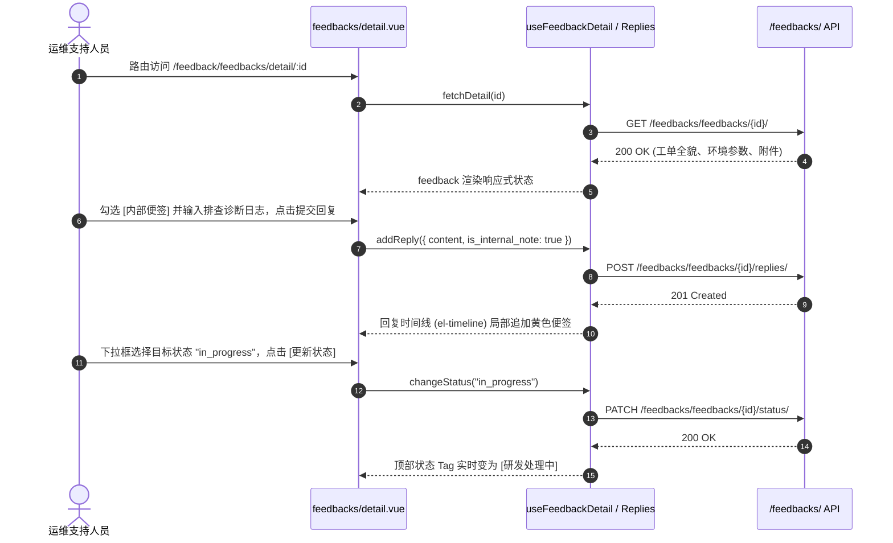

# 反馈与软件支持体系 (feedback)

## 1. 模块业务职责与核心能力

`feedback` 模块是 `lipeaks_admin` 系统中的**工单服务台、终端用户反馈闭环、邮件触达系统与底层中间件健康监控中心**。它不仅处理常规的使用反馈，更深度集成了软件产品版本交付流水与 Redis/Database 基础设施探活，是保障全系统稳定运行与客户满意的综合支撑生态。

核心业务能力涵盖：
- **工单（Feedback）多维度生命周期治理**：
  - **反馈类型（FeedbackType）**：缺陷报告（`bug`）、新功能诉求（`feature`）、体验改进（`improvement`）、业务咨询（`question`）、其他（`other`）。
  - **8 态工单流转状态机（FeedbackStatus）**：已提交（`submitted`） -> 审核中（`reviewing`） -> 已确认（`confirmed`） -> 研发处理中（`in_progress`） -> 已解决（`resolved`） -> 已关闭（`closed`）/ 驳回（`rejected`）/ 重复（`duplicate`）。
  - **优先级矩阵（FeedbackPriority）**：紧急阻断（`critical`）、高（`high`）、中（`medium`）、低（`low`）。
- **技术人员与用户盖楼互动（Replies & Notes）**：
  - 针对工单开展盖楼式回复，支持前台用户公开回复与**研发内部便签（`is_internal_note: true`）**，内部便签普通会员无权查看。
  - 用户需求点赞支持（`vote` / `cancelVote`），助力产品决策排序。
  - 环境元信息自动上报（浏览器、分辨率、OS）与多附件上传下载。
- **邮件通知与投递审计子系统（Email Service）**：
  - 动态邮件模板管理（占位符变量插值渲染）；
  - 邮件投递流水日志归档（发送中、成功、投递失败），支持通过 `getEmailLogList` 与 `getEmailLogDetail` 查询与审计追溯。
- **基础设施与中间件健康探活（System Health）**：
  - 全局健康状态监测（`healthy`, `degraded`, `unhealthy`）。
  - 实时透视 **Redis 内存占用（`used_memory_human`）、在线客户端连接数（`connected_clients`）与运行模式**；
  - 监测关系型数据库（Database）引擎连通性与查询延迟。
- **软件产品与发版流水线（Software Release）**：
  - 维护旗下关联的软件产品、功能分类与版本发布日志（Changelog），支撑软件版本的新增与维护（`addSoftwareVersion`）。

---

## 2. 源码结构与组件分工

### 2.1 视图与组件目录树

```
src/views/feedback/
├── feedbacks/                      # 工单主线
│   ├── index.vue                   # 工单大厅（复合筛选、卡片/表格切换、分页）
│   ├── detail.vue                  # 工单详情（盖楼回复、内部便签、附件、状态流转）
│   └── submit.vue                  # 提交新反馈（集成环境抓取与多附件上传）
├── dashboard/                      # 反馈监控仪表盘
│   └── index.vue                   # 工单处理时效、满意度、待办泳道大盘
├── statistics/                     # 统计分析
│   └── index.vue                   # 反馈类型与应用分布趋势 ECharts 图表
├── email/                          # 邮件子系统
│   ├── templates/index.vue         # 邮件动态模板设计与变量映射
│   └── logs/index.vue              # 邮件发送记录日志与失败补发
├── health/                         # 运维健康监控
│   └── index.vue                   # 全局健康度、Redis 与 Database 实时探活看板
├── notification/                   # 事件订阅
│   └── config/index.vue            # 工单状态变动通知通道配置
└── software/                       # 软件版本发布
    ├── products/index.vue          # 关联软件产品列表
    ├── categories/index.vue        # 软件行业/功能分类
    └── versions/index.vue          # 发版日志流转与正式发布动作

src/composables/
└── useFeedback.ts                  # 工单详情与回复响应式驱动 Composable
```

---

## 3. 路由与前置守卫

### 3.1 动态路由拓扑

模块由后端接口动态下发，统一挂载于 `/feedback` 主路径下：

```ts
{
  path: "/feedback",
  name: "Feedback",
  component: Layout,
  meta: { title: "menus.pureFeedback", icon: "ri:feedback-line" },
  children: [
    {
      path: "/feedback/feedbacks",
      name: "FeedbackList",
      component: () => import("@/views/feedback/feedbacks/index.vue"),
      meta: { title: "feedback.feedbacks" }
    },
    {
      path: "/feedback/feedbacks/detail/:id",
      name: "FeedbackDetail",
      component: () => import("@/views/feedback/feedbacks/detail.vue"),
      meta: { title: "feedback.detail.title", showLink: false }
    },
    {
      path: "/feedback/dashboard",
      name: "FeedbackDashboard",
      component: () => import("@/views/feedback/dashboard/index.vue"),
      meta: { title: "feedback.dashboard" }
    },
    {
      path: "/feedback/health",
      name: "FeedbackHealth",
      component: () => import("@/views/feedback/health/index.vue"),
      meta: { title: "feedback.systemHealth", roles: ["admin", "super_admin"] }
    },
    {
      path: "/feedback/email/templates",
      name: "EmailTemplates",
      component: () => import("@/views/feedback/email/templates/index.vue"),
      meta: { title: "feedback.emailTemplates" }
    },
    {
      path: "/feedback/email/logs",
      name: "EmailLogs",
      component: () => import("@/views/feedback/email/logs/index.vue"),
      meta: { title: "feedback.emailLogs" }
    }
  ]
}
```

---

## 4. API 通信契约

通信层接口统一定义于 `src/api/modules/feedback.ts`，基于系统单例 `http` 发起交互：

### 4.1 核心接口矩阵

| 业务分类 | 方法名 | HTTP Method | 路径 (Endpoint) | 说明 / 核心载荷 |
|---|---|---|---|---|
| 工单 | `getFeedbackList` | `GET` | `/feedbacks/feedbacks/` | 检索工单（`type`, `status`, `priority`, `application`） |
| 工单 | `getFeedbackDetail` | `GET` | `/feedbacks/feedbacks/${id}/` | 路径参数 `id`（含环境、附件与回复） |
| 工单 | `changeFeedbackStatus`| `PATCH`| `/feedbacks/feedbacks/${id}/status/` | `{ status: FeedbackStatus }` 状态扭转 |
| 工单 | `voteFeedback` | `POST` | `/feedbacks/feedbacks/${id}/vote/` | 投票点赞需求 |
| 回复 | `getFeedbackReplies`| `GET` | `/feedbacks/feedbacks/${id}/replies/` | 获取全部回复盖楼 |
| 回复 | `addFeedbackReply` | `POST`| `/feedbacks/feedbacks/${id}/replies/` | `{ content: string, is_internal_note: boolean }` 添加回复 |
| 邮件 | `getEmailTemplateList`| `GET` | `/feedbacks/email-templates/` | 查询邮件模板 |
| 邮件 | `getEmailLogList` / `getEmailLogDetail` | `GET` | `/feedbacks/email-logs/` (及 `${id}/`) | 邮件日志列表与详情回溯（当前后端未开放单独的 `resendEmail` 接口） |
| 健康 | `getSystemHealth` | `GET` | `/feedbacks/health/` | 检测整体系统与 DB 连通性 |
| 健康 | `getRedisStatus` | `GET` | `/feedbacks/health/redis/` | 获取 Redis 内存与连接数 |
| 版本 | `getSoftwareVersionList`| `GET`| `/feedbacks/software-versions/` | 获取版本流水 |
| 版本 | `addSoftwareVersion` | `POST`| `/feedbacks/software-versions/` | 添加并记录软件版本（带 software ID 与版本元信息） |

### 4.2 核心数据模型契约 (`src/types/feedback.ts`)

```ts
export type FeedbackType = "bug" | "feature" | "improvement" | "question" | "other";
export type FeedbackPriority = "critical" | "high" | "medium" | "low";
export type FeedbackStatus =
  | "submitted" | "reviewing" | "confirmed" | "in_progress"
  | "resolved" | "closed" | "rejected" | "duplicate";

export interface Feedback {
  id: number;
  title: string;
  description: string;
  feedback_type: FeedbackType;
  status: FeedbackStatus;
  priority: FeedbackPriority;
  application: number;
  environment_info?: Record<string, any>;
  attachments?: { id: number; file: string; file_name: string; file_size: number }[];
  votes_count: number;
  replies?: FeedbackReply[];
  created_at: string;
  resolved_at?: string;
}

export interface SystemHealthData {
  status: "healthy" | "degraded" | "unhealthy";
  components: {
    redis: { available: boolean; mode?: string; version?: string; used_memory_human?: string; connected_clients?: number; error?: string };
    database: { available: boolean; engine?: string; error?: string };
  };
}
```

---

## 5. 状态管理：Composable 驱动机制

在 `src/views/feedback/feedbacks/detail.vue` 中，系统采用解耦的 `useFeedbackDetail` 与 `useFeedbackReplies`（`src/composables/useFeedback.ts`）实施细粒度状态治理：

```ts
const {
  feedback,
  loading,
  error,
  fetchDetail,
  changeStatus,
  vote,
  cancelVote
} = useFeedbackDetail(feedbackId);

const { replies, addReply, fetchReplies } = useFeedbackReplies(feedbackId);
```
该模式使得工单详情拉取、投票状态乐观更新、内部技术便签过滤与状态流转操作高内聚于 Composable 内，保证复杂工单视图的清晰度与可复用性。

---

## 6. 关键业务流程与时序

### 6.1 工单处理、内部便签与状态扭转时序



---

## 7. 权限控制与风控审计

### 7.1 内部便签数据隔离
- 回复接口支持 `is_internal_note` 标记。服务端与前端渲染层根据当前登录者的 `is_admin / is_super_admin` 角色实施软隔离，保证内部敏感调试日志不对外泄露。

### 7.2 运维中间件健康探活权限封锁
- `feedback/health` 页面直通底层 Redis 与 Database 核心参数，路由元信息被限制为仅管理员可见（`roles: ["admin", "super_admin"]`）。
