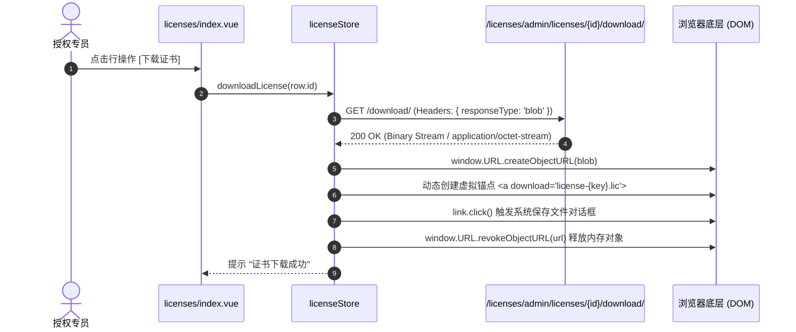

# 授权与证书许可管理 (license)

## 1. 模块业务职责与核心能力

`license` 模块是 `lipeaks_admin` 系统中面向商业化软件产品交付的**知识产权数字版权管理（DRM）与授权许可中枢**。该模块管理从商业计费方案定义、加密证书密钥签发、终端设备硬件指纹绑定、在线/离线激活流转，到合规安全审计日志的全链路业务。

核心业务能力涵盖：
- **商业许可方案（Plans）**：
  - **方案类型（PlanType）**：涵盖免费试用（`trial`）、周期性订阅（`subscription`）与永久买断（`perpetual`）。
  - 配置约束策略：最大并发终端设备数（`max_machines`）、授权有效天数（`validity_days`）与自定义功能特性掩码。
  - 支持方案一键克隆复制（`duplicatePlan`），提升运营配置效率。
- **证书实例与密钥治理（Licenses）**：
  - 核心属性：高强度加密密钥（`license_key`，列表页智能展示前后 8 位截断 `xxxx...xxxx`）、签发时间、生效时间、过期时间。
  - **5 态生命周期状态机（LicenseStatus）**：已生成未激活（`generated`） -> 已联网激活（`activated`） -> 欠费/违规挂起（`suspended`） -> 主动吊销废弃（`revoked`） -> 自然超期（`expired`）。
  - **单发与批量签发**：支持单张签发与多张批量密钥签发（`batchCreateLicenses`）。
  - **证书二进制导出**：支持调用服务端接口下载加密证书文件（`downloadLicense`，前端基于 Axios Blob 管道流式落盘保存）。
  - **受控延期与吊销**：延期强制执行正则正整数（`/^\d+$/`）天数核验；撤销强制弹窗录入合规撤销原因（`revokeReason`）。
- **机器指纹绑定与硬件防伪（Machine Bindings）**：
  - 收集终端机器指纹（CPU ID、MAC 地址、主板 UUID 等硬件哈希），建立设备与 License 的绑定关系。
  - 支持运营端主动执行“设备硬件封禁（`blockMachineBinding`）”，阻断黑产或超授权盗用。
- **联网激活与反激活会话控制（Activations）**：
  - 记录每次激活的 IP 地址、激活时间戳、心跳状态；
  - 支撑管理端远程强制将指定会话下线反激活（`deactivateActivation`），释放终端绑定配额。
- **安全审计留痕与报表大盘（Audit Logs & Dashboard）**：
  - 记录证书全生命周期所有敏感操作（变更前快照、变更后快照、操作人 IP）；
  - 授权激活走势与商业转化收入报表可视化呈现。

---

## 2. 源码结构与组件分工

### 2.1 视图与组件目录树

```
src/views/license/
├── plans/                          # 商业授权方案管理
│   ├── index.vue                   # 方案列表（支持复制方案、启停用）
│   ├── create.vue                  # 独立创建方案页面
│   ├── edit.vue                    # 编辑方案配置
│   └── detail.vue                  # 方案参数详情
├── licenses/                       # 许可证实例主控台
│   ├── index.vue                   # 许可证大盘（搜索、复制密钥、下载证书、延期、撤销、批量操作）
│   ├── create.vue                  # 签发许可证页面（单发/批量）
│   ├── edit.vue                    # 编辑许可参数
│   └── detail.vue                  # 许可证终端绑定详情看板
├── machines/                       # 硬件指纹设备绑定
│   ├── index.vue                   # 终端设备列表、硬件指纹识别与封锁操作
│   └── detail.vue                  # 机器特征详情
├── activations/                    # 联网激活会话
│   ├── index.vue                   # 激活流水记录、IP 查询、强制反激活下线
│   └── detail.vue                  # 激活单次上下文
├── audit-logs/                     # 合规安全审计
│   ├── index.vue                   # 审计日志列表（动作追踪）
│   └── detail.vue                  # 变更前后 Diff 追溯
└── dashboard/                      # 授权运营大盘
    └── index.vue                   # 激活趋势图与收入分析报表
```

---

## 3. 路由与前置守卫

### 3.1 动态路由拓扑

模块由后端接口动态返回，属于 `/license` 命名空间下的多级管理路由：

```ts
{
  path: "/license",
  name: "License",
  component: Layout,
  meta: { title: "menus.pureLicense", icon: "ri:shield-keyhole-line" },
  children: [
    {
      path: "/license/licenses",
      name: "LicenseList",
      component: () => import("@/views/license/licenses/index.vue"),
      meta: { title: "license.licenses.title" }
    },
    {
      path: "/license/plans",
      name: "LicensePlans",
      component: () => import("@/views/license/plans/index.vue"),
      meta: { title: "license.plans.title" }
    },
    {
      path: "/license/machines",
      name: "MachineBindings",
      component: () => import("@/views/license/machines/index.vue"),
      meta: { title: "license.machines.title" }
    },
    {
      path: "/license/activations",
      name: "LicenseActivations",
      component: () => import("@/views/license/activations/index.vue"),
      meta: { title: "license.activations.title" }
    },
    {
      path: "/license/audit-logs",
      name: "LicenseAuditLogs",
      component: () => import("@/views/license/audit-logs/index.vue"),
      meta: { title: "license.auditLogs.title" }
    },
    {
      path: "/license/dashboard",
      name: "LicenseDashboard",
      component: () => import("@/views/license/dashboard/index.vue"),
      meta: { title: "license.dashboard.title" }
    }
  ]
}
```

### 3.2 页面级硬性拦截

在 `licenses/index.vue` 脚本执行期，设置强权限守卫：
```ts
const checkPermission = () => hasPerms("license:view");

if (!checkPermission()) {
  ElMessage.error("无权限访问此页面");
  router.push("/dashboard");
}
```

---

## 4. API 通信契约

通信层文件位于 `src/api/modules/license.ts`，基于系统单例 `http` 发起交互：

### 4.1 核心接口矩阵

| 业务分类 | 方法名 | HTTP Method | 路径 (Endpoint) | 说明 / 核心载荷 |
|---|---|---|---|---|
| 方案 | `getPlanList` | `GET` | `/licenses/admin/plans/` | 获取方案分页列表 |
| 方案 | `createPlan` | `POST` | `/licenses/admin/plans/` | 提交 `PlanCreateParams` |
| 方案 | `duplicatePlan` | `POST` | `/licenses/admin/plans/${id}/duplicate/` | 一键克隆复制方案 |
| 许可证 | `getLicenseList` | `GET` | `/licenses/admin/licenses/` | 多维查询（按应用、方案、状态、签发时间排序） |
| 许可证 | `createLicense` | `POST` | `/licenses/admin/licenses/` | 签发单张证书 |
| 许可证 | `batchCreateLicenses`| `POST` | `/licenses/admin/licenses/batch/` | `{ quantity, plan_id, application_id }` 批量签发 |
| 许可证 | `downloadLicense` | `GET` | `/licenses/admin/licenses/${id}/download/` | `responseType: 'blob'`, 二进制证书流导出 |
| 许可证 | `revokeLicense` | `POST` | `/licenses/admin/licenses/${id}/revoke/` | `{ reason: string }` 撤销许可证 |
| 许可证 | `extendLicense` | `POST` | `/licenses/admin/licenses/${id}/extend/` | `{ days: number }` 延展有效天数 |
| 机器绑定 | `getMachineBindingList`| `GET`| `/licenses/admin/machine-bindings/` | 终端设备绑定记录 |
| 机器绑定 | `blockMachineBinding` | `POST`| `/licenses/admin/machine-bindings/${id}/block/` | 封锁作弊机器指纹 |
| 激活会话 | `getActivationList` | `GET` | `/licenses/admin/activations/` | 激活历史流水 |
| 激活会话 | `deactivateActivation`| `POST`| `/licenses/admin/activations/${id}/deactivate/`| 远程强制下线反激活 |
| 审计 | `getAuditLogList` | `GET` | `/licenses/admin/audit-logs/` | 证书全生命周期变更审计 |
| 报表 | `getActivationTrend` | `GET` | `/licenses/statistics/activation-trend/` | 激活走势 |
| 报表 | `getRevenueReport` | `GET` | `/licenses/statistics/revenue-report/` | 商业转化收入报表 |

### 4.2 核心数据模型契约 (`src/types/license.ts`)

```ts
export type LicenseStatus = "generated" | "activated" | "suspended" | "revoked" | "expired";
export type PlanType = "trial" | "subscription" | "perpetual";

export interface License {
  id: number;
  license_key: string;
  application: number;
  application_name: string;
  plan: number;
  plan_name: string;
  status: LicenseStatus;
  max_machines: number;
  current_machines_count: number;
  issued_at: string;
  expires_at?: string;
  revoked_at?: string;
  revoke_reason?: string;
  created_at: string;
}

export interface MachineBinding {
  id: number;
  license: number;
  machine_id: string;
  machine_name?: string;
  os_info?: string;
  is_blocked: boolean;
  first_seen: string;
  last_seen: string;
}
```

---

## 5. 状态管理与数据模型

### 5.1 Pinia Store 架构 (`src/store/modules/license.ts`)

`useLicenseStore` 接管证书、方案与设备绑定的大型状态树：

```ts
export const useLicenseStore = defineStore("license", {
  state: () => ({
    licenses: { total: 0, page: 1, limit: 10, data: [] as License[] },
    plans: [] as Plan[],
    machineBindings: [] as MachineBinding[],
    activations: [] as Activation[],
    auditLogs: [] as AuditLog[],
    loading: {
      licenseList: false,
      planList: false,
      machineList: false,
      revoke: false,
      extend: false,
      download: false
    }
  }),
  actions: {
    async fetchLicenseList(params: LicenseListParams) { ... },
    async revokeLicense(id: number, data: { reason: string }) { ... },
    async extendLicense(id: number, days: number) { ... },
    async downloadLicense(id: number) { ... }
  }
});
```

---

## 6. 关键业务流程与时序

### 6.1 许可证流式文件下载与客户端落盘时序

前端通过封装的 Axios 单例配置 `responseType: "blob"` 接收加密流，在内存中完成文件锚点触发下载：



---

## 7. 权限控制与风控审计

### 7.1 输入防护与风控约束
- **延期参数强校验**：使用 `inputPattern: /^\d+$/` 约束延期天数必须为正整数，并二次核验 `extendDays > 0`，防止输入负数或非法注入。
- **撤销原因必填**：撤销属于不可逆操作，系统弹窗要求输入明确的 `revokeReason`，该原因直接记录入防篡改审计日志中（`AuditLog`）。

### 7.2 机器指纹黑名单风控
- 在 `machines/index.vue` 中，若发现异常指纹批量拉起激活，管理员可一键触发 `blockMachineBinding`，服务端将把该硬件指纹列入全局黑名单，阻断后续任何证书的绑定尝试。
