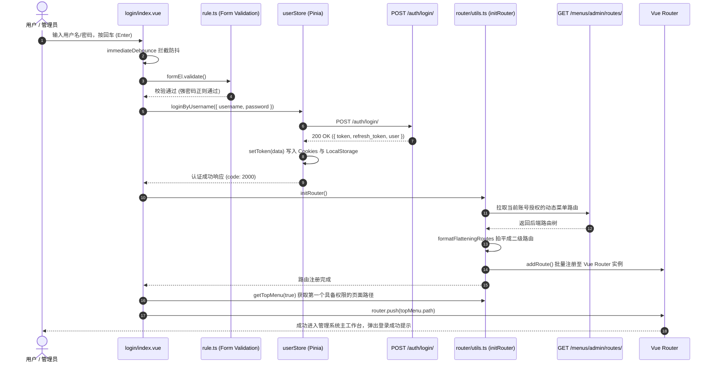

# 登录鉴权与重定向 (login)

## 1. 模块业务职责与核心能力

`login` 模块是 `lipeaks_admin` 系统的**安全身份认证总门户与首屏动态路由引导中枢**。该模块不仅承担用户账密凭证核验与 JWT 双令牌交换，更负责在认证就绪后触发后端动态菜单路由树的编译注入（`initRouter`），并将用户精准引导重定向至具有访问权限的首个工作台页面。

核心业务能力涵盖：
- **高安全级别凭证前端校验**：
  - 密码强规则校验集（`REGEXP_PWD`）：严格要求 8-18 位，且必须为数字、小写字母、大写字母、特殊符号组合，严禁纯单一字符集或汉字，在请求发起前阻断弱口令风险。
- **微交互与沉浸式入场体验**：
  - 基于 Vue 3 函数式动画组件（`Motion`）实现表单输入控件、登录按钮、多语言切换下拉与暗黑/明亮主题切换的级联入场动效。
  - 集成 `@vueuse/core` 的 `useEventListener` 全局监听键盘 `Enter` 与小键盘 `NumpadEnter` 回车提交。
  - 采用 1000ms 立即执行防抖（`immediateDebounce`），杜绝因疯狂敲击回车或点击按钮导致的并发登录重放攻击。
- **JWT 双令牌双通道持久化机制**：
  - 成功认证后，获取访问令牌（`token`）与静默续期令牌（`refresh_token`）。
  - 数据双层持久化：轻量凭证与标签会话标记存入 **Cookies**（`authorized-token`, `multiple-tabs`），用户详细实体与权限存入 **LocalStorage**（`user-info`）。
- **动态权限路由加载与智能首屏重定向**：
  - 登录成功瞬时调用 `initRouter()`，拉取 `/menus/admin/routes/` 动态拍平挂载至 Vue Router，随后通过 `getTopMenu(true).path` 计算首个有效路由实施 `router.push()` 重定向。

---

## 2. 源码结构与基础设施协同

### 2.1 目录结构树

```
src/views/login/
├── index.vue                   # 登录页核心 SFC（整合表单、主题切换、国际化、动效与键盘事件）
└── utils/
    ├── motion.ts               # 函数式动画组件（封装 Transition 与入场 Delay 级联）
    ├── rule.ts                 # 密码正则强校验与 Element Plus FormRules 校验集
    └── static.ts               # 背景矢量波浪 (Wave)、插画 (Illustration) 静态资源装载

src/router/
├── index.ts                    # 全局路由前置守卫 beforeEach、白名单机制与 403/404 拦截
├── utils.ts                    # 核心 initRouter() 引擎、路由拍平与 getTopMenu()
└── modules/remaining.ts        # 静态豁免路由定义（/login 注册）

src/store/modules/
└── user.ts                     # 用户鉴权 Pinia Store (useUserStore, pure-user)

src/utils/
└── auth.ts                     # Token 操作规范封装 (setToken, removeToken, userKey)
```

### 2.2 核心子文件分工明细

| 文件路径 | 职责定位 | 核心逻辑与特性 |
|---|---|---|
| `login/index.vue` | 认证主视图 | 挂载 `ruleForm`，双向绑定 `username`, `password`，编排登录时序与禁用态（`disabled`） |
| `login/utils/rule.ts` | 安全校验规则 | 导出 `REGEXP_PWD` 与 `loginRules`，执行国际化错误文案插值 |
| `login/utils/motion.ts` | 级联入场动画 | 接收 `delay: number`，通过自定义渲染函数输出带延迟过渡的动画容器 |
| `store/modules/user.ts` | 凭证与角色模型 | 维护登录、退出（`logOut`）、静默刷新（`handRefreshToken`）及用户信息更新 |

---

## 3. 路由注册与守卫拦截链

### 3.1 静态路由注册 (`src/router/modules/remaining.ts`)

登录页面作为无外层 Layout 边框的独立全屏视图，采用静态声明方式注册：

```ts
{
  path: "/login",
  name: "Login",
  component: () => import("@/views/login/index.vue"),
  meta: {
    title: $t("menus.pureLogin"),
    showLink: false,
    rank: 101
  }
}
```

### 3.2 路由守卫拦截链 (`src/router/index.ts`)

全局前置守卫 `router.beforeEach` 构建了严密的状态机拦截规则：

1. **白名单策略**：
   ```ts
   const whiteList = ["/login"];
   ```
2. **已登录态防重复登录保护（`toCorrectRoute`）**：
   - 若 Cookies 中存在会话标记且 LocalStorage 存在有效 `userInfo`：
     - 若目标路由在白名单（即访问 `/login`），强制调用 `next(_from.fullPath)` 拦截并留在当前页面，禁止重复进入登录页。
     - 若页面刷新且 `wholeMenus.length === 0`，自动调用 `initRouter()` 异步复原动态路由树。
3. **未登录态强制拦截重定向**：
   - 若未登录且目标路径不在 `whiteList` 中，立即执行 `removeToken()` 擦除可能残留的脏凭证，并调用 `next({ path: "/login" })` 强制重定向至登录页。

---

## 4. API 通信契约

登录模块直接调用基础鉴权接口 `src/api/user.ts`：

### 4.1 接口清单

| 方法名 | HTTP Method | 路径 (Endpoint) | 请求参数 (Request) | 响应契约 (Response) |
|---|---|---|---|---|
| `getLogin` | `POST` | `/auth/login/` | `{ username: string, password: string }` | `ApiResponse<LoginResponseData>` |
| `refreshTokenApi` | `POST` | `/auth/refresh/` | `{ refresh: string }` | `ApiResponse<RefreshTokenResponseData>` |

### 4.2 响应载荷实体契约

```ts
export interface LoginResponseData {
  token: string;          // 访问业务接口携带的 Access Token (Bearer)
  refresh_token: string;  // 用于 5 分钟静默换票的 Refresh Token
  user: {
    id: number;
    username: string;
    email: string;
    is_admin: boolean;
    is_super_admin: boolean;
    is_member: boolean;
    tenant: number;
    roles?: string[];
    avatar?: string;
  };
}
```

---

## 5. 状态管理与存储模型

### 5.1 Pinia Store 架构 (`src/store/modules/user.ts`)

`useUserStore`（`id: "pure-user"`）负责持久化与响应式状态映射：

```ts
export const useUserStore = defineStore("pure-user", {
  state: (): userType => ({
    id: storageLocal().getItem(userKey)?.id,
    avatar: storageLocal().getItem(userKey)?.avatar ?? "",
    username: storageLocal().getItem(userKey)?.username ?? "",
    is_admin: storageLocal().getItem(userKey)?.is_admin ?? false,
    is_super_admin: storageLocal().getItem(userKey)?.is_super_admin ?? false,
    is_member: storageLocal().getItem(userKey)?.is_member ?? false,
    roles: storageLocal().getItem(userKey)?.roles ?? [],
    permissions: storageLocal().getItem(userKey)?.permissions ?? ["*:*:*"]
  }),
  actions: {
    async loginByUsername(data: LoginParams) {
      return new Promise<UserResult>((resolve, reject) => {
        getLogin(data).then(res => {
          if (res.code === 2000 && res.data) {
            // 设置 Token 与 LocalStorage 存储
            setToken(res.data);
            resolve(res);
          }
        }).catch(error => reject(error));
      });
    },
    async logOut() {
      this.username = "";
      this.roles = [];
      this.permissions = [];
      removeToken();
      useMultiTagsStoreHook().handleTags("equal", [...routerArrays]);
      resetRouter();
      router.push("/login");
    }
  }
});
```

### 5.2 角色降级决议逻辑

在将用户信息同步进本地时，系统基于布尔标志动态推导最高角色权限代码：
```ts
const role = user.is_super_admin ? "super_admin" : user.is_admin ? "admin" : "member";
```

---

## 6. 关键业务流程与时序

### 6.1 登录认证、路由动态挂载与重定向时序



---

## 7. 权限控制与防护机制

### 7.1 前端防暴力重试（Immediate Debounce）
- 登录事件统一通过 `immediateDebounce` 封装，参数配置为 `1000ms, true`（即第一次立即执行，1秒内后续触发均被静默丢弃），有效化解手抖或连续按键造成的重复认证开销。

### 7.2 登出彻底销毁原则（Security Wipe）
- 当用户主动登出或 Token 彻底失效时，`logOut()` 执行多层重置：
  1. 清除 Cookies 中的 Access Token、Refresh Token、Expires 时间戳；
  2. 清除 LocalStorage 中的 `userInfo`；
  3. 调用 `useMultiTagsStoreHook().handleTags("equal", ...)` 清空历史打开的标签页缓存；
  4. 调用 `resetRouter()` 卸载全部动态路由，彻底防止前一个用户的菜单和受保护组件残留在内存中。
