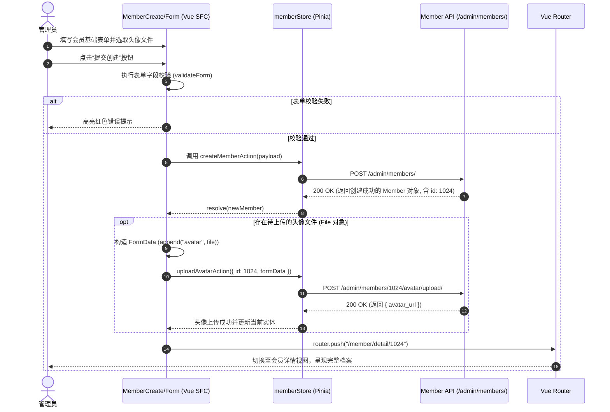
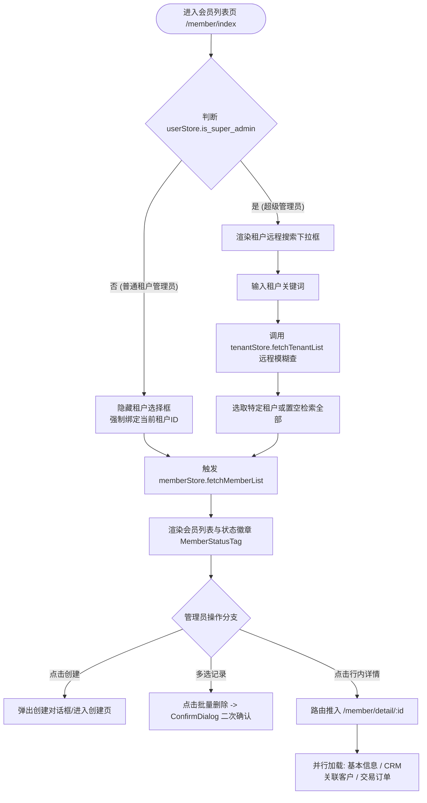

# 会员/用户中心模块 (Member Management)

## 1. 模块业务职责与核心能力

会员模块（Member）是系统管理面向多租户体系下会员档案、账号安全与客户关系的核心业务中心。其核心业务能力涵盖：

1. **多租户数据隔离与超管穿透**：
   - 普通租户管理员登录后受租户边界隔离，仅可检索与维护归属当前租户的会员档案；
   - 平台超级管理员（`is_super_admin`）具备全局穿透视界，支持通过远程动态模糊搜索（`remoteTenantSearch`）按租户筛选和穿透管理各租户会员。
2. **全生命周期账号管理**：
   - 涵盖会员基础档案（用户名、昵称、邮箱、手机号、微信号、状态、所属租户及备注）的录入、维护与停复机处理；
   - 状态三态管控：正常激活（`active`）、暂停封禁（`suspended`）、停用/注销（`inactive`）；
   - 支持单条与批量状态更新、单条与批量安全删除。
3. **CRM 客户关系映射 (MemberCustomerRelation)**：
   - 支持维护会员与企业客户档案之间的多对多或一对多服务关系；
   - 允许为会员挂载多个企业客户并指派业务角色（`role`）、设定主服务客户（`setPrimaryCustomerRelation`）及解除绑定。
4. **安全与凭证管理**：
   - 支持管理员对会员密码执行定向重置（调用局部更新接口 `partialUpdateMember` 注入新口令并验证确认密码）。
5. **多媒体资产与头像上传**：
   - 支持会员独立个性化头像上传，通过 `AvatarUpload` 组件将图片封装为 `multipart/form-data` 二进制流直接提交后台，并支持本地前端即时预览与文件大小/类型校验。
6. **业务域跨模块联动**：
   - 会员详情页内嵌 `MemberOrderList` 订单子列表，无缝拉取该会员在交易中心的履约订单与消费流水，形成用户-交易数据闭环。

---

## 2. 源码结构与组件分工

```
src/
├── views/member/
│   ├── index.vue                       # 会员主列表工作台（搜索条、操作栏、分页表格、内嵌弹窗）
│   ├── detail.vue                      # 会员综合详情页（基本信息卡片、CRM关系Tab、订单历史Tab）
│   ├── create.vue                      # 独立页面级会员创建视图（适合全屏沉浸式录入）
│   └── edit.vue                        # 独立页面级会员编辑视图（支持路由传参与数据回填）
├── components/MemberManagement/
│   ├── MemberForm.vue                  # 会员新增/编辑复用表单组件（内置表单校验规则与租户选择）
│   ├── MemberStatusTag.vue             # 语义化状态标签组件（active: success, suspended: warning, inactive: info）
│   ├── AvatarUpload.vue                # 头像上传与裁剪预览组件（封装 ElUpload 与二进制文件检查）
│   ├── CustomerRelationForm.vue        # 会员关联企业客户关系表单弹窗
│   ├── ConfirmDialog.vue               # 危险操作（删除、重置密码、状态切换）统一二次确认弹窗
│   └── index.ts                        # 组件库统一聚合导出入口
├── components/OrderManagement/
│   └── MemberOrderList.vue             # 跨模块复用：会员历史交易订单表格组件
├── store/modules/
│   ├── member.ts                       # Pinia 仓储（useMemberStore / useMemberStoreHook）
│   ├── tenant.ts                       # 多租户状态仓储（提供远程租户下拉列表支持）
│   └── user.ts                         # 当前登录用户信息（鉴别 is_super_admin 与权限集合）
├── api/modules/
│   └── member.ts                       # Axios/PureHttp 网络通信契约方法封装
└── types/
    └── member.ts                       # 领域实体与请求/响应 TypeScript 严格类型定义
```

### 核心子组件职责分解

| 组件名称 | 视图定位 | 关键 Props / Emits | 核心业务职责 |
|---|---|---|---|
| `MemberForm.vue` | 表单呈现与输入 | Props: `memberData`, `isEdit`, `loading`, `showTenantSelect`<br/>Emits: `submit`, `cancel` | 提供账号、邮箱、昵称、密码、租户与状态等字段的统一校验，内置 async-validator 规则 |
| `MemberStatusTag.vue` | 状态可视化 | Props: `status: MemberStatus`, `size` | 映射 `active`、`suspended`、`inactive` 三态至 Element Plus 预设的主题色徽章 |
| `AvatarUpload.vue` | 头像上传控制器 | Props: `currentAvatar`, `disabled`<br/>Emits: `file-change`, `upload-success` | 限制图片格式（JPG/PNG/WEBP）与最大文件尺寸（2MB），生成 Blob 本地预览并抛出 File 对象 |
| `CustomerRelationForm.vue` | 关联关系绑定 | Props: `visible`, `memberId`<br/>Emits: `success`, `update:visible` | 远程检索企业客户下拉列表，指定会员在客户企业中的业务角色与是否为主客户 |
| `MemberOrderList.vue` | 业务聚合子表 | Props: `memberId: number` | 独立请求订单域接口，展示该会员在平台历史订单的编号、服务类型、交付状态与付款总额 |

---

## 3. 路由与前置守卫

会员模块采用基于后端的**动态路由（Dynamic Routing）**机制加载。路由配置由后端接口 `/menus/admin/routes/` 下发，经由前端动态路由扫描器 `import.meta.glob("/src/views/**/*.{vue,tsx}")` 映射至物理 SFC 文件。

### 路由定义元数据规范

```ts
// 典型路由结构映射
export const memberRoutes: RouteConfigsTable = {
  path: "/member",
  name: "Member",
  component: Layout,
  redirect: "/member/index",
  meta: {
    title: "menus.memberManagement",
    icon: "ep:user",
    rank: 20
  },
  children: [
    {
      path: "/member/index",
      name: "MemberIndex",
      component: () => import("@/views/member/index.vue"),
      meta: {
        title: "menus.memberManagement",
        roles: ["admin", "super_admin"]
      }
    },
    {
      path: "/member/detail/:id",
      name: "MemberDetail",
      component: () => import("@/views/member/detail.vue"),
      meta: {
        title: "menus.memberDetail",
        showLink: false,
        hiddenTag: true,
        activePath: "/member/index"
      }
    },
    {
      path: "/member/create",
      name: "MemberCreate",
      component: () => import("@/views/member/create.vue"),
      meta: {
        title: "menus.createMember",
        showLink: false,
        activePath: "/member/index"
      }
    },
    {
      path: "/member/edit/:id",
      name: "MemberEdit",
      component: () => import("@/views/member/edit.vue"),
      meta: {
        title: "menus.editMember",
        showLink: false,
        hiddenTag: true,
        activePath: "/member/index"
      }
    }
  ]
};
```

### 页面级守卫与拦截逻辑
1. **列表页权限守卫**：用户必须具备 `member:manage` 权限码或属于 `is_super_admin`；
2. **多租户越权防护**：详情页与编辑页在 `onMounted` 钩子中解析路由参数 `:id`。当请求会员详情响应返回时，前端与后端双重比对会员的 `tenant_id` 与当前租户上下文。若非超级管理员且会员不归属当前租户，立即报错并重定向返回 `/member/index`。

---

## 4. API 通信契约 (`src/api/modules/member.ts`)

| 接口函数 | HTTP 方法 | 请求路径 | 请求入参说明 | 核心返回数据结构 |
|---|---|---|---|---|
| `getMemberList` | `GET` | `/admin/members/` | `MemberListParams`: `{ search?, status?, tenant_id?, page?, page_size?, sort_by?, sort_order? }` | `PaginationResponse<Member>`: `{ count, next, previous, results: Member[] }` |
| `getMemberDetail` | `GET` | `/admin/members/{id}/` | 路径参数 `id: number` | `ApiResponse<Member>` |
| `createMember` | `POST` | `/admin/members/` | `MemberCreateUpdateParams`: `{ username, nick_name, email, password, confirm_password, phone?, status?, tenant_id?, notes? }` | `ApiResponse<Member>` |
| `updateMember` | `PUT` | `/admin/members/{id}/` | 路径参数 `id`, 全量字段参数 | `ApiResponse<Member>` |
| `partialUpdateMember` | `PATCH` | `/admin/members/{id}/` | 路径参数 `id`, `Partial<MemberCreateUpdateParams>` | `ApiResponse<Member>` |
| `deleteMember` | `DELETE` | `/admin/members/{id}/` | 路径参数 `id: number` | `ApiResponse<null>` |
| `bulkUpdateMembers` | `PUT` | `/admin/members/bulk/update/` | `{ member_ids: number[], status?: MemberStatus, tenant_id?: number }` | `ApiResponse<MemberBulkOperationResponse>` |
| `bulkDeleteMembers` | `DELETE` | `/admin/members/bulk/delete/` | `{ member_ids: number[] }` | `ApiResponse<MemberBulkOperationResponse>` |
| `uploadMemberAvatar` | `POST` | `/admin/members/{id}/avatar/upload/` | `id: number`, `FormData`（包含二进制字段 `avatar`） | `ApiResponse<{ avatar_url: string }>` |
| `getMemberCustomerRelations` | `GET` | `/customers/members/relations/member-customers/` | `params: { member_id: number, page?, page_size? }` | `PaginationResponse<MemberCustomerRelation>` |
| `createMemberCustomerRelation` | `POST` | `/customers/members/relations/` | `{ member_id: number, customer_id: number, role: string, is_primary?: boolean, remarks?: string }` | `ApiResponse<MemberCustomerRelation>` |
| `deleteMemberCustomerRelation` | `DELETE` | `/customers/members/relations/{id}/` | 路径参数 `id: number` | `ApiResponse<null>` |
| `setPrimaryCustomerRelation` | `POST` | `/members/{id}/customers/{relId}/set-primary/` | 路径参数 `id: number, relId: number` | `ApiResponse<MemberCustomerRelation>` |

---

## 5. 状态管理与数据模型

### Pinia Store: `memberStore` (`src/store/modules/member.ts`)

```ts
interface MemberState {
  memberList: PaginationData<Member>;               // 分页会员列表集合
  currentMember: Member | null;                     // 正在查看或编辑的单体会员档案
  memberCustomerRelations: PaginationData<MemberCustomerRelation>; // 当前会员绑定的客户关系列表
  loading: {                                        // 细粒度操作加载态隔离
    list: boolean;
    detail: boolean;
    create: boolean;
    update: boolean;
    delete: boolean;
    bulkUpdate: boolean;
    bulkDelete: boolean;
    customerRelations: boolean;
    createCustomerRelation: boolean;
    updateCustomerRelation: boolean;
    deleteCustomerRelation: boolean;
    resetPassword: boolean;
    uploadAvatar: boolean;
  };
  error: string | null;                             // 异常回执提示
}
```

### 实体数据契约 (`src/types/member.ts`)

```ts
export type MemberStatus = "active" | "suspended" | "inactive";

export interface Member {
  id: number;
  username: string;
  nick_name: string;
  email: string;
  phone?: string;
  avatar?: string;
  wechat_id?: string;
  status: MemberStatus;
  tenant_id?: number;
  tenant_name?: string;
  parent?: number | null;
  is_sub_account?: boolean;
  created_at?: string;
  last_login?: string;
  notes?: string;
}

export interface MemberCustomerRelation {
  id: number;
  member: number;
  member_name: string;
  customer: number;
  customer_name: string;
  role: string;
  is_primary: boolean;
  remarks?: string;
  created_at: string;
}
```

### 组件内部响应式 State (以 `src/views/member/index.vue` 为例)

- `searchForm`: `reactive({ search: "", status: undefined, tenant_id: undefined })` 检索条件容器；
- `pagination`: `reactive({ page: 1, limit: 10, total: 0 })` 分页游标；
- `selectedRows`: `ref<Member[]>([])` 表格复选选中的会员记录数组；
- `createDialog`: `reactive({ visible: false, loading: false })` 快速新建弹窗控制器；
- `editDialog`: `reactive({ visible: false, loading: false, memberData: null })` 编辑弹窗控制器；
- `confirmDialog`: `reactive({ visible: false, title: "", content: "", type: "warning", loading: false, action: null })` 统一二次确认模型。

---

## 6. 关键业务流程与时序

### 会员创建与头像异步绑定时序图

在高级会员录入流程中，系统支持“先创建会员基础档案，再以新建会员的主键 ID 异步提交头像二进制流并挂载关联”的双阶段事务流程：



### 多租户穿透检索与数据流转流程图



---

## 7. 权限控制与按钮级鉴权

### 权限逻辑判定规范

在会员模块中，权限采用“**超级管理员特权 + 细粒度权限码交集**”双轨制校验：

```ts
// 核心权限计算属性 (src/views/member/index.vue)
const hasManagePermission = computed(
  () => userStore.is_super_admin || hasPerms("member:manage")
);

const isSuperAdmin = computed(() => userStore.is_super_admin);
```

### 按钮与交互级受控清单

| 操作要素 | 界面元素 | 鉴权控制代码实现 | 无权限时前端表现 |
|---|---|---|---|
| **新增会员** | “创建会员”主按钮 | `v-if="hasManagePermission"` | DOM 节点不渲染，隐藏入口 |
| **批量删除** | “批量删除”危险按钮 | `v-if="hasManagePermission"` 且 `:disabled="!selectedRows.length"` | DOM 节点不渲染，未勾选时禁用 |
| **跨租户穿透筛选** | 租户选择下拉框 | `v-if="isSuperAdmin"` | 仅超管可见，普通管理员不可见且请求自动附带本租户 ID |
| **行内编辑** | 操作列“编辑”按钮 | `v-if="hasManagePermission"` | 仅渲染“查看”按钮 |
| **行内删除** | 操作列“删除”按钮 | `v-if="hasManagePermission"` | 不显示删除按钮 |
| **密码重置** | 详情页“重置密码”功能 | `v-if="hasManagePermission"` | 不显示弹窗唤起触发器 |
| **客户关系绑定** | “添加关联客户”按钮 | `v-if="hasManagePermission"` | 客户关系列表仅供只读浏览 |
