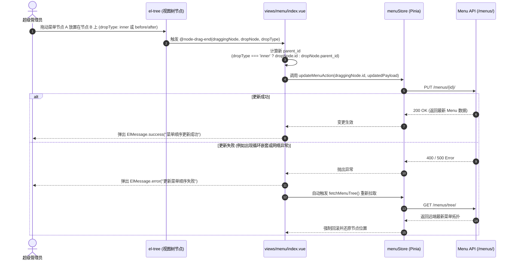

# 动态菜单配置模块 (Menu Management)

## 1. 模块业务职责与核心能力

菜单管理模块（Menu）是系统动态路由分发、导航拓扑组织与访问鉴权元数据的控制中枢。其核心业务能力涵盖：

1. **动态路由元数据全生命周期管理**：
   - 维护全系统菜单项的名称（`name`，唯一路由英文名）、编码标识（`code`）、路由访问路径（`path`）、前端组件物理路径（`component`，基于 `src/views/`）、重定向地址（`redirect`）、国际化多语言标题（`title`）、菜单图标（`icon`）及排序权重（`rank`）；
   - 支持配置路由元信息标记：侧边栏可见性（`show_link`）、父级展示标记（`show_parent`）、视图缓存开启（`keep_alive`）、外链嵌入地址（`frame_src`）、关联角色白名单（`roles`）及按钮权限码列表（`auths`）。
2. **表格与树形结构双模式工作台**：
   - **表格模式**：基于 `el-table` 的平面列表展现，结合分页器、多条件模糊搜索（菜单名称、启用状态、父级菜单）与批量复选操作；
   - **树形模式**：基于 `el-tree` 的层级拓扑直观展现，默认展开全部分支，清晰表达父子菜单从属关系。
3. **节点可视化拖拽重排 (Drag & Drop Reordering)**：
   - 支持在树形结构中自由拖拽菜单节点，在 `@node-drag-end` 监听中自动解析拖拽类型（`inner` 变为目标子菜单，或前后兄弟节点位置计算），动态调整 `parent_id` 并无缝持久化至服务端；若失败则安全回滚并拉取最新树状态。
4. **级联安全删除防御体系**：
   - 支持单节点删除与级联级联删除（`cascade: true`）；
   - 删除含有子孙节点的菜单时，通过级联确认弹窗（`cascadeDialog`）强制告警，防范子节点孤立漂移。
5. **菜单配置资产化导入导出 (JSON Configuration)**：
   - **一键导出**：调用 `/menus/export/` 导出全量菜单拓扑为结构化 JSON 文件下载，便于跨环境（开发/预发/生产）快速迁移；
   - **文件校验与导入**：通过 `FileReader` 在客户端对用户上传的 JSON 文件进行语法完整性前置校验，再通过 `FormData` 提交至 `/menus/import/` 执行动态合并与路由树重建。
6. **用户与角色授权指派**：
   - 提供向特定管理员查询已分配菜单（`getUserMenus`）与批量分配菜单权限（`assignUserMenus`）的能力契约。

---

## 2. 源码结构与组件分工

```
src/
├── views/menu/
│   └── index.vue                       # 统一动态菜单工作台（双模式切换、搜索、表格、树形、拖拽与弹窗聚合）
├── components/MenuManagement/
│   ├── MenuForm.vue                    # 菜单配置表单（路由、组件、角色权限绑定、图标选择联动）
│   ├── IconSelector.vue                # 图标选择弹窗组件（支持 Element Plus 与 Remix Icon 检索预览）
│   └── ConfirmDialog.vue               # 菜单危险删除/级联清除/批量操作二次确认弹窗
├── store/modules/
│   ├── menu.ts                         # Pinia 仓储（useMenuStore / useMenuStoreHook，管理列表、树、缓存）
│   └── user.ts                         # 用户仓储（获取超管标记与当前权限）
├── api/modules/
│   └── menu.ts                         # 菜单全量网络通信接口方法
└── types/
    └── menu.ts                         # Menu / MenuTree / MenuCreateUpdateParams 等数据结构契约
```

### 核心子组件职责分解

| 组件名称 | 视图定位 | 关键 Props / Emits | 核心业务职责 |
|---|---|---|---|
| `MenuForm.vue` | 核心编辑/新增表单 | Props: `menuData`, `isEdit`, `loading`, `menuTree`<br/>Emits: `submit`, `cancel` | 提供表单校验规则，实现菜单类型切换（目录/菜单/外链）、父级选择、图标联动与角色/按钮权限码多选标签录入 |
| `IconSelector.vue` | 图标拾取器 | Props: `modelValue`, `disabled`<br/>Emits: `update:modelValue` | 汇总系统已注册的图标库，提供按关键字快速检索、分类筛选与点击回填 |
| `ConfirmDialog.vue` | 危险确认弹窗 | Props: `visible`, `title`, `content`, `type`, `loading`<br/>Emits: `confirm`, `cancel` | 阻断危险误操作，以 Danger 语义确认菜单删除或级联清算 |

---

## 3. 路由与前置守卫

### 路由定义元数据规范

菜单模块作为系统核心基础设施，挂载于系统管理拓扑中：

```ts
export const menuRoutes: RouteConfigsTable = {
  path: "/menu",
  name: "Menu",
  component: Layout,
  redirect: "/menu/index",
  meta: {
    title: "menus.menuManagement",
    icon: "ep:menu",
    rank: 80,
    roles: ["super_admin"]
  },
  children: [
    {
      path: "/menu/index",
      name: "MenuIndex",
      component: () => import("@/views/menu/index.vue"),
      meta: {
        title: "menus.menuManagement",
        roles: ["super_admin"],
        auths: ["super_admin"]
      }
    }
  ]
};
```

### 页面级守卫与拦截逻辑
1. **超级管理员强限制**：`src/views/menu/index.vue` 内部依赖 `isSuperAdmin = computed(() => userStore.is_super_admin)`。如果非超级管理员试图通过修改 URL 越权访问，触发防线：
   ```ts
   if (!isSuperAdmin.value) {
     ElMessage.error(t("common.noPermission"));
     router.push("/dashboard");
   }
   ```
2. **全局路由守卫联动**：在 `src/router/index.ts` 中比对 `to.meta.roles`。无 `super_admin` 身份直接由全局拦截器重定向至 `/error/403`。

---

## 4. API 通信契约 (`src/api/modules/menu.ts`)

| 接口函数 | HTTP 方法 | 请求路径 | 请求入参说明 | 核心返回数据结构 |
|---|---|---|---|---|
| `getMenuList` | `GET` | `/menus/` | `MenuListParams`: `{ search?, is_active?, parent_id?, page?, page_size? }` | `PaginationResponse<Menu>` |
| `getMenuTree` | `GET` | `/menus/tree/` | `params: { is_active?: boolean }` | `ApiResponse<MenuTree[]>` (递归嵌套树) |
| `getMenuDetail` | `GET` | `/menus/{id}/` | 路径参数 `id: number` | `ApiResponse<Menu>` |
| `createMenu` | `POST` | `/menus/` | `MenuCreateUpdateParams` | `ApiResponse<Menu>` |
| `updateMenu` | `PUT` | `/menus/{id}/` | `id: number`, `MenuCreateUpdateParams` | `ApiResponse<Menu>` |
| `patchMenu` | `PATCH` | `/menus/{id}/` | `id: number`, `Partial<MenuCreateUpdateParams>` | `ApiResponse<Menu>` |
| `deleteMenu` | `DELETE` | `/menus/{id}/` | `id: number`, query: `{ cascade?: boolean }` | `ApiResponse<null>` |
| `toggleMenuStatus` | `PATCH` | `/menus/{id}/toggle_status/` | `id: number`, `{ is_active: boolean }` | `ApiResponse<Menu>` |
| `batchMenus` | `POST` | `/menus/batch/` | `{ create?: [], update?: [], delete?: number[] }` | `ApiResponse<{ created: number, updated: number, deleted: number }>` |
| `importMenus` | `POST` | `/menus/import/` | `FormData` (包含键名为 `file` 的 JSON 配置文件) | `ApiResponse<{ imported: number, created: number, updated: number }>` |
| `exportMenus` | `GET` | `/menus/export/` | 无 | `Blob` (application/json 文件流) |
| `getUserMenus` | `GET` | `/menus/admins/{userId}/menus/` | `userId: number` | `ApiResponse<{ user_id: number, username: string, menus: number[] }>` |
| `assignUserMenus` | `POST` | `/menus/admins/{userId}/menus/` | `userId: number`, `{ menu_ids: number[] }` | `ApiResponse<{ assigned_menus: number[] }>` |

---

## 5. 状态管理与数据模型

### Pinia Store: `menuStore` (`src/store/modules/menu.ts`)

```ts
interface MenuState {
  menuList: PaginationData<Menu>;       // 平面列表分页数据
  menuTree: MenuTree[];                 // 树形层级拓扑结构
  currentMenu: Menu | null;             // 正在编辑的菜单实体
  loading: {                            // 动作隔离 loading 态
    list: boolean;
    tree: boolean;
    detail: boolean;
    create: boolean;
    update: boolean;
    delete: boolean;
    toggleStatus: boolean;
    batch: boolean;
    import: boolean;
    export: boolean;
  };
  error: string | null;
}
```

### 实体数据契约 (`src/types/menu.ts`)

```ts
export interface Menu {
  id: number;
  name: string;                         // 路由标识英文名称（不可重复，用于 router name）
  code: string;                         // 权限校验标识编码
  path: string;                         // 浏览器 URL 路由路径
  component: string;                    // 视图 SFC 相对路径（如 member/index）
  redirect: string | null;              // 重定向目标路由
  title: string;                        // 显示文本或国际化 key（如 menus.memberManagement）
  icon: string | null;                  // 图标标识（如 ep:user）
  extra_icon: string | null;            // 辅助右侧图标
  rank: number;                         // 排序权重值（数字越小排序越前）
  show_link: boolean;                   // 是否在左侧侧边栏展示
  show_parent: boolean;                 // 是否在层级中显示父级目录
  roles: string[];                      // 角色准入集合（如 ["admin", "super_admin"]）
  auths: string[];                      // 页面内按钮鉴权码集合
  keep_alive: boolean;                  // 是否启用 Keep-Alive 组件缓存
  frame_src: string | null;             // 嵌入式 iframe 外部网址
  parent_id: number | null;             // 上级菜单主键 ID（根节点为 null 或 0）
  is_active: boolean;                   // 启用/禁用状态
  created_at?: string;
  updated_at?: string;
}

export interface MenuTree extends Menu {
  children: MenuTree[];                 // 递归下级子菜单
}
```

---

## 6. 关键业务流程与时序

### 树节点拖拽层级与顺序调整时序图



### JSON 菜单配置文件导入校验流程

```mermaid
flowchart TD
    Start([管理员点击'导入菜单']) --> OpenDialog[弹出导入对话框 importDialog]
    OpenDialog --> SelectFile[选取本地 .json 配置文件]
    
    SelectFile --> ClientCheck{客户端 FileReader 解析}
    ClientCheck -- JSON 格式解析失败 --> SyntaxError[提示'JSON 文件格式错误'并清空]
    ClientCheck -- JSON 解析合法 --> SubmitUpload[点击'开始导入']
    
    SubmitUpload --> PackFormData[打包为 FormData append('file', blob)]
    PackFormData --> ReqApi[POST /menus/import/]
    
    ReqApi --> ApiResp{服务端响应解析}
    ApiResp -- 成功导入 --> ShowStats[提示: 导入成功 (新增 X 项, 更新 Y 项)]
    ShowStats --> RefreshTree[自动执行 fetchMenuTree 刷新系统拓扑]
    RefreshTree --> CloseDialog[关闭对话框]
    
    ApiResp -- 失败 --> ShowFail[提示服务端报错信息并保持弹窗]
```

---

## 7. 权限控制与按钮级鉴权

### 权限模型设计

菜单管理属于底层最高管理特权模块，任何菜单配置不当都可能导致整个系统白屏或鉴权崩溃。因此，本模块实行**全流程超级管理员专有控制（Super Admin Exclusive）**：

### 按钮级鉴权受控清单

| 功能按钮 | 所在位置 | 鉴权控制机制 | 权限标识 | 业务影响 |
|---|---|---|---|---|
| **新增顶级菜单** | 顶部工具栏操作区 | 自定义指令鉴权 | `v-perms="['super_admin']"` | 物理移除无权者的创建按钮 |
| **导入配置** | 顶部工具栏操作区 | 自定义指令鉴权 | `v-perms="['super_admin']"` | 阻断配置文件注入入口 |
| **导出配置** | 顶部工具栏操作区 | 自定义指令鉴权 | `v-perms="['super_admin']"` | 保护系统内部路由架构元数据不外泄 |
| **批量删除** | 顶部工具栏操作区 | 自定义指令鉴权 + 多选联动 | `v-perms="['super_admin']"` | 仅超管在选定记录后方可点击 |
| **行内编辑** | 表格行内 / 树节点工具条 | 自定义指令鉴权 | `v-perms="['super_admin']"` | 保护菜单字段与路由映射不被篡改 |
| **行内删除** | 表格行内 / 树节点工具条 | 自定义指令鉴权 | `v-perms="['super_admin']"` | 防御非超管清理系统功能节点 |
| **状态启停** | 表格行内状态操作列 | 自定义指令鉴权 | `v-perms="['super_admin']"` | 控制模块即时向全网管理员开放/关闭 |
| **添加子菜单** | 树形节点操作区 | 自定义指令鉴权 | `v-perms="['super_admin']"` | 限制新增层级分支权限 |
