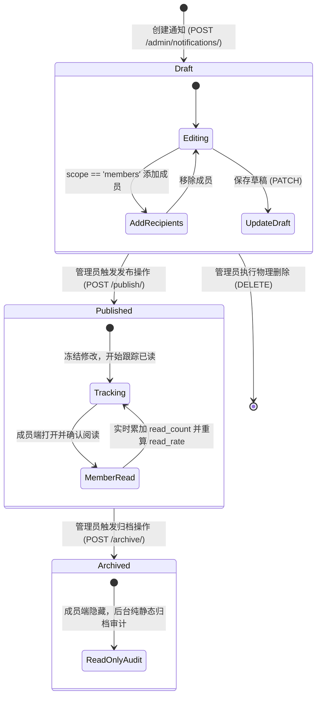
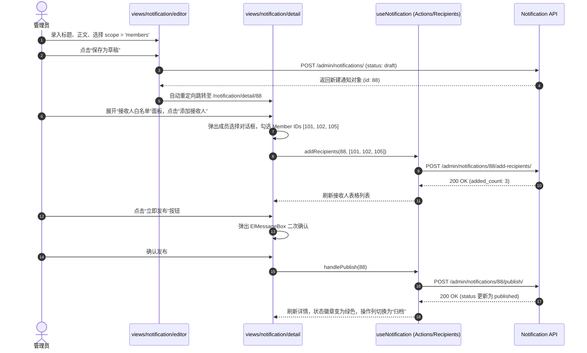

# 消息与系统通知模块 (Notification Management)

## 1. 模块业务职责与核心能力

消息与系统通知模块（Notification）构成了平台连接管理员、租户企业与个人会员的异步触达、公告发布与运营触角体系。其核心业务能力涵盖：

1. **三维触达范围策略 (Broadcast Scopes)**：
   - **租户广播 (`tenant`)**：向归属当前租户名下所有处于激活状态的会员（`Member`）自动全员分发；
   - **应用系统广播 (`application`)**：与特定应用系统（`application` ID）绑定，精准触达使用该子系统或授权该应用的租户成员；
   - **特定成员白名单 (`members`)**：允许管理员在草稿阶段定向挑选目标成员（`member_ids`），建立名单制专属通知白名单。
2. **三态生命周期状态机 (Lifecycle State Machine)**：
   - **草稿态 (`draft`)**：通知处于编辑起草期。允许自由修改标题、正文、优先级、通知类型，并可执行“增删接收者”、“发布”或“物理删除”；
   - **已发布态 (`published`)**：通知正式下发。正文与触达范围全面冻结防篡改，后端自动生成接收记录并启动阅读追踪（已读/未读状态），支持执行“归档”；
   - **已归档态 (`archived`)**：历史留存态。下线成员端弹窗与消息红点，只供管理后台回溯审计。
3. **多维分类与告警评级**：
   - **通知类型 (`notification_type`)**：信息（`info`）、警告（`warning`）、错误（`error`）、更新（`update`）、公告（`announcement`）；
   - **优先级 (`priority`)**：低（`low`）、普通（`normal`）、高（`high`）、紧急（`urgent`）；
   - **多通道联动**：集成可选的邮件同步推送开关（`send_email: boolean`）。
4. **实时转化追踪与阅读率指标分析**：
   - 详情面板内置统计卡片，实时获取目标受众数（`total_recipients`）、已读人数（`read_count`）、未读人数（`unread_count`）及阅读转化百分比（`read_rate`），并支持分页下钻查看每个成员的具体首次阅读时间（`read_at`）。

---

## 2. 源码结构与组件分工

```
src/
├── views/notification/
│   ├── list/
│   │   └── index.vue                   # 通知全量监控列表（多维度组合过滤器、状态机操作按钮列、分页）
│   ├── editor/
│   │   └── index.vue                   # 通知富文本/纯文本起草工作台（支持保存草稿与直接发布）
│   └── detail/
│       └── index.vue                   # 通知多维审计看板（左侧基础档案与正文，右侧实时阅读率仪表盘与名单）
├── composables/
│   ├── useNotification.ts             # 核心组合式函数：useNotificationList, useNotificationDetail, useNotificationActions, useNotificationRecipients
│   └── useApplication.ts              # 应用选择器组合式函数：useApplicationSelector（拉取应用下拉列表）
├── api/modules/
│   └── notification.ts                 # Axios/PureHttp 网络请求契约封装
└── types/
    └── notification.ts                 # 枚举常量、字典选项、入参与实体响应 TypeScript 契约
```

### 组合式函数 (Composables) 分工设计

该模块采用现代 Vue 3 Composables 架构，替代单体全局 Pinia Store，实现按视图生命周期动态挂载与自动垃圾回收：

| Composable 函数 | 职责边界 | 核心暴露状态与方法 |
|---|---|---|
| `useNotificationList` | 列表页分页与检索 | `notifications`, `loading`, `pagination`, `params`, `fetchNotifications`, `handlePageChange`, `resetParams` |
| `useNotificationDetail`| 单条通知数据拉取 | `notification`, `statistics`, `loading`, `statisticsLoading`, `fetchDetail`, `fetchStatistics` |
| `useNotificationActions`| 状态机流转操作 | `publishing`, `archiving`, `deleting`, `handlePublish`, `handleArchive`, `handleDelete` |
| `useNotificationRecipients`| 白名单成员维护 | `recipients`, `loading`, `total`, `fetchRecipients`, `addRecipients`, `removeRecipients` |
| `useApplicationSelector`| 应用系统联动 | `applications`, `loading`, `fetchApplications` |

---

## 3. 路由与前置守卫

### 路由定义元数据规范

```ts
export const notificationRoutes: RouteConfigsTable = {
  path: "/notification",
  name: "Notification",
  component: Layout,
  redirect: "/notification/list",
  meta: {
    title: "menus.notificationManagement",
    icon: "ep:bell",
    rank: 35
  },
  children: [
    {
      path: "/notification/list",
      name: "NotificationList",
      component: () => import("@/views/notification/list/index.vue"),
      meta: {
        title: "menus.notificationList",
        roles: ["admin", "super_admin"]
      }
    },
    {
      path: "/notification/create",
      name: "NotificationCreate",
      component: () => import("@/views/notification/editor/index.vue"),
      meta: {
        title: "menus.createNotification",
        showLink: false,
        activePath: "/notification/list"
      }
    },
    {
      path: "/notification/edit/:id",
      name: "NotificationEdit",
      component: () => import("@/views/notification/editor/index.vue"),
      meta: {
        title: "menus.editNotification",
        showLink: false,
        hiddenTag: true,
        activePath: "/notification/list"
      }
    },
    {
      path: "/notification/detail/:id",
      name: "NotificationDetail",
      component: () => import("@/views/notification/detail/index.vue"),
      meta: {
        title: "menus.notificationDetail",
        showLink: false,
        hiddenTag: true,
        activePath: "/notification/list"
      }
    }
  ]
};
```

### 页面级防御性逻辑
- **草稿防篡改保护**：在 `editor/index.vue` 的 `onMounted` 阶段拉取已存在通知时，校验其 `status`。若 `status !== 'draft'`，直接阻断编辑并提示“已发布或已归档通知不可编辑”，立即回退重定向到 `/notification/detail/:id`；
- **成员白名单发布保护**：在起草页执行“直接发布”时，若 `scope === 'members'`，前端校验拦截并阻止提交，强制提示“特定成员通知必须先保存草稿并添加接收者名单后方可发布”。

---

## 4. API 通信契约 (`src/api/modules/notification.ts`)

| 接口函数 | HTTP 方法 | 请求路径 | 请求入参说明 | 核心返回数据结构 |
|---|---|---|---|---|
| `getNotificationList` | `GET` | `/admin/notifications/` | `NotificationListParams`: `{ application?, scope?, status?, type?, priority?, page?, page_size? }` | `NotificationListResponse`: `{ results: Notification[], pagination: PaginationMeta }` |
| `createNotification` | `POST` | `/admin/notifications/` | `NotificationCreateParams`: `{ title, content?, scope, application?, notification_type, priority, send_email? }` | `NotificationResponse`: `ApiResponse<Notification>` |
| `getNotificationDetail` | `GET` | `/admin/notifications/{id}/` | 路径参数 `id: number` | `NotificationResponse` |
| `updateNotification` | `PATCH` | `/admin/notifications/{id}/` | `id: number`, `NotificationUpdateParams` | `NotificationResponse` |
| `deleteNotification` | `DELETE` | `/admin/notifications/{id}/` | 路径参数 `id: number` | `ApiResponse<null>` |
| `publishNotification` | `POST` | `/admin/notifications/{id}/publish/` | 路径参数 `id: number` | `NotificationResponse` |
| `archiveNotification` | `POST` | `/admin/notifications/{id}/archive/` | 路径参数 `id: number` | `NotificationResponse` |
| `getNotificationRecipients`| `GET` | `/admin/notifications/{id}/recipients/` | `id: number`, `{ page?, page_size?, is_read? }` | `NotificationRecipientListResponse`: `{ results: NotificationRecipient[] }` |
| `addNotificationRecipients`| `POST` | `/admin/notifications/{id}/add-recipients/` | `id: number`, `{ member_ids: number[] }` | `NotificationRecipientsActionResponse`: `{ added_count: number }` |
| `removeNotificationRecipients`| `POST` | `/admin/notifications/{id}/remove-recipients/` | `id: number`, `{ member_ids: number[] }` | `NotificationRecipientsActionResponse`: `{ removed_count: number }` |
| `getNotificationStatistics`| `GET` | `/admin/notifications/{id}/statistics/` | 路径参数 `id: number` | `NotificationStatisticsResponse`: `{ data: NotificationStatistics }` |

---

## 5. 状态管理与数据模型

### 领域实体契约 (`src/types/notification.ts`)

```ts
export type NotificationScope = "tenant" | "application" | "members";
export type NotificationType = "info" | "warning" | "error" | "update" | "announcement";
export type NotificationPriority = "low" | "normal" | "high" | "urgent";
export type NotificationStatus = "draft" | "published" | "archived";

export interface Notification {
  id: number;
  title: string;
  content?: string;
  scope: NotificationScope;
  scope_display: string;
  application: number | null;
  application_name: string | null;
  notification_type: NotificationType;
  type_display: string;
  priority: NotificationPriority;
  priority_display: string;
  status: NotificationStatus;
  status_display: string;
  send_email: boolean;
  recipient_count: number;
  read_count: number;
  created_by?: number;
  created_by_name?: string;
  created_at: string;
  published_at: string | null;
}

export interface NotificationRecipient {
  id: number;
  member_id: number;
  member_name: string;
  member_email: string;
  is_read: boolean;
  read_at: string | null;
  created_at: string;
}

export interface NotificationStatistics {
  notification_id: number;
  total_recipients: number;
  read_count: number;
  unread_count: number;
  read_rate: number;                   // 百分比数值 (0 - 100)
}
```

### 字典常量映射模型

- `NOTIFICATION_SCOPE_OPTIONS`: `[{ value: "tenant", label: "租户广播" }, { value: "application", label: "应用关联" }, { value: "members", label: "特定成员" }]`
- `NOTIFICATION_TYPE_OPTIONS`: `[{ value: "info", label: "信息" }, { value: "warning", label: "警告" }, ...]`
- `NOTIFICATION_PRIORITY_OPTIONS`: `[{ value: "low", label: "低" }, { value: "normal", label: "普通" }, { value: "high", label: "高" }, { value: "urgent", label: "紧急" }]`
- `NOTIFICATION_STATUS_OPTIONS`: `[{ value: "draft", label: "草稿" }, { value: "published", label: "已发布" }, { value: "archived", label: "已归档" }]`

---

## 6. 关键业务流程与时序

### 通知全生命周期流转状态机



### 成员白名单通知创建发布时序图



---

## 7. 权限控制与按钮级鉴权

### 动态状态控制与按钮互斥守卫

通知模块采用**严格的生命周期状态感知拦截**机制：

| 操作项 | 按钮呈现位置 | 状态守卫逻辑 | 行为与安全约束 |
|---|---|---|---|
| **编辑** | 列表页操作列 / 详情页顶栏 | `v-if="row.status === 'draft'"` | 仅草稿允许修改；发布与归档态绝对只读 |
| **发布** | 列表页操作列 / 详情页顶栏 | `v-if="row.status === 'draft'"` | 触发后状态不可逆变为 `published` |
| **归档** | 列表页操作列 / 详情页顶栏 | `v-if="row.status === 'published'"` | 仅已生效通知允许转入历史归档 |
| **删除** | 列表页操作列 | `v-if="row.status === 'draft'"` | 仅草稿可物理删除，已发布通知需走归档流程以备审计 |
| **添加/删除白名单接收人** | 详情页接收人面板 | `v-if="notification.status === 'draft'"` | 发布后接收者名单锁死，禁止任何增删改 |
