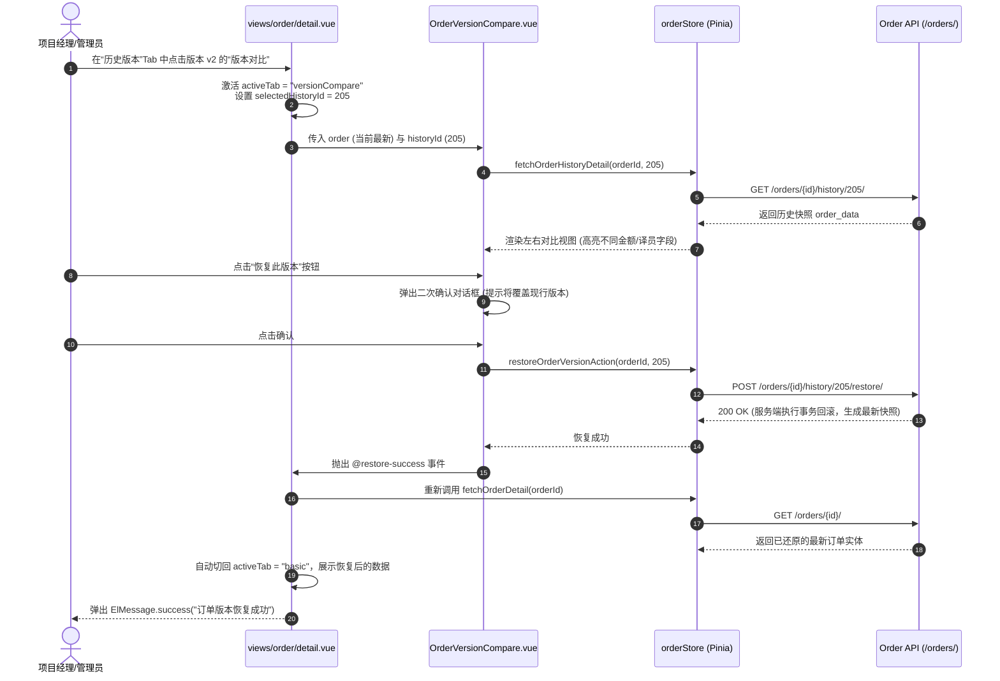
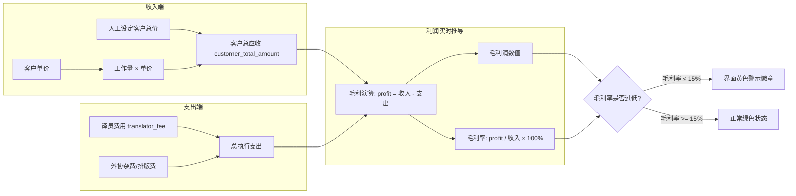

# 订单与交易流转模块 (Order Management)

## 1. 模块业务职责与核心能力

订单与交易流转模块（Order）是平台支撑高端多语言翻译、本地化工程与外包译员结算的商业中枢与履约交付体系。其核心业务能力涵盖：

1. **复杂语言服务业务建模**：
   - 维护从订单立项到最终归档的完整交付要素：订单自动编号（如 `PQ-202507-1234`）、关联客户与联系人、服务类型（文档翻译、口译服务、校对服务、本地化服务、其他）、源语言/目标语种对（`language`）、工作量计数（字数、页数、工时）、交付截止时间与线下/线上服务地点。
2. **双边财务核算与动态毛利推导**：
   - **客户收入侧**：客户单价、客户总额（`customer_total_amount`）、支付状态（`paid`/`unpaid`/`partial`/`refunded`/`cancelled`）、支付方式及开票状态（`issued`/`pending`/`not_required`）；
   - **外包译员支出侧**：外聘译员姓名、译员费用（`translator_fee`）、译员结算状态（`paid`/`unpaid`/`partial`）；
   - **自动化毛利演算**：前端录入或后台计算时自动求导毛利润（`profit = customer_total_amount - translator_fee - project_cost`）与毛利率（`profit_rate = (profit / customer_total_amount) * 100%`），提供实时财务预警。
3. **版本快照控制与差量变更审计 (Audit Trail & Version Control)**：
   - 每次订单修改均由后端保存一份完整的历史版本快照（`OrderHistory`）；
   - 前端详情页提供版本时间线、单字段级变更日志（`OrderChangeLog`），以及双版本左右分屏对比器（`OrderVersionCompare`），支持高亮差异字段并支持“一键还原至历史版本”（`restoreOrderVersion`）。
4. **Excel 资产化导入与导出管道**：
   - 支持全量订单或选定订单（`order_ids`）导出为标准 `.xlsx` 格式；
   - 提供标准化 Excel 导入模板下载（`downloadOrderImportTemplate`）与带有是否覆盖更新开关（`update_existing`）的批量导入解析能力。
5. **运营统计决策与临期预警看板**：
   - 专用统计大屏（`statistics.vue`）提供周期（日/周/月/季度/年度）与自定义日期维度的订单总量、流水总额、毛利总额及环比增减幅仪表盘；
   - 挂载订单趋势折线图（`OrderTrendChart`）、状态分布饼图（`OrderStatusChart`）与服务类型分布图（`ServiceTypeChart`），并支持临期交付催办与催款告警（`getOrderReminders`）。

---

## 2. 源码结构与组件分工

```
src/
├── views/order/
│   ├── index.vue                       # 订单主工作台（复合筛选条、批量操作、Excel 导入导出、分页表格）
│   ├── create.vue                      # 独立新建订单页面（内嵌 OrderForm）
│   ├── edit.vue                        # 独立编辑订单页面（数据回填与同步）
│   ├── detail.vue                      # 订单全景详情看板（Tab 聚合：基础档案、历史快照、变更日志、版本比对）
│   └── statistics.vue                  # 订单与财务统计大屏（指标卡片、ECharts 图表、周期切换）
├── components/OrderManagement/
│   ├── OrderForm.vue                   # 订单全量属性录入表单（内置财务金额联动计算与校验）
│   ├── OrderDetail.vue                 # 订单全量档案展示卡片
│   ├── OrderFilter.vue                 # 订单复合高级检索过滤器
│   ├── OrderStatusTag.vue              # 订单业务状态与支付状态徽章
│   ├── OrderHistory.vue                # 历史版本时间线列表组件
│   ├── OrderChangeLog.vue              # 字段级差量变更审计日志组件
│   ├── OrderVersionCompare.vue         # 历史快照与当前版本双屏对比还原器
│   ├── ImportDialog.vue                # Excel 批量导入弹窗（含模版下载与上传进度）
│   ├── BatchUpdateDialog.vue           # 批量修改订单状态/属性对话框
│   ├── CustomerOrderList.vue           # 客户名下订单列表复用子组件
│   ├── MemberOrderList.vue             # 会员名下订单列表复用子组件
│   ├── ConfirmDialog.vue               # 危险操作二次确认弹窗
│   └── Charts/                         # 统计图表子组件目录
│       ├── OrderTrendChart.vue         # 订单业务量/交易额双轴趋势图
│       ├── OrderStatusChart.vue        # 订单支付与履约状态占比环形图
│       └── ServiceTypeChart.vue        # 服务品类贡献度图表
├── store/modules/
│   └── order.ts                        # Pinia 仓储（useOrderStore / useOrderStoreHook）
├── api/modules/
│   └── order.ts                        # Axios/PureHttp 网络通信契约方法封装
└── types/
    └── order.ts                        # Order / OrderHistory / OrderStatistics 等领域类型
```

---

## 3. 路由与前置守卫

### 路由定义元数据规范

```ts
export const orderRoutes: RouteConfigsTable = {
  path: "/order",
  name: "Order",
  component: Layout,
  redirect: "/order/index",
  meta: {
    title: "menus.orderManagement",
    icon: "ep:document",
    rank: 30
  },
  children: [
    {
      path: "/order/index",
      name: "OrderIndex",
      component: () => import("@/views/order/index.vue"),
      meta: {
        title: "menus.orderList",
        roles: ["admin", "super_admin"]
      }
    },
    {
      path: "/order/create",
      name: "OrderCreate",
      component: () => import("@/views/order/create.vue"),
      meta: {
        title: "menus.createOrder",
        showLink: false,
        activePath: "/order/index"
      }
    },
    {
      path: "/order/edit/:id",
      name: "OrderEdit",
      component: () => import("@/views/order/edit.vue"),
      meta: {
        title: "menus.editOrder",
        showLink: false,
        hiddenTag: true,
        activePath: "/order/index"
      }
    },
    {
      path: "/order/detail/:id",
      name: "OrderDetail",
      component: () => import("@/views/order/detail.vue"),
      meta: {
        title: "menus.orderDetail",
        showLink: false,
        hiddenTag: true,
        activePath: "/order/index"
      }
    },
    {
      path: "/order/statistics",
      name: "OrderStatistics",
      component: () => import("@/views/order/statistics.vue"),
      meta: {
        title: "menus.orderStatistics",
        roles: ["admin", "super_admin"]
      }
    }
  ]
};
```

### 页面级防御性逻辑
- **合法 ID 路由守卫**：在 `detail.vue` 与 `edit.vue` 的 `onMounted` 阶段，解析 `Number(route.params.id)`。若 ID 为空或非法非数值，触发告警提示并安全回退到 `/order/index`；
- **历史快照 Tab 防御**：若当前订单尚未产生任何编辑快照（`history_count === 0`），详情页自动隐藏 `versionCompare` 标签页，防范空数据对比报错。

---

## 4. API 通信契约 (`src/api/modules/order.ts`)

| 接口函数 | HTTP 方法 | 请求路径 | 请求入参说明 | 核心返回数据结构 |
|---|---|---|---|---|
| `getOrderList` | `GET` | `/orders/` | `OrderListParams`: `{ ordering?, page?, page_size?, customer?, payment_status?, service_type? }` | `PaginationResponse<Order>` |
| `getOrderDetail` | `GET` | `/orders/{id}/` | 路径参数 `id: number` | `ApiResponse<Order>` |
| `createOrder` | `POST` | `/orders/` | `OrderCreateUpdateParams` (包含商务及财务全量字段) | `ApiResponse<Order>` |
| `updateOrder` | `PUT` | `/orders/{id}/` | `id: number`, 全量更新参数 | `ApiResponse<Order>` |
| `deleteOrder` | `DELETE` | `/orders/{id}/` | 路径参数 `id: number` | `ApiResponse<null>` |
| `bulkUpdateOrders` | `PUT` | `/orders/bulk/update/` | `{ order_ids: number[], payment_status?, invoice_status? }` | `ApiResponse<OrderBulkOperationResponse>` |
| `bulkDeleteOrders` | `DELETE` | `/orders/bulk/delete/` | `{ order_ids: number[] }` | `ApiResponse<OrderBulkOperationResponse>` |
| `exportOrders` | `POST` | `/orders/export/` | `{ order_ids?: number[], format?: string }` | `Blob` (Excel 二进制流) |
| `downloadOrderImportTemplate` | `GET` | `/orders/import/template/` | 无 | `Blob` (Excel 模版文件流) |
| `importOrders` | `POST` | `/orders/import_data/` | `FormData` 包含 `file` 与 `update_existing: boolean` | `ApiResponse<OrderImportResponse>` |
| `getOrderStatistics` | `GET` | `/orders/statistics/` | `{ period?, start_date?, end_date? }` | `ApiResponse<OrderStatistics>` |
| `getOrderReminders` | `GET` | `/orders/reminders/` | `{ days?: number, limit?: number }` | `ApiResponse<OrderReminders>` |
| `getOrderHistoryList` | `GET` | `/orders/{id}/history/` | `id: number`, 分页参数 | `PaginationResponse<OrderHistory>` |
| `restoreOrderVersion` | `POST` | `/orders/{id}/history/{histId}/restore/` | 路径参数 `id: number, histId: number` | `ApiResponse<Order>` |

---

## 5. 状态管理与数据模型

### Pinia Store: `orderStore` (`src/store/modules/order.ts`)

```ts
interface OrderState {
  orderList: PaginationData<Order>;             // 订单分页数据
  currentOrder: Order | null;                   // 当前选中的订单详情
  orderHistory: PaginationData<OrderHistory>;   // 当前订单的历史版本快照
  orderReminders: OrderReminders | null;        // 临期交付与催款提醒
  orderStatistics: OrderStatistics | null;      // 宏观统计指标
  loading: {                                    // 操作级加载态
    list: boolean;
    detail: boolean;
    create: boolean;
    update: boolean;
    delete: boolean;
    bulkUpdate: boolean;
    bulkDelete: boolean;
    export: boolean;
    import: boolean;
    history: boolean;
    restore: boolean;
    statistics: boolean;
    reminders: boolean;
  };
  error: string | null;
}
```

### 实体数据契约 (`src/types/order.ts`)

```ts
export type PaymentStatus = "paid" | "unpaid" | "partial" | "refunded" | "cancelled";
export type InvoiceStatus = "issued" | "pending" | "not_required";
export type ServiceType = "文档翻译" | "口译服务" | "校对服务" | "本地化服务" | "其他";

export interface Order {
  id: number;
  order_number: string;                         // 业务唯一编码
  customer: number;                             // 客户 ID
  customer_name: string;                         // 客户企业名称
  customer_contact?: number;                     // 客户联系人 ID
  service_type: ServiceType;                    // 服务类型
  language: string;                             // 语言对 (如 中译英)
  word_count?: number;                          // 字数/工作量
  customer_unit_price?: string;                 // 客户单价
  customer_total_amount: string;                // 客户订单总额
  translator?: string;                          // 承接译员
  translator_fee?: string;                      // 译员成本
  profit?: number;                              // 毛利润
  profit_rate?: number;                         // 毛利率
  payment_status: PaymentStatus;                // 客户付款状态
  invoice_status?: InvoiceStatus;               // 开票状态
  deadline?: string;                            // 交付截止时间
  history_count?: number;                       // 历史版本数量
  created_at: string;
  updated_at: string;
}

export interface OrderHistory {
  id: number;
  order_id: number;
  version: number;                              // 快照版本号
  order_data: Partial<Order>;                   // 该版本全字段快照镜像
  changed_fields: string[];                     // 相比前一版本发生变动的字段列表
  changed_by: string;                           // 修改人
  created_at: string;                           // 快照生成时间
}
```

---

## 6. 关键业务流程与时序

### 历史版本对比与一键还原时序图



### 订单双边财务核算数据流转图



---

## 7. 权限控制与按钮级鉴权

### 业务操作鉴权矩阵

| 操作动作 | 交互触发点 | 鉴权逻辑 | 界面防护表现 |
|---|---|---|---|
| **创建订单** | 列表顶部“新建订单”按钮 | 需具备管理员角色或 `order:create` | 隐藏按钮入口 |
| **全量/勾选导出** | 顶部“导出订单”按钮 | 需具备 `order:export` | 导出按钮置灰禁用 |
| **Excel 批量导入** | 顶部“批量导入”按钮 | 需具备 `order:import` | 隐藏导入弹窗触发器 |
| **批量修改属性** | 顶部“批量修改”按钮 | 需勾选至少 1 条订单且具备更新权限 | 未勾选时 `:disabled="!selectedRows.length"` |
| **历史版本还原** | 详情页版本比对区“恢复此版本” | 高危动作，要求 `admin` 或超管 | 普通只读角色隐藏操作按钮 |
| **删除订单** | 详情页顶栏 / 列表操作列 | 极度危险动作，必须弹出红色 Danger 确认窗 | 软删除前校验是否存在下游收付款记录 |
