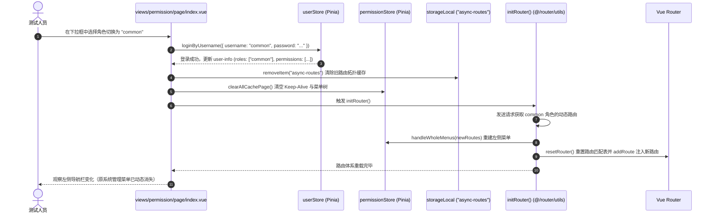

# 权限规则与分配模块 (Permission Architecture)

## 1. 模块业务职责与核心能力

权限规则与分配模块（Permission）是系统基于角色的访问控制（RBAC）与精细化按钮鉴权的理论基准、运行沙盒与交互验证中心。其核心业务能力涵盖：

1. **双轨制权限鉴权体系 (Dual-Track Authorization)**：
   - **路由定义级权限 (Route Auths)**：与当前激活的路由配置紧密绑定，依赖路由元数据 `meta.auths`，用于页面局部特定业务上下文的受控；
   - **用户登录态全局权限 (User Permissions / Perms)**：与当前登录用户身份严格绑定，源自登录响应 `userInfo.permissions`，用于跨页面、跨业务的全局功能码与操作权限校验。
2. **三种判定范式 (Tri-Modal Permission Evaluation)**：
   - **声明式组件包裹**：`<Auth value="...">` 与 `<Perms value="...">`，支持动态插槽渲染；
   - **响应式函数判定**：`v-if="hasAuth(...)"` 与 `v-if="hasPerms(...)"`，用于复杂多条件逻辑表达式组合；
   - **高性能 DOM 物理移除指令**：`v-auth` 与 `v-perms`，在元素挂载时若无权直接从 DOM 树物理移除节点，杜绝控制台样式篡改越权。
3. **超级管理员通配特权 (`*:*:*`)**：
   - 支持全局通配符特权，当登录用户的 `permissions` 包含首项 `*:*:*` 时，系统判定具备所有操作特权，无条件放行所有 `hasPerms` 判定。
4. **运行时动态路由重载沙盒 (Dynamic Route Reload Sandbox)**：
   - 在 `page/index.vue` 视图中提供不同角色（管理员角色 `admin` vs 普通角色 `common`）的实时切换沙盒；
   - 模拟清空本地动态路由持久化缓存（`async-routes`）、清理页面 Keep-Alive 缓存（`clearAllCachePage`），并无刷新调用 `initRouter()` 重新拉取菜单拓扑并重新挂载路由树。

---

## 2. 源码结构与组件分工

```
src/
├── views/permission/
│   ├── page/
│   │   └── index.vue                   # 页面/角色级动态权限演示与沙盒切换视图
│   └── button/
│       ├── index.vue                   # 路由定义级按钮权限（Route Auths）三种鉴权范式验证组件
│       └── perms.vue                   # 用户全局按钮权限（User Perms）三种鉴权范式与通配符验证组件
├── router/
│   ├── utils.ts                        # 路由鉴权工具：hasAuth, getAuths, initRouter, resetRouter
│   └── index.ts                        # 全局路由守卫（白名单、Token 校验、Role 守卫）
├── utils/
│   └── auth.ts                         # 用户登录凭证与鉴权工具：hasPerms, setToken, getToken
├── directives/
│   ├── auth/index.ts                   # 自定义指令 v-auth（绑定 route meta.auths）
│   └── perms/index.ts                  # 自定义指令 v-perms（绑定 userStore.permissions）
├── components/
│   ├── ReAuth/
│   │   ├── index.ts                    # 顶层统一导出 Auth 组件
│   │   └── src/auth.tsx                # <Auth> 权限声明式组件 TSX 实现
│   └── RePerms/
│       ├── index.ts                    # 顶层统一导出 Perms 组件
│       └── src/perms.tsx               # <Perms> 权限声明式组件 TSX 实现
└── store/modules/
    ├── permission.ts                   # 路由与菜单仓储（wholeMenus, cachePageList, clearAllCachePage）
    └── user.ts                         # 用户态仓储（roles, permissions, is_super_admin）
```

### 核心鉴权组件与指令分工

| 机制类型 | 标识/组件/指令 | 底层依赖数据源 | 鉴权逻辑与核心特性 |
|---|---|---|---|
| **路由级组件** | `<Auth :value="string \| string[]">` | `router.currentRoute.value.meta.auths` | 若当前路由元信息中包含指定 code 则渲染插槽，否则销毁插槽内容 |
| **路由级函数** | `hasAuth(value)` | `getAuths()` | 字符串或数组交集比对（`isIncludeAllChildren`），适合用于模板内复杂三元表达式 |
| **路由级指令** | `v-auth="value"` | `getAuths()` | 元素挂载阶段计算，未授权时调用 `el.parentNode?.removeChild(el)` 物理移除 DOM |
| **用户级组件** | `<Perms :value="string \| string[]">`| `userStore.permissions` | 支持 `*:*:*` 全局通配，动态响应式插槽 |
| **用户级函数** | `hasPerms(value)` | `useUserStoreHook().permissions` | 支持字符串、多权限与全量包含校验，全系统通用鉴权方法 |
| **用户级指令** | `v-perms="value"` | `userStore.permissions` | 物理移除无权 DOM，防止普通用户通过审查元素修改 `display: none` 越权操作 |

---

## 3. 路由与前置守卫

### 路由定义元数据规范

```ts
export const permissionRoutes: RouteConfigsTable = {
  path: "/permission",
  name: "Permission",
  component: Layout,
  redirect: "/permission/page/index",
  meta: {
    title: "menus.purePermission",
    icon: "ep:lollipop",
    rank: 10
  },
  children: [
    {
      path: "/permission/page/index",
      name: "PermissionPage",
      component: () => import("@/views/permission/page/index.vue"),
      meta: {
        title: "menus.purePermissionPage",
        roles: ["admin", "common"]
      }
    },
    {
      path: "/permission/button",
      name: "PermissionButton",
      redirect: "/permission/button/router",
      meta: {
        title: "menus.purePermissionButton",
        roles: ["admin", "common"]
      },
      children: [
        {
          path: "/permission/button/router",
          name: "PermissionButtonRouter",
          component: () => import("@/views/permission/button/index.vue"),
          meta: {
            title: "menus.purePermissionButtonRouter",
            auths: [
              "permission:btn:add",
              "permission:btn:edit",
              "permission:btn:delete"
            ]
          }
        },
        {
          path: "/permission/button/login",
          name: "PermissionButtonLogin",
          component: () => import("@/views/permission/button/perms.vue"),
          meta: {
            title: "menus.purePermissionButtonLogin"
          }
        }
      ]
    }
  ]
};
```

### 全局路由守卫的鉴权责任链 (`src/router/index.ts`)

```mermaid
flowchart TD
    ReqRoute[路由跳转: router.push(to)] --> CheckWhite{在白名单中? (whiteList)}
    CheckWhite -- 是 (如 /login) --> AllowNext[放行: next()]
    CheckWhite -- 否 --> CheckToken{检查 getToken() 是否有效}
    
    CheckToken -- 无效/未登录 --> RedirectLogin[重定向: next({ path: '/login', query: { redirect: to.fullPath } })]
    CheckToken -- 有效 --> CheckAsyncRoute{路由树是否已挂载? (wholeMenus.length === 0)}
    
    CheckAsyncRoute -- 否 (首次登录或强刷) --> InitRouteTree[调用 initRouter() 异步拉取路由]
    InitRouteTree --> ReEnter[next({ ...to, replace: true })]
    
    CheckAsyncRoute -- 是 (已挂载) --> CheckRouteRoles{目标路由 meta.roles 是否定义?}
    CheckRouteRoles -- 未限制角色 --> AllowNext
    CheckRouteRoles -- 有角色要求 --> VerifyRole{isOneOfArray(to.meta.roles, userInfo.roles)}
    VerifyRole -- 角色匹配通过 --> AllowNext
    VerifyRole -- 角色不匹配 --> Intercept403[阻断越权: next({ path: '/error/403' })]
```

---

## 4. API 通信契约与鉴权元数据来源

权限模块不直接维护独立的增删改查表，其权限编码与角色信息来源于以下两大标准 API 契约：

### 1) 登录鉴权返回契约 (`src/api/modules/user.ts` -> `/login/`)
```json
{
  "code": 200,
  "success": true,
  "data": {
    "accessToken": "eyJhbGciOi...",
    "refreshToken": "eyJhbGciOi...",
    "expires": "2026/10/17 00:00:00",
    "id": 1,
    "username": "admin",
    "nickname": "超级管理员",
    "is_admin": true,
    "is_super_admin": true,
    "roles": ["admin"],
    "permissions": ["*:*:*"]
  }
}
```

### 2) 动态菜单与路由树返回契约 (`/menus/admin/routes/`)
后端在返回动态菜单树节点时，为每个节点注入元信息对象 `meta`：
```json
{
  "path": "/permission/button/router",
  "name": "PermissionButtonRouter",
  "component": "permission/button/index",
  "meta": {
    "title": "menus.purePermissionButtonRouter",
    "roles": ["admin"],
    "auths": [
      "permission:btn:add",
      "permission:btn:edit",
      "permission:btn:delete"
    ]
  }
}
```

---

## 5. 状态管理与数据模型

### Pinia 仓储模型 (`src/store/modules/permission.ts`)

```ts
export const usePermissionStore = defineStore("pure-permission", {
  state: () => ({
    // 静态路由生成的菜单
    constantMenus: [],
    // 整体菜单拓扑（包含动态路由与静态路由合并结果）
    wholeMenus: [],
    // 深层拍平后的两级路由，用于渲染 Tab 标签
    flatteningRoutes: [],
    // 缓存页面名称列表，用于 Keep-Alive
    cachePageList: []
  }),
  actions: {
    // 组装整体路由菜单
    handleWholeMenus(routes: any[]) {
      this.wholeMenus = filterTree(handleTree(routes));
    },
    // 清空页面所有缓存
    clearAllCachePage() {
      this.wholeMenus = [];
      this.cachePageList = [];
    }
  }
});
```

### 核心权限判定函数底层实现

#### 1. `hasAuth` (`src/router/utils.ts`)
```ts
export function hasAuth(value: string | Array<string>): boolean {
  if (!value) return false;
  // 从当前匹配路由的 meta 字段中提取 auths
  const metaAuths = getAuths();
  if (!metaAuths) return false;
  return isString(value)
    ? metaAuths.includes(value)
    : isIncludeAllChildren(value, metaAuths);
}
```

#### 2. `hasPerms` (`src/utils/auth.ts`)
```ts
export const hasPerms = (value: string | Array<string>): boolean => {
  if (!value) return false;
  const allPerms = "*:*:*";
  const { permissions } = useUserStoreHook();
  if (!permissions) return false;
  // 超管无条件通配放行
  if (permissions.length === 1 && permissions[0] === allPerms) return true;
  return isString(value)
    ? permissions.includes(value)
    : isIncludeAllChildren(value, permissions);
};
```

---

## 6. 关键业务流程与时序

### 运行时角色切换与动态路由重载时序图

在沙盒环境 `src/views/permission/page/index.vue` 中演示了切换角色身份后的系统无刷新热重载时序：



---

## 7. 权限控制与按钮级鉴权

### 三种按钮鉴权方式对比及使用规范

| 鉴权范式 | 典型语法 | 优点 | 局限性 / 适用场景 |
|---|---|---|---|
| **指令式 (`v-perms` / `v-auth`)** | `<el-button v-perms="['member:add']">新增</el-button>` | 性能极高，无权时直接物理移除 DOM 节点，杜绝前端样式作弊 | **无法响应式动态修改**：指令在 `mounted` 阶段直接销毁 DOM，如遇运行时动态改变权限，需刷新页面 |
| **函数式 (`v-if="hasPerms(...)"`)** | `<el-button v-if="hasPerms('member:add')">新增</el-button>` | 高度灵活，支持 `&&`、`\|\|`、三元表达式与计算属性联动 | 需在每个需要判断的 SFC 中显式 import 导入对应工具函数 |
| **组件包裹式 (`<Perms>` / `<Auth>`)** | `<Perms value="member:add"><el-button>新增</el-button></Perms>` | 语义清晰，声明式组件包裹，与纯 CSS/Tailwind 布局兼容性良好 | 会在组件层级树中增加虚拟包裹层 |

### 超管通配与安全防越权准则
- 前端按钮隐藏仅属于**用户体验优化（UX Guard）**，所有由 `hasPerms` / `v-perms` 保护的高危操作（如删除、重置密码、更新配额），在网络通信层必须由后端 Django REST framework 的 `PermissionClasses` 进行严格的双重鉴权防御，杜绝直接通过 Postman 或控制台脚本发包越权。
