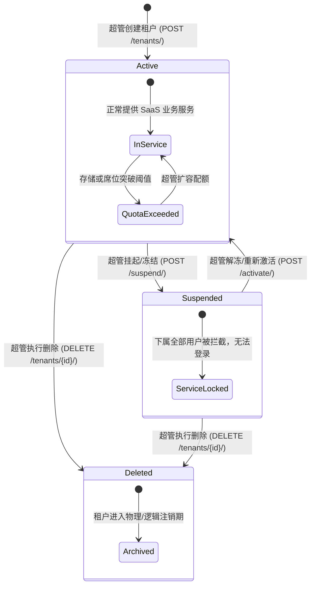
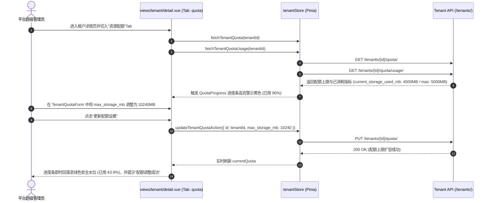

# 多租户管理体系模块 (Multi-Tenant Architecture)

## 1. 模块业务职责与核心能力

多租户管理体系模块（Tenant）是 SaaS 架构中顶层多企业客户隔离、全局数据围栏与资源配额约束的管理总中枢。其核心业务能力涵盖：

1. **绝对的平台超管访问隔离与安全防御**：
   - 本模块所有前端视图均加装前置硬防线：非超级管理员（`!is_super_admin`）坚决禁止访问，一经发现立刻弹出安全警示并强制重定向返回 `/dashboard`；
   - 作为物理/逻辑多租户数据隔离机制的源头，保障跨企业客户数据的绝对私密。
2. **租户全生命周期三态状态机管控**：
   - **正常激活 (`active`)**：租户状态完好，该租户下所有管理员与会员账号正常准入并执行业务；
   - **暂停冻结 (`suspended`)**：调用 `/tenants/{id}/suspend/` 一键冻结。该企业下属全部账号即时被阻断业务访问，用于逾期催缴、合规风控或服务暂停；可通过 `/tenants/{id}/activate/` 一键恢复；
   - **逻辑删除 (`deleted`)**：租户标记为已删除状态，回收对应资源配额并进入数据归档期。
3. **多维资源配额监管体系 (`TenantQuota`)**：
   - 严格约束四大核心容量指标：最大用户数（`max_users`）、最大管理员数（`max_admins`）、最大云存储空间（`max_storage_mb`）、最大产品数（`max_products`）；
   - 动态使用率透视：调用 `/tenants/{id}/quota/usage/` 实时抓取实际已消耗存储量（`current_storage_used_mb`），通过 `QuotaProgress` 仪表组件动态展示百分比进度条及高负载（>85%）变色预警；
   - 弹性扩缩容：通过 `TenantQuotaForm` 实时调整并保存租户各项指标阈值。
4. **企业组织用户穿透监管**：
   - 详情面板内置租户用户下钻子系统（`getTenantUsers`），分页掌握归属于该企业租户的名下管理员与成员规模、最后登录时间与账号状态。
5. **租户宏观商业图表与增长态势分析**：
   - 整合 `src/api/modules/tenant.ts` 接口，提供按月度/季度统计的租户数量趋势折线图（`fetchTenantTrendData`）、激活/暂停比例状态分布饼图（`fetchTenantStatusDistribution`）及新增速率柱状图（`fetchTenantCreationRate`）。

---

## 2. 源码结构与组件分工

```
src/
├── views/tenant/
│   ├── index.vue                       # 租户总览与管理工作台（多状态筛选、分页列表、内嵌弹窗、启停高危动作）
│   ├── create.vue                      # 独立全屏租户创建视图（内嵌 TenantForm）
│   ├── edit.vue                        # 独立全屏租户编辑视图（全字段同步回填）
│   └── detail.vue                      # 租户多维度综合监管中心（Tab聚合：基础档案、资源配额进度、下属用户列表）
├── components/TenantManagement/
│   ├── TenantForm.vue                  # 租户基本属性录入表单（企业名称、联系人姓名/电话/邮箱统一校验）
│   ├── TenantQuotaForm.vue             # 租户资源配额分配表单（用户数、管理员数、存储MB等上限设定）
│   ├── QuotaProgress.vue               # 配额消耗百分比进度条与仪表盘组件
│   └── ConfirmDialog.vue               # 租户冻结、解冻、删除高危操作通用二次确认弹窗
├── store/modules/
│   ├── tenant.ts                       # Pinia 仓储（useTenantStore / useTenantStoreHook）
│   └── user.ts                         # 用户态仓储（检查 is_super_admin 标识）
├── api/modules/
│   ├── tenantManagement.ts             # 租户业务 CRUD、配额维护、用户查询及启停通信契约
│   └── tenant.ts                       # 租户宏观统计分析与商业图表接口方法
└── types/
    └── tenant.ts                       # 租户实体、配额、参数与分页 TypeScript 强类型定义
```

### 核心业务组件分工

| 组件名称 | 视图定位 | 关键 Props / Emits | 核心业务职责 |
|---|---|---|---|
| `TenantForm.vue` | 租户档案录入 | Props: `tenantData`, `isEdit`, `loading`<br/>Emits: `submit`, `cancel` | 提供租户企业名称、联系人等基础信息的表单验证规则 |
| `TenantQuotaForm.vue`| 资源上限调配 | Props: `quotaData`, `loading`<br/>Emits: `submit`, `cancel` | 调整各项资源配额上限，保证提交时各上限值均为正整数 |
| `QuotaProgress.vue` | 容量消耗可视化 | Props: `current`, `max`, `unit`, `label` | 计算已消耗百分比，根据 70%/90% 阈值智能切换 success/warning/exception 颜色状态 |
| `ConfirmDialog.vue` | 安全风控阻断 | Props: `visible`, `title`, `content`, `type`, `loading`<br/>Emits: `confirm`, `cancel` | 阻断因误触导致的租户停机或删除重大事故 |

---

## 3. 路由与前置守卫

### 路由定义元数据规范

```ts
export const tenantRoutes: RouteConfigsTable = {
  path: "/tenant",
  name: "Tenant",
  component: Layout,
  redirect: "/tenant/index",
  meta: {
    title: "menus.tenantManagement",
    icon: "ep:office-building",
    rank: 70,
    roles: ["super_admin"]
  },
  children: [
    {
      path: "/tenant/index",
      name: "TenantIndex",
      component: () => import("@/views/tenant/index.vue"),
      meta: {
        title: "menus.tenantList",
        roles: ["super_admin"]
      }
    },
    {
      path: "/tenant/create",
      name: "TenantCreate",
      component: () => import("@/views/tenant/create.vue"),
      meta: {
        title: "menus.createTenant",
        showLink: false,
        activePath: "/tenant/index"
      }
    },
    {
      path: "/tenant/edit/:id",
      name: "TenantEdit",
      component: () => import("@/views/tenant/edit.vue"),
      meta: {
        title: "menus.editTenant",
        showLink: false,
        hiddenTag: true,
        activePath: "/tenant/index"
      }
    },
    {
      path: "/tenant/detail/:id",
      name: "TenantDetail",
      component: () => import("@/views/tenant/detail.vue"),
      meta: {
        title: "menus.tenantDetail",
        showLink: false,
        hiddenTag: true,
        activePath: "/tenant/index"
      }
    }
  ]
};
```

### 页面级防御性逻辑 (In-Component Hard Guard)

在每个 SFC 视图的 `<script setup>` 顶层均执行超管特权硬拦截：

```ts
// 检查用户是否有超级管理员权限 (src/views/tenant/index.vue, detail.vue, etc.)
const isSuperAdmin = computed(() => userStore.is_super_admin);

// 如果不是超级管理员，显示无权限提示并强退
if (!isSuperAdmin.value) {
  ElMessage.error("无权限访问此页面");
  router.push("/dashboard");
}
```

---

## 4. API 通信契约

### 1) 业务管理接口契约 (`src/api/modules/tenantManagement.ts`)

| 接口函数 | HTTP 方法 | 请求路径 | 请求入参说明 | 核心返回数据结构 |
|---|---|---|---|---|
| `getTenantList` | `GET` | `/tenants/` | `TenantListParams`: `{ search?, status?, page?, page_size? }` | `PaginationResponse<Tenant>` |
| `createTenant` | `POST` | `/tenants/` | `TenantCreateUpdateParams`: `{ name, contact_name, contact_email, contact_phone }` | `ApiResponse<Tenant>` |
| `getTenantDetail` | `GET` | `/tenants/{id}/` | 路径参数 `id: number` | `ApiResponse<Tenant>` |
| `getTenantComprehensive`| `GET`| `/tenants/{id}/comprehensive/` | 路径参数 `id: number` | `ApiResponse<Tenant>` (包含配额与用户数统计) |
| `updateTenant` | `PUT` | `/tenants/{id}/` | `id: number`, `TenantCreateUpdateParams` | `ApiResponse<Tenant>` |
| `deleteTenant` | `DELETE` | `/tenants/{id}/` | 路径参数 `id: number` | `ApiResponse<null>` |
| `suspendTenant` | `POST` | `/tenants/{id}/suspend/` | 路径参数 `id: number` | `ApiResponse<Tenant>` (status -> 'suspended') |
| `activateTenant` | `POST` | `/tenants/{id}/activate/` | 路径参数 `id: number` | `ApiResponse<Tenant>` (status -> 'active') |
| `getTenantQuota` | `GET` | `/tenants/{id}/quota/` | 路径参数 `id: number` | `ApiResponse<TenantQuota>` |
| `updateTenantQuota` | `PUT` | `/tenants/{id}/quota/` | `id: number`, `TenantQuotaUpdateParams` | `ApiResponse<TenantQuota>` |
| `getTenantQuotaUsage` | `GET` | `/tenants/{id}/quota/usage/` | 路径参数 `id: number` | `ApiResponse<TenantQuota>` (附带使用量) |
| `getTenantUsers` | `GET` | `/tenants/{id}/users/` | `id: number`, 分页参数 | `PaginationResponse<TenantUser>` |

### 2) 商业宏观图表分析接口 (`src/api/modules/tenant.ts`)

| 接口函数 | HTTP 方法 | 请求路径 (Endpoint) | 请求入参说明 | 返回数据结构 |
|---|---|---|---|---|
| `fetchTenantTrendData` | `GET` | `/admin/charts/tenant-trend/?period=${period}` | `period?: ChartPeriod` (默认 'monthly'), `startDate?`, `endDate?` | `ApiResponse<TenantTrendChartData>` |
| `fetchTenantStatusDistribution`| `GET` | `/admin/charts/tenant-status-distribution/` | 无 | `ApiResponse<TenantStatusChartData>` |
| `fetchTenantCreationRate` | `GET` | `/admin/charts/tenant-creation-rate/?period=${period}` | `period?: ChartPeriod` (默认 'monthly'), `startDate?`, `endDate?` | `ApiResponse<TenantCreationChartData>` |

> **说明**：`tenant.ts` 另导出 `calculateTenantSummary(trendData: TenantChartData)` 前端辅助函数，用于直接从已有趋势数据中就地解构提取租户总数与增长率等核心指标，属于纯前端计算逻辑，无需发起额外网络请求。

---

## 5. 状态管理与数据模型

### Pinia Store: `tenantStore` (`src/store/modules/tenant.ts`)

```ts
interface TenantState {
  tenantList: PaginationData<Tenant>;           // 租户分页列表
  currentTenant: Tenant | null;                 // 当前详情租户
  currentQuota: TenantQuota | null;             // 当前租户配额信息
  tenantUsers: PaginationData<TenantUser>;      // 当前租户下属用户列表
  loading: {
    list: boolean;
    detail: boolean;
    create: boolean;
    update: boolean;
    delete: boolean;
    suspend: boolean;
    activate: boolean;
    quota: boolean;
    updateQuota: boolean;
    quotaUsage: boolean;
    users: boolean;
  };
  error: string | null;
}
```

### 实体数据契约 (`src/types/tenant.ts`)

```ts
export type TenantStatus = "active" | "suspended" | "deleted";

export interface Tenant {
  id: number;
  name: string;                                 // 租户/企业机构全称
  status: TenantStatus;                         // 租户运行状态
  contact_name: string;                         // 负责人/联系人姓名
  contact_email: string;                        // 联系人电子邮箱
  contact_phone: string;                        // 联系人移动电话
  created_at: string;
  updated_at: string;
  user_count?: number;                          // 租户已创建用户总数
  admin_count?: number;                         // 租户分配管理员数
}

export interface TenantQuota {
  id: number;
  tenant: { id: number; name: string };
  max_users: number;                            // 最大允许用户席位数
  max_admins: number;                           // 最大允许管理员席位数
  max_storage_mb: number;                       // 最大云盘存储配额 (MB)
  max_products: number;                         // 最大商品/业务单项数
  current_storage_used_mb?: number;             // 实时已消耗存储空间 (MB)
}
```

---

## 6. 关键业务流程与时序

### 租户全生命周期流转状态机



### 租户配额监控与动态扩容时序图



---

## 7. 权限控制与按钮级鉴权

### 权限模型设计

多租户体系是 SaaS 平台的底层基础设施，具备全局最高破坏力，实行**平台超级管理员专有控制（Super Admin Only）**：

| 操作项 | 呈现位置 | 权限保护机制 | 无权限行为 |
|---|---|---|---|
| **页面进入** | 整个 `/tenant/*` 路由 | 页面级硬校验 `isSuperAdmin` + 路由守卫 `roles: ["super_admin"]` | 强退 `/dashboard`，提示“无权限访问此页面” |
| **创建租户** | 列表页顶部操作栏 | 仅超级管理员展示 | 普通租户管理员无此界面入口 |
| **冻结租户** | 表格行内 / 详情操作栏 | 仅激活租户 (`active`) 可点击，且弹出确认窗 | 阻断因误点造成租户停服 |
| **激活恢复** | 表格行内 / 详情操作栏 | 仅挂起租户 (`suspended`) 可点击 | 重新开放下属用户访问权限 |
| **调整配额** | 详情页配额 Tab | 仅平台超管有权修改各项上限 | 避免租户自行篡改资源上限 |
| **删除租户** | 表格操作列 / 详情页顶部 | 红色 Danger 弹窗二次确认 | 杜绝意外销毁租户档案 |
