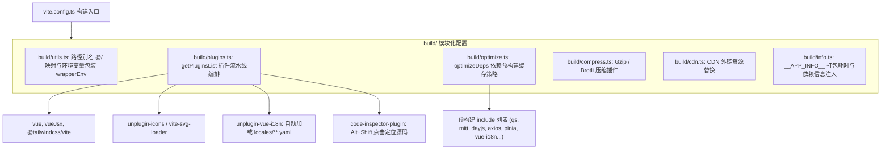
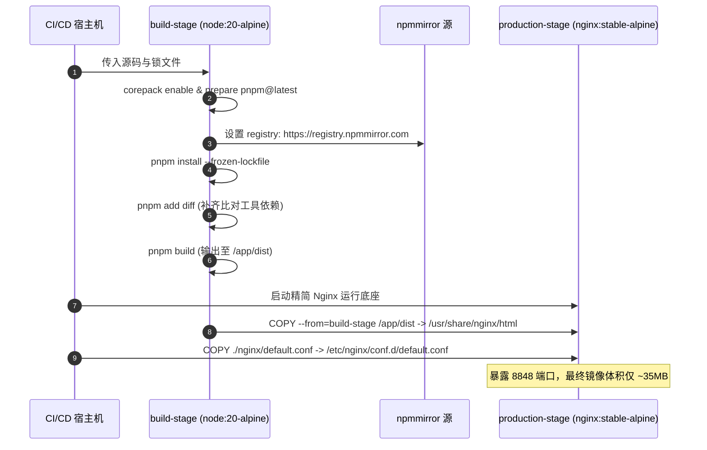
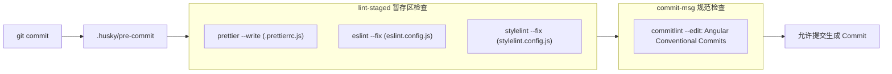

# 工程化与容器化部署

> **相关参考**：  
> - 返回主索引：[README.md](./README.md)  
> - 系统总架构：[architecture.md](./architecture.md)  
> - 状态管理与持久化：[state-management.md](./state-management.md)  
> - 网络层与通信契约：[api-and-network.md](./api-and-network.md)

---

## 一、 构建打包体系 (Vite 6 / TypeScript / Tailwind CSS v4)

`lipeaks_admin` 深度拥抱现代前端构建生态，采用 **Vite 6.3.3 + TypeScript 5.8.3 + Tailwind CSS v4.1.4** 构建全套工程基础设施。



### 1.1 依赖预构建与性能优化 (`build/optimize.ts`)

为了消除本地开发热重载（HMR）过程中的 CommonJS/ESM 模块转换延迟，系统对核心高频依赖执行了预构建配置：
- **预构建白名单 (`include`)**：  
  `qs`, `mitt`, `dayjs`, `axios`, `pinia`, `vue-i18n`, `vue-types`, `js-cookie`, `vue-tippy`, `pinyin-pro`, `sortablejs`, `@vueuse/core`, `@pureadmin/utils`, `responsive-storage`。  
  在执行 `pnpm dev` 时，Vite 将上述库提前编译为单文件 ESM 缓存于 `node_modules/.vite`，极大加快初次启动与冷加载效率。
- **排除项 (`exclude`)**：  
  `@iconify/json`（由于包含全量庞大图标库，采取运行时按需拆分加载，不进行全量预打包）。

### 1.2 客户端预热机制 (`server.warmup`)

在 `vite.config.ts` 中显式指定服务端预热文件列表：
```typescript
warmup: {
  clientFiles: ["./index.html", "./src/{views,components}/*"]
}
```
本地开发服务器启动瞬间即在后台预热转换 `views` 与 `components` 下的 SFC 模板与脚本，使开发者首次在浏览器中打开页面时免除瀑布式编译等待。

### 1.3 静态资源分类打包与分块规划

在生产编译 (`build`) 阶段，采用细粒度的 Rollup 输出配置，将构建产物分类归档至 `dist/static/` 目录：
```typescript
build: {
  target: "es2015",
  sourcemap: false,
  chunkSizeWarningLimit: 4000,
  rollupOptions: {
    input: {
      index: pathResolve("./index.html", import.meta.url)
    },
    output: {
      chunkFileNames: "static/js/[name]-[hash].js",
      entryFileNames: "static/js/[name]-[hash].js",
      assetFileNames: "static/[ext]/[name]-[hash].[ext]"
    }
  }
}
```

> **⚠️ 关键工程事实注意**：  
> `build/` 目录存放了 `cdn.ts`, `compress.ts`, `info.ts`, `optimize.ts`, `plugins.ts`, `utils.ts` 6 个构建核心模块。如果在某些精简分支下拉取代码后发现 `build/` 缺失或提示模块未找到，请务必执行 `git restore build/` 恢复构建脚手架文件，严禁手动删除该目录。

---

## 二、 多环境配置策略 (`.env.*`)

系统支持完整的四套环境矩阵，各环境核心配置变量对比如下表所示：

| 配置变量名 | `.env` (全局基准) | `.env.development` (本地开发) | `.env.staging` (测试/预发布) | `.env.production` (生产环境) |
| :--- | :--- | :--- | :--- | :--- |
| `VITE_PORT` | `8848` | `8848` | - | - |
| `VITE_PUBLIC_PATH` | - | `/` | `/` | `/` |
| `VITE_ROUTER_HISTORY` | - | `"hash"` | `"hash"` | `"hash"` |
| `VITE_HIDE_HOME` | `false` | - | - | - |
| `VITE_CDN` | - | - | `true` | `false` |
| `VITE_COMPRESSION` | - | - | `"none"` | `"none"` |
| `VITE_BASE_API` | - | `http://localhost:8000/api/v1/` | `http://43.142.76.105:8000/api/v1/` | `https://backend.compressx.online/api/v1/` |

### 统一使用 Hash 路由模式的原因与优势

在所有的环境配置中，`VITE_ROUTER_HISTORY` 均显式锁定为 `"hash"`。

```typescript
// src/router/utils.ts
export function getHistoryMode(routerHistory): RouterHistory {
  // 解析 hash 模式
  if (routerHistory === "hash") {
    return createWebHashHistory("");
  }
  return createWebHistory("");
}
```

**工程决策考量**：
1. **彻底消除刷新 404**：Hash 模式下路由路径均置于 URL 的 `#` 之后（例如 `http://domain.com/#/system/tenant`），浏览器向 Web 服务器发送请求时永远只请求根路径 `/`，即使在 Nginx 未配置完善或在任意静态 CDN 节点刷新，也绝对不会发生传统 HTML5 History 模式的 404 资源丢失故障。
2. **多租户与复杂网关转发兼容**：在微服务多级子路径部署场景下，Hash 模式无需后端网关额外配合重写匹配规则。

---

## 三、 容器化构建与 Nginx 反向代理方案

### 3.1 Dockerfile 多阶段构建流水线 (`Dockerfile`)

系统采用两阶段构建（Multi-Stage Build），实现体积最小化与高安全性交付：



#### 完整 `Dockerfile` 源码定义：
```dockerfile
FROM node:20-alpine AS build-stage

WORKDIR /app
RUN corepack enable
RUN corepack prepare pnpm@latest --activate

RUN npm config set registry https://registry.npmmirror.com

COPY .npmrc package.json pnpm-lock.yaml ./
RUN pnpm install --frozen-lockfile
# 添加安装diff包的命令
RUN pnpm add diff

COPY . .
RUN pnpm build

FROM nginx:stable-alpine AS production-stage

# 复制前端构建文件和nginx配置
COPY --from=build-stage /app/dist /usr/share/nginx/html
COPY ./nginx/default.conf /etc/nginx/conf.d/default.conf

EXPOSE 8848
```

### 3.2 Nginx 生产反向代理配置解析 (`nginx/default.conf`)

Nginx 统一监听 `8848` 端口，实现了静态页面托管、前端资源加速以及对后端 Django API 与媒体资源的代理分发：

```nginx
server {
    listen 8848;
    server_name localhost;
    
    # 1. 前端根路径单页应用托管与回退
    location / {
        root /usr/share/nginx/html;
        index index.html;
        try_files $uri $uri/ /index.html;
    }
    
    # 2. 前端静态资源目录 (JS/CSS/Fonts/Images)
    location /static/ {
        root /usr/share/nginx/html;
        try_files $uri $uri/ =404;
    }
    
    # 3. 后端 Django REST Framework API 反向代理
    location /api/ {
        proxy_pass http://web:8000/api/;
        proxy_set_header Host $host;
        proxy_set_header X-Real-IP $remote_addr;
        proxy_set_header X-Forwarded-For $proxy_add_x_forwarded_for;
        proxy_set_header X-Forwarded-Proto $scheme;
    }
    
    # 4. 后端 Django Admin / Framework 自身静态资源
    location /backend-static/ {
        proxy_pass http://web:8000/static/;
        proxy_set_header Host $host;
        proxy_set_header X-Real-IP $remote_addr;
        proxy_set_header X-Forwarded-For $proxy_add_x_forwarded_for;
    }
    
    # 5. 后端用户上传的多媒体资源 (头像、证书、导入文件)
    location /media/ {
        proxy_pass http://web:8000/media/;
        proxy_set_header Host $host;
        proxy_set_header X-Real-IP $remote_addr;
        proxy_set_header X-Forwarded-For $proxy_add_x_forwarded_for;
    }
    
    # 6. 统一错误页面兜底
    error_page 500 502 503 504 /50x.html;
    location = /50x.html {
        root /usr/share/nginx/html;
    }
}
```

### 3.3 Docker Compose 整体编排 (`docker-compose.yml`)

项目支持与后端及数据库一键拉起协同编排：
- **`db`**：`mysql:8.0`，统一维护多租户与系统业务数据持久化。
- **`web`**：`lipeaks_backend:latest`，基于 Django/Gunicorn 的应用服务，挂载 `media/` 与 `static/` 卷，暴露端口 `8000`。
- **前端容器**：与 `web` 处于同一 Docker 虚拟网络中，通过内部域名 `http://web:8000` 直连代理，实现容器集群内网高性能通信。

---

## 四、 代码质量保障与工程规范工具链

为确保大型跨团队协作的代码健壮性与一致性，项目构建了完备的质量红线检查链：



### 4.1 ESLint v9 扁平化配置 (`eslint.config.js`)

项目率先采用了 ESLint v9 的 Flat Config 配置体系：
- 集成 `@eslint/js`, `typescript-eslint`, `eslint-plugin-vue`, `eslint-plugin-prettier`。
- 显式声明全局类型只读：内置了对前端常用全局类型（如 `RefType`, `Nullable`, `Recordable`, `ImportMetaEnv`）的免报错配置。
- 强化规则：禁用未使用的变量声明，约束 Vue 模板内属性顺序与驼峰组件命名规范。

### 4.2 Prettier 格式化规范 (`.prettierrc.js`)

代码风格严格收敛为以下统一格式：
```javascript
export default {
  bracketSpacing: true,      // 对象大括号内前后保留空格
  singleQuote: false,        // 使用双引号，保持与 HTML 属性一致
  arrowParens: "avoid",      // 单参数箭头函数省略括号: x => x
  trailingComma: "none"      // 末尾不保留逗号
};
```

### 4.3 Stylelint 样式重排规范 (`stylelint.config.js`)

- 继承 `stylelint-config-standard`, `stylelint-config-html/vue`。
- 集成 `stylelint-config-recess-order`：在保存时自动按照盒模型顺序（定位 $\rightarrow$ 尺寸 $\rightarrow$ 边框 $\rightarrow$ 背景 $\rightarrow$ 排版）对 CSS 属性进行自动化重排。
- 对 Tailwind CSS 专有指令（`@apply`, `@config`, `@theme`）进行了兼容白名单放行。

### 4.4 Git Hooks 与 Commit 提交规范

- **`husky` + `lint-staged` (`.lintstagedrc`)**：
  在触发 `git commit` 时，仅针对 Git 暂存区中的变更文件执行自动化 Lint 与格式化修复，杜绝全库扫描引发的提交缓慢。
- **`commitlint` (`commitlint.config.js`)**：  
  遵循 `@commitlint/config-conventional`，限定提交前缀必须为以下 15 种类型之一：  
  `feat`（新功能）、`fix`（缺陷修复）、`perf`（性能优化）、`style`（格式调整）、`docs`（文档更新）、`test`（测试用例）、`refactor`（代码重构）、`build`（构建依赖）、`ci`（持续集成）、`chore`（事务杂务）、`revert`（回滚）、`wip`（在制品）、`workflow`（工作流变更）、`types`（类型声明）、`release`（版本发布）。
