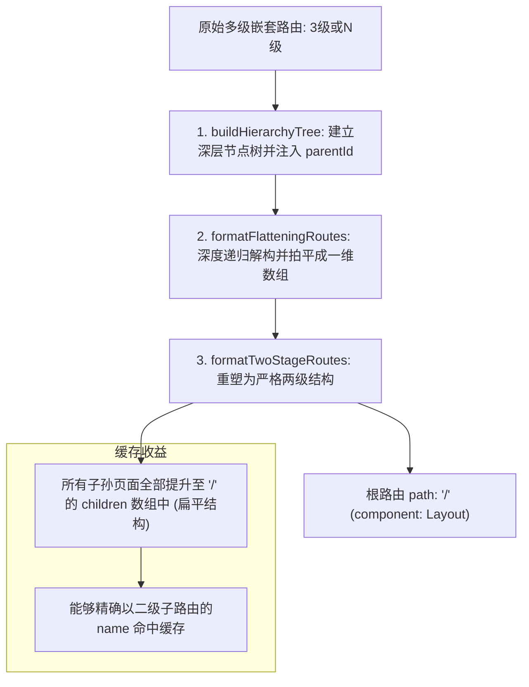
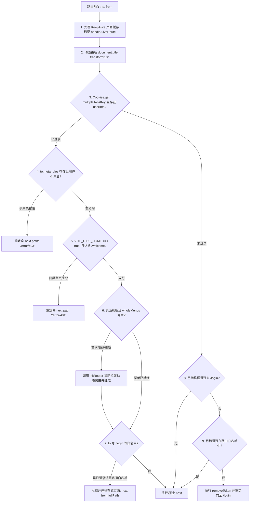

# 路由系统与权限控制

> **相关参考**：  
> - 返回主索引：[README.md](./README.md)  
> - 系统总架构：[architecture.md](./architecture.md)  
> - 全局状态管理：[state-management.md](./state-management.md)  
> - 登录鉴权模块：[login.md](./business-modules/login.md)  
> - 权限规则沙盒：[permission.md](./business-modules/permission.md)

---

## 一、 静态与动态路由生成机制

`lipeaks_admin` 采用“静态基座路由与运行时后端动态菜单合并”的双轨装配架构。

```mermaid
graph TD
    subgraph StaticRoutes [静态路由装配阶段 (编译期 / 首次执行)]
        ModulesGlob["import.meta.glob(['./modules/**/*.ts', '!./modules/**/remaining.ts'], { eager: true })"]
        RemainingRouter[src/router/modules/remaining.ts: /login, /redirect...]
        
        ModulesGlob --> RawRoutes[收集原始路由数组]
        RawRoutes --> AscendRank[ascending: 根据 meta.rank 升序排列]
        AscendRank --> BuildHierarchy[buildHierarchyTree: 构建层级树]
        BuildHierarchy --> FlattenRoutes[formatFlatteningRoutes: 拍平成一维数组]
        FlattenRoutes --> TwoStage[formatTwoStageRoutes: 重组为严格二级路由]
        TwoStage --> ConstantRoutes[constantRoutes 静态路由树]
    end

    subgraph DynamicRoutes [动态路由装配阶段 (运行时)]
        InitRouter[initRouter: 触发动态路由获取]
        ApiRoutes["getAsyncRoutes: GET /menus/admin/routes/"]
        AddAsync["addAsyncRoutes: 解析 component 字符串并映射 SFC 模块"]
        FilterPerms[filterNoPermissionTree: 基于当前用户角色 roles 过滤]
        
        InitRouter --> ApiRoutes
        ApiRoutes --> AddAsync
        AddAsync --> FilterPerms
        FilterPerms --> MountRouter[router.addRoute 动态追加至 Vue Router]
        MountRouter --> WholeMenus[更新 usePermissionStore.wholeMenus]
    end
```

### 1.1 静态基座路由装配 (`src/router/index.ts`)

1. **自动扫描与排除语法**：  
   借助 Vite 的 Fast-Glob 语法，在编译期 eager 导入 `src/router/modules/` 下的所有 `.ts` 文件，同时显式排除 `remaining.ts`：
   ```typescript
   const modules: Record<string, any> = import.meta.glob(
     ["./modules/**/*.ts", "!./modules/**/remaining.ts"],
     { eager: true }
   );
   ```
2. **非菜单独立路由 (`remainingRouter`)**：  
   `remaining.ts` 存放不进入侧边栏/顶栏菜单体系的基础页面，包括：
   - 登录页：`/login`
   - 重定向中转页：`/redirect/:path(.*)`
   - 403 / 404 / 500 异常页：`/error/403`, `/error/404`, `/error/500`
   - 外部文章预览页：`/preview/article/:id`

---

## 二、 两级路由拍平算法 (Two-Stage Flattening)

### 2.1 核心痛点与背景

在 Vue 3 与 Vue Router 4 的架构下，内置组件 `<keep-alive>` 对超过两级以上的嵌套路由（例如 `/system/tenant/detail`，层级为 `Layout -> TenantParent -> Detail`）**无法进行多级状态缓存**。若路由层级达到三级或更深，从子页面返回时页面必然被销毁重建，导致用户在表单填写、滚动位置和 Tab 切换时的上下文全部丢失。

### 2.2 拍平算法实现全流程

系统在初始化路由与挂载动态路由时，执行严格的拍平管道：
`ascending` $\rightarrow$ `buildHierarchyTree` $\rightarrow$ `formatFlatteningRoutes` $\rightarrow$ `formatTwoStageRoutes`



#### 关键源码实现 (`src/router/utils.ts`)：

```typescript
/**
 * 将多级嵌套路由处理成一维数组
 */
function formatFlatteningRoutes(routesList: RouteRecordRaw[]) {
  if (routesList.length === 0) return routesList;
  let hierarchyList = buildHierarchyTree(routesList);
  for (let i = 0; i < hierarchyList.length; i++) {
    if (hierarchyList[i].children) {
      hierarchyList = hierarchyList
        .slice(0, i + 1)
        .concat(hierarchyList[i].children, hierarchyList.slice(i + 1));
    }
  }
  return hierarchyList;
}

/**
 * 一维数组处理成严格二级嵌套数组
 */
function formatTwoStageRoutes(routesList: RouteRecordRaw[]) {
  if (routesList.length === 0) return routesList;
  const newRoutesList: RouteRecordRaw[] = [];
  routesList.forEach((v: RouteRecordRaw) => {
    if (v.path === "/") {
      newRoutesList.push({
        component: v.component,
        name: v.name,
        path: v.path,
        redirect: v.redirect,
        meta: v.meta,
        children: []
      });
    } else {
      newRoutesList[0]?.children.push({ ...v });
    }
  });
  return newRoutesList;
}
```

### 2.3 菜单展示层与路由寻址层的正交解耦

拍平算法导致 `router.options.routes` 中的物理路由全部变成了二级结构，但侧边栏菜单（Sidebar）仍需展示多层级树状折叠视图。系统通过**数据流双轨分离**完美解决了这一矛盾：
- **物理路由表（Vue Router）**：注册的是拍平后的 `formatTwoStageRoutes`，确保底层路由跳转和 `<keep-alive :include="cachePageList">` 缓存百分之百生效。
- **菜单渲染树（Pinia Store）**：`usePermissionStore().wholeMenus` 维系由 `buildHierarchyTree` 保留完整父子树形结构的原始菜单对象，由 `NavVertical` 递归组件独立渲染。

---

## 三、 动态路由组件映射算法 (`addAsyncRoutes`)

后端 API（`GET /menus/admin/routes/`）返回的路由配置中，`component` 字段是普通字符串（例如 `"/src/views/tenant/list.vue"` 或 `"Layout1"`）。前端需要将其精确还原为 Vue 组件工厂函数。

```mermaid
flowchart TD
    AsyncItem[后端返回单条路由配置: v] --> CheckFrame{v.meta.frameSrc 存在?}
    CheckFrame -->|是| SetIFrame[v.component = IFrame 内嵌外链容器]
    CheckFrame -->|否| CheckLayout{component 值为 '/src/layout/index.vue' 或 'Layout1'?}
    CheckLayout -->|是| SetLayout[v.component = Layout 页面骨架]
    CheckLayout -->|否| GlobLookup[从 modulesRoutes 中查找匹配模块]

    GlobLookup --> ExactMatch{完全匹配路径?}
    ExactMatch -->|是| AssignComponent[分配真实导入函数: modulesRoutes[exactMatch]]
    ExactMatch -->|否| SuffixMatch{追加 '.vue' 后缀能否匹配?}
    SuffixMatch -->|是| AssignComponent
    SuffixMatch -->|否| NullFallback[兜底设为 null]
```

### 映射核心规则 (`src/router/utils.ts`)：
1. **视图扫描字典**：定义 `const modulesRoutes = import.meta.glob("/src/views/**/*.{vue,tsx}")`，扫描本地全部业务组件。
2. **外链 IFrame 拦截**：若配置了 `v.meta.frameSrc`，直接分配 `IFrame` 组件 (`src/layout/frame.vue`)。
3. **骨架标识匹配**：支持完整路径 `"/src/layout/index.vue"` 与后端通用别名 `"Layout1"` 双向兼容匹配至 `Layout`。
4. **智能文件后缀容错**：优先全路径精确匹配；若后端省略了 `.vue` 扩展名（例如 `"tenant/list"`），自动补全 `/src/views/` 前缀及 `.vue` 后缀进行二次匹配。
5. **动态标记打标**：对后端动态注入的路由强制设置 `v.meta.backstage = true`，以便后续多标签页管理识别来源。

---

## 四、 全局导航守卫拦截链路 (`router.beforeEach`)

系统的全局前置路由守卫承载了身份鉴权、角色权限验证、动态路由冷启动重新挂载、多标签页同步和标题动态国际化等全套治理：



### 拦截节点核心逻辑说明：

1. **KeepAlive 状态维护（节点 1）**：若目标路由 `to.meta?.keepAlive` 为真，调用 `handleAliveRoute(to, "add")` 登记至 `usePermissionStore().cachePageList`。若为点击刷新标签或全页面刷新，先执行 `delete` 再经 100ms 延迟重新执行 `add` 触发缓存刷新。
2. **多语言标题渲染（节点 2）**：遍历 `to.matched` 路由链，优先提取末级标题，结合 `transformI18n(item.meta.title)` 与运行时 `Title` 拼接赋值给 `document.title`。
3. **角色鉴权（节点 4）**：比对目标路由声明的 `roles: Array<string>` 与 `userInfo.roles`。若非其子集，立即重定向到 `/error/403`。
4. **隐藏首页策略（节点 5）**：若构建环境变量 `VITE_HIDE_HOME = "true"`，即使用户在地址栏手动输入 `/welcome`，守卫也会硬重定向至 `/error/404`。
5. **动态路由热刷新自愈（节点 6）**：用户在非登录页按 F5 刷新时，Pinia 内存中的动态路由和 `wholeMenus` 会被重置。守卫捕获 `wholeMenus.length === 0`，立即触发 `initRouter()` 重新向后端拉取菜单，并在完全挂载后通过 `router.push(to.fullPath)` 恢复现场。
6. **未登录防穿透（节点 9）**：白名单仅包含 `const whiteList = ["/login"]`。未携带合法 Token 访问任何业务页面，一律调用 `removeToken()` 擦除残留 Cookie 与 LocalStorage，强制跳转 `/login`。

---

## 五、 双轨制按钮级权限鉴权系统

`lipeaks_admin` 创新性地构建了兼具全局性与局部灵活性的“双轨制”权限鉴权机制：

| 鉴权维度 | 全局权限体系 (`v-perms` / `<Perms>`) | 局部页面权限体系 (`v-auth` / `<Auth>`) |
| :--- | :--- | :--- |
| **指令与组件** | `v-perms="['btn.add']"` / `<Perms value="...">` | `v-auth="['permission:btn:edit']"` / `<Auth value="...">` |
| **判断入口函数** | `hasPerms(value)` (`src/utils/auth.ts`) | `hasAuth(value)` (`src/router/utils.ts`) |
| **权限数据源** | `useUserStoreHook().permissions`（来自登录接口返回的权限码列表） | `router.currentRoute.value.meta.auths`（配置在当前路由 `meta` 中的按钮码） |
| **通配符支持** | **支持** `*:*:*`（超级管理员全局一票放行） | **不支持**，仅作严格数组包含判定 |
| **DOM 处置策略** | 无权限时：`el.parentNode?.removeChild(el)` | 无权限时：`el.parentNode?.removeChild(el)` |
| **典型应用场景** | 跨租户跨页面的通用功能鉴权，如系统操作、通用删除、导出等 | 页面内私有按钮或需要按页面元数据静态固化的操作按钮 |

### 5.1 全局鉴权核心实现 (`src/utils/auth.ts` -> `hasPerms`)

```typescript
export const hasPerms = (value: string | Array<string>): boolean => {
  if (!value) return false;
  const allPerms = "*:*:*";
  const { permissions } = useUserStoreHook();
  if (!permissions) return false;
  // 超级管理员通配符判定：一票全通
  if (permissions.length === 1 && permissions[0] === allPerms) return true;
  
  const isAuths = isString(value)
    ? permissions.includes(value)
    : isIncludeAllChildren(value, permissions);
  return isAuths ? true : false;
};
```

### 5.2 局部鉴权核心实现 (`src/router/utils.ts` -> `hasAuth`)

```typescript
function hasAuth(value: string | Array<string>): boolean {
  if (!value) return false;
  /** 从当前路由的 meta 字段里获取按钮级别的所有自定义 code 值 */
  const metaAuths = router.currentRoute.value.meta.auths as Array<string>;
  if (!metaAuths) return false;
  const isAuths = isString(value)
    ? metaAuths.includes(value)
    : isIncludeAllChildren(value, metaAuths);
  return isAuths ? true : false;
}
```

### 5.3 DOM 物理剔除与安全性保障

传统前端权限控制常采用 `display: none` 样式隐藏无权限按钮，极易被恶意用户在开发者工具中修改 CSS 进行绕过。

在 `src/directives/perms/index.ts` 与 `src/directives/auth/index.ts` 中，均采用了物理删除节点的安全设计：
```typescript
mounted(el: HTMLElement, binding: DirectiveBinding<string | Array<string>>) {
  const { value } = binding;
  if (value) {
    !hasPerms(value) && el.parentNode?.removeChild(el);
  }
}
```
当指令生命周期 `mounted` 被触发时，一旦判定用户缺少对应权限，立即通过其父节点调用 `removeChild(el)` 将元素从 DOM 树中彻底移除，杜绝了页面 DOM 篡改绕过的潜在安全风险。
