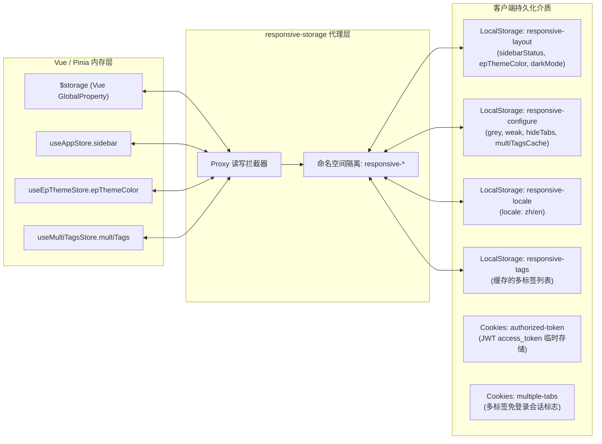
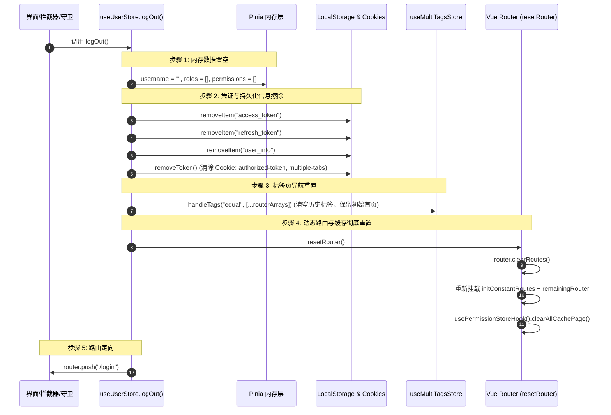

# 全局状态管理与数据流

> **相关参考**：  
> - 返回主索引：[README.md](./README.md)  
> - 系统总架构：[architecture.md](./architecture.md)  
> - 路由与权限控制：[routing-and-permissions.md](./routing-and-permissions.md)  
> - 网络通信与错误治理：[api-and-network.md](./api-and-network.md)

---

## 一、 Pinia 架构蓝图与模块划分

`lipeaks_admin` 基于 **Pinia 3.0.2** 建立了高内聚、弱耦合的响应式状态管理体系。所有 Store 统一收敛于 `src/store/modules/`，划分为**底座 6 大基础 Store**与**业务 9 大领域 Store**两大层次。

```mermaid
graph TD
    RootPinia[Pinia 根实例: src/store/index.ts setupStore] --> BaseGroup[底座基础 Store 组 (Framework Layer)]
    RootPinia --> BizGroup[业务领域 Store 组 (Business Domain Layer)]

    subgraph BaseGroup [底座 6 大核心 Store]
        S_User[useUserStore: pure-user<br/>用户会话/角色权限/资料]
        S_Perm[usePermissionStore: pure-permission<br/>菜单过滤/KeepAlive缓存]
        S_App[useAppStore: pure-app<br/>设备断点/侧边栏状态/视口尺寸]
        S_Tags[useMultiTagsStore: pure-multiTags<br/>多标签导航页签增删缓存]
        S_Setting[useSettingStore: pure-setting<br/>顶栏固定/标题/界面设置]
        S_Theme[useEpThemeStore: pure-epTheme<br/>Element Plus 主题色彩变幻]
    end

    subgraph BizGroup [业务 9 大领域 Store]
        B_Tenant[useTenantStore: 多租户全生命周期]
        B_Admin[useAdminUserStore: 管理员与账号审计]
        B_App[useApplicationStore: 应用系统与接入]
        B_CMS[useCmsStore: 内容/分类/标签/评论]
        B_Cust[useCustomerStore: 客户客群与企业关联]
        B_License[useLicenseStore: 软件许可/指纹激活]
        B_Member[useMemberStore: 注册会员与批量操作]
        B_Menu[useMenuStore: 动态菜单树与节点重排]
        B_Order[useOrderStore: 订单流转/差异比对/回滚]
    end

    subgraph SyncEngine [响应式持久化桥接]
        Responsive[responsive-storage: 命名空间双向持久化]
        CookiesLayer[js-cookie: Token 时效与多标签标记]
        LocalStorageLayer[LocalStorage: access_token / refresh_token / user_info]
    end

    S_User <--> LocalStorageLayer
    S_User <--> CookiesLayer
    S_App <--> Responsive
    S_Setting <--> Responsive
    S_Tags <--> Responsive
```

---

## 二、 底座 6 大核心 Store 深度解析

系统底座 Store 统一提供标准 Hook 封装（如 `useUserStoreHook()`），方便在非 Vue 组件上下文（如路由守卫、Axios 拦截器、底层工具类）中直接调用。

### 2.1 用户与认证 Store (`store/modules/user.ts` -> `pure-user`)

- **模块 ID**：`pure-user`
- **导出 Hook**：`useUserStore()`, `useUserStoreHook()`
- **核心 State 字段**：
  ```typescript
  state: (): userType => ({
    id: storageLocal().getItem<DataInfo<number>>(userKey)?.id,
    avatar: storageLocal().getItem<DataInfo<number>>(userKey)?.avatar ?? "",
    username: storageLocal().getItem<DataInfo<number>>(userKey)?.username ?? "",
    nickname: storageLocal().getItem<DataInfo<number>>(userKey)?.nick_name ?? "",
    email: storageLocal().getItem<DataInfo<number>>(userKey)?.email ?? "",
    is_admin: storageLocal().getItem<DataInfo<number>>(userKey)?.is_admin ?? false,
    is_super_admin: storageLocal().getItem<DataInfo<number>>(userKey)?.is_super_admin ?? false,
    is_member: storageLocal().getItem<DataInfo<number>>(userKey)?.is_member ?? false,
    phone: storageLocal().getItem<DataInfo<number>>(userKey)?.phone ?? "",
    status: storageLocal().getItem<DataInfo<number>>(userKey)?.status ?? "",
    last_login_ip: storageLocal().getItem<DataInfo<number>>(userKey)?.last_login_ip ?? "",
    tenant: storageLocal().getItem<DataInfo<number>>(userKey)?.tenant,
    parent: storageLocal().getItem<DataInfo<number>>(userKey)?.parent,
    roles: storageLocal().getItem<DataInfo<number>>(userKey)?.roles ?? [],
    permissions: storageLocal().getItem<DataInfo<number>>(userKey)?.permissions ?? [],
    isRemembered: false,
    loginDay: 7,
    loading: { getCurrentAdmin: false, updateCurrentAdmin: false }
  })
  ```
- **核心 Actions**：
  - `loginByUsername(data)`：调用 `/auth/login/` 接口，写入 LocalStorage（`access_token`, `refresh_token`, `user_info`），调用 `setToken(userData)` 更新 Cookie，并根据身份注入角色数组。
  - `logOut()`：全套注销清理链，重置内存、擦除 Token、重置多标签与动态路由，强行推向登录页。
  - `handRefreshToken(data)`：执行刷新 Token 并回写。
  - `uploadCurrentAdminAvatar(file)`：上传并同步更新 Store 与 LocalStorage 中的头像链接。

### 2.2 权限与菜单 Store (`store/modules/permission.ts` -> `pure-permission`)

- **模块 ID**：`pure-permission`
- **核心 State 字段**：
  - `constantMenus`：包含静态基础路由与未拍平菜单项的初始列表。
  - `wholeMenus`：用于渲染前端侧边栏（`NavVertical`）与顶部导航的完整树形菜单数据。
  - `flatteningRoutes`：经过 `formatFlatteningRoutes` 拍平后的一维路由数组。
  - `cachePageList`：当前处于 `<keep-alive>` 激活缓存状态的组件名称数组（`Array<string>`）。
- **核心 Actions**：
  - `handleWholeMenus(routes)`：将动态路由追加合并至 `wholeMenus`，并生成对应的一维扁平路由缓存列表。
  - `cacheOperate({ mode, name })`：对 `cachePageList` 执行 `add`、`delete` 或 `refresh` 操作，精准控制单个页面的组件级缓存。
  - `clearAllCachePage()`：清空全部页面缓存（在退出登录或重载时调用）。

### 2.3 应用环境与布局 Store (`store/modules/app.ts` -> `pure-app`)

- **模块 ID**：`pure-app`
- **核心 State 字段**：
  - `sidebar.opened`：侧边栏当前是否处于展开状态（受 `responsive-storage` 持久化同步）。
  - `sidebar.withoutAnimation`：切换折叠时是否禁用 CSS 过渡动画（视口重算时防止抖动）。
  - `layout`：当前布局形态（`vertical` 纵向 / `horizontal` 横向 / `mix` 混合）。
  - `device`：当前视口终端模式（`desktop` 桌面 / `mobile` 移动端）。
  - `viewportSize`：视口实时宽高 `{ width: number, height: number }`。
- **核心 Actions**：
  - `toggleSideBar(opened, resize)`：切换侧边栏展开状态。
  - `toggleDevice(device)`：切换桌面/移动设备模式。
  - `setLayout(layout)`：设置系统布局模式。

### 2.4 多标签页导航 Store (`store/modules/multiTags.ts` -> `pure-multiTags`)

- **模块 ID**：`pure-multiTags`
- **核心 State 字段**：
  - `multiTags`：当前打开的标签列表（`Array<TagItem>`），每项包含 `path`, `name`, `meta`, `query`, `params`。
  - `multiTagsCache`：是否开启多标签本地持久化缓存开关。
- **核心 Actions**：
  - `handleTags(mode, value, position)`：
    - `"push"`：新开标签（自动去重并识别固定标签 `fixedTag`）；
    - `"splice"`：关闭指定下标标签，自动激活临近标签；
    - `"slice"`：批量关闭其他标签或全部标签；
    - `"equal"`：覆盖重置整个标签列表（登录重置与登出恢复默认首页时使用）。

### 2.5 偏好设置 Store (`store/modules/settings.ts` -> `pure-setting`)

- **模块 ID**：`pure-setting`
- **核心 State 字段**：
  - `title`：系统标头显示的标题名称。
  - `fixedHeader`：是否吸顶固定导航顶栏。
  - `hiddenSideBar`：是否在全屏展示场景下临时隐藏侧边栏。
- **核心 Actions**：
  - `changeSetting({ key, value })`：动态修改单个界面配置属性。

### 2.6 Element Plus 主题 Store (`store/modules/epTheme.ts` -> `pure-epTheme`)

- **模块 ID**：`pure-epTheme`
- **核心 State 字段**：
  - `epThemeColor`：当前系统主色调（默认 `#409EFF`）。
  - `epTheme`：当前主题配色（浅色/深色主题）。
- **核心 Actions**：
  - `setEpThemeColor(color)`：动态生成梯度变量并注入 DOM 根节点 CSS Variables，实现无刷实时换肤。

---

## 三、 业务 9 大领域 Store 模型体系

各业务 Store 均严格封装了**模块化请求、分页状态、防重复并发锁与错误规整**，形成统一的工程开发规范：

| 业务 Store 模块 | 核心管理状态 | 关键业务 Actions | 关联 API 模块 |
| :--- | :--- | :--- | :--- |
| **`useTenantStore`** | `tenants`, `currentTenant`, `pagination`, `loading` | `getTenantList`, `createTenant`, `updateTenant`, `changeTenantStatus` (冻结/解冻) | `@/api/modules/tenant` |
| **`useAdminUserStore`** | `adminList`, `currentAdmin`, `roles`, `loading` | `getAdminList`, `toggleSuperAdmin`, `assignTenant`, `toggleAdminStatus` | `@/api/modules/adminUser` |
| **`useApplicationStore`** | `appList`, `currentApp`, `loading` | `getApplicationList`, `createApplication`, `updateApplication`, `uploadAppLogo` | `@/api/modules/application` |
| **`useCmsStore`** | `articles`, `categories`, `tags`, `comments`, `loading` | `getArticleList`, `batchImportImages`, `exportMarkdown`, `auditComment` | `@/api/modules/cms` |
| **`useCustomerStore`** | `customerList`, `memberList`, `statistics`, `loading` | `getCustomerList`, `getCustomerMembers`, `bindTenantCustomer`, `exportCustomerData` | `@/api/modules/customer` |
| **`useLicenseStore`** | `packages`, `licenses`, `activations`, `stats`, `loading` | `getLicensePackages`, `activateLicense`, `unbindMachine`, `auditLicenseQuota` | `@/api/modules/license` |
| **`useMemberStore`** | `members`, `currentMember`, `batchSelection`, `loading` | `getMemberList`, `batchUpdateStatus`, `uploadMemberAvatar`, `getMemberOrders` | `@/api/modules/member` |
| **`useMenuStore`** | `menuTree`, `rawMenus`, `currentMenuNode`, `loading` | `getMenuList`, `saveMenuTreeOrder` (拖拽重排), `importMenuJson`, `exportMenuJson` | `@/api/modules/menu` |
| **`useOrderStore`** | `orders`, `currentOrder`, `diffSnapshot`, `metrics`, `loading` | `getOrderList`, `calculateProfitMargin`, `compareOrderDiff`, `rollbackOrderSnapshot` | `@/api/modules/order` |

---

## 四、 响应式持久化联动机制 (`responsive-storage`)

系统在 `src/utils/responsive.ts` 中通过 `injectResponsiveStorage` 挂载双向响应式桥梁。其机制与底层 Storage 的映射关系如下：



- **免登录跨标签通信**：当用户在登录界面勾选“记住我”后，`setToken` 会在 Cookie 中写入有效期为 `loginDay` 天的 `multiple-tabs` 标记。在同一浏览器内新开 Tab 时，路由守卫直接读取该 Cookie 与 LocalStorage 的 `user-info` 恢复登录态，无需重复输入密码。
- **细粒度更新优势**：当仅修改侧边栏折叠状态时，系统仅写回 `responsive-layout` 键，不触发全库序列化，避免 LocalStorage 高频 IO 引起的页面卡顿。

---

## 五、 注销登录与清理机制 (`useUserStore.logOut`)

当用户主动点击退出登录，或因 Token 过期刷新失败、系统强制注销时，系统触发严格的六步清理链路：



### 清理关键保障点：
1. **防止权限残留穿越**：`resetRouter()` 会执行 `router.clearRoutes()` 清空全部路由，并仅重新挂载静态路由。如果上一个用户是超级管理员，其动态添加的租户/权限模块路由会被彻底剔除，下一个普通用户登录绝对不会因路由残留导致访问到未授权视图。
2. **`<keep-alive>` 缓存彻底释放**：调用 `clearAllCachePage()` 立即销毁所有组件的内存实例，彻底释放内存资源并避免遗留旧用户的表单数据。
